Metagenomic surveillance unveils environmental dysbiosis and enriched
resistome of human-impacted surface waters in central Mexico
================
GENVET Laboratory
2026-11-03

- [Module 1. Environment Setup and Target Taxa
  Definition](#module-1-environment-setup-and-target-taxa-definition)
- [Module 2. Load Taxonomy Data and Filter Target
  Species](#module-2-load-taxonomy-data-and-filter-target-species)
- [Module 3. Load Resistome Data and Build Combined
  Matrices](#module-3-load-resistome-data-and-build-combined-matrices)
- [Module 4. Metagenomic Taxonomic Profiling, Abundance Dynamics, and
  Microbial Co-occurrence
  Networks](#module-4-metagenomic-taxonomic-profiling-abundance-dynamics-and-microbial-co-occurrence-networks)
- [Module 5. Spatial and Environmental Abundance Distribution Across
  Sampling
  Sites](#module-5-spatial-and-environmental-abundance-distribution-across-sampling-sites)
- [Module 6. Clinical and Priority Bacterial Species Profiling (Figure
  4)](#module-6-clinical-and-priority-bacterial-species-profiling-figure-4)
- [Module 7. Bacterial Community Dissimilarity and Beta Diversity
  (Figure
  5)](#module-7-bacterial-community-dissimilarity-and-beta-diversity-figure-5)
- [Module 8. Resistome Beta Diversity and Community Dissimilarity
  (Figure
  6)](#module-8-resistome-beta-diversity-and-community-dissimilarity-figure-6)
- [Module 9. Abundance and Spatial Profiling of Top 50 Antimicrobial
  Resistance Genes (Figure 7 & Table
  S7)](#module-9-abundance-and-spatial-profiling-of-top-50-antimicrobial-resistance-genes-figure-7--table-s7)
- [Module 10. Tripartite Procrustes and Partial Mantel Cross-Analysis
  (Figure
  8)](#module-10-tripartite-procrustes-and-partial-mantel-cross-analysis-figure-8)
- [Module 11. Bipartite Species–ARG Co-occurrence Network (Figure
  9)](#module-11-bipartite-speciesarg-co-occurrence-network-figure-9)
- [Supplementary Figures](#supplementary-figures)
  - [Module 12. Rarefaction Curves across States and Water Body Types
    (Figure
    S1)](#module-12-rarefaction-curves-across-states-and-water-body-types-figure-s1)
  - [Module 13. Global Relative Abundance Profiles Across Taxonomic
    Ranks (Figure
    S2)](#module-13-global-relative-abundance-profiles-across-taxonomic-ranks-figure-s2)
  - [Module 14. Alpha Diversity Comparison by Region and Water Body Type
    (Figure
    S3)](#module-14-alpha-diversity-comparison-by-region-and-water-body-type-figure-s3)
- [List of Supplementary Tables](#list-of-supplementary-tables)

------------------------------------------------------------------------

### Module 1. Environment Setup and Target Taxa Definition

``` r
# ------------------------------------------------------------------------------
# Data Management & Graphical Rendering
# ------------------------------------------------------------------------------
library(readxl)
library(tidyverse) # Includes dplyr, tidyr, tibble, stringr, ggplot2
library(ggplot2)
library(dplyr)
library(ggtext)
library(patchwork)
library(ggpubr)
library(Hmisc)
library(ComplexHeatmap)
library(circlize)
library(grid)
library(ggh4x)
library(vegan)
library(openxlsx)
library(readr)
library(svglite)
library(ggrepel)

# ------------------------------------------------------------------------------
# Taxonomic Tree & Data Management
# ------------------------------------------------------------------------------
library(taxize)
library(ape)

# ------------------------------------------------------------------------------
# Network Topology Computation & Rendering
# ------------------------------------------------------------------------------
library(igraph)
library(tidygraph)
library(ggraph)

# ------------------------------------------------------------------------------
# Rendering Tables
# ------------------------------------------------------------------------------
library(knitr)
library(kableExtra)

# ------------------------------------------------------------------------------
# Target Species Panels
# ------------------------------------------------------------------------------

# ESKAPE Pathogens
focal_eskape_species <- c(
  "Acinetobacter baumannii", "Enterobacter cloacae", "Enterobacter hormaechei",
  "Klebsiella pneumoniae", "Pseudomonas aeruginosa"
)

# Opportunistic Pathogens
focal_opportunistic_species <- c(
  "Acinetobacter johnsonii", "Acinetobacter lwoffii", "Klebsiella oxytoca", "Pseudomonas putida",
  "Aeromonas media", "Aeromonas caviae", "Aeromonas veronii", 
  "Aliarcobacter cryaerophilus", "Aliarcobacter butzleri",
  "Escherichia coli", "Escherichia albertii", "Escherichia fergusonii",
  "Mycobacterium tuberculosis", "Mycobacterium intracellulare", "Mycobacterium avium"
)

# Consolidated 20 Clinical Pathogens Panel
focal_20_clinical <- c(focal_eskape_species, focal_opportunistic_species)

# Native Aquatic Genera
native_target_genera <- c(
  "Microcystis", "Fluviibacter", "Acidovorax", "Cyanobium", "Rheinheimera", 
  "Thauera", "Polynucleobacter", "Synechococcus", "Streptomyces", "Flavobacterium", "Massilia"
)

# Core Environmental Genera
core_target_genera <- c("Faucicola", "Tolumonas", "Bifidobacterium")
```

------------------------------------------------------------------------

### Module 2. Load Taxonomy Data and Filter Target Species

``` r
# Load raw taxonomy table
tax_data_raw <- read_excel("Taxonomy.xlsx")

# Standardize species-level records
tax_species_all <- tax_data_raw %>%
  filter(Taxonomic_level == "Species" | Taxonomic_level == "species" | is.na(Taxonomic_level)) %>%
  mutate(
    Taxa = str_trim(Taxa),
    Sample_name = str_trim(Sample_name),
    Relative_abundance = as.numeric(Relative_abundance),
    Genus = str_extract(Taxa, "^[A-Za-z]+")
  )

# Abundance threshold
abundance_cutoff <- 0.1

# Filter native aquatic species (top representative per target genus >= 0.1%)
filtered_native_species <- tax_species_all %>%
  filter(Genus %in% native_target_genera) %>%
  group_by(Genus, Taxa) %>%
  summarise(Mean_Abundance = mean(Relative_abundance, na.rm = TRUE), .groups = "drop") %>%
  group_by(Genus) %>%
  slice_max(order_by = Mean_Abundance, n = 1, with_ties = FALSE) %>%
  filter(Mean_Abundance >= abundance_cutoff) %>%
  pull(Taxa)

# Filter core environmental species (top representative per target genus >= 0.1%)
filtered_core_species <- tax_species_all %>%
  filter(Genus %in% core_target_genera) %>%
  group_by(Genus, Taxa) %>%
  summarise(Mean_Abundance = mean(Relative_abundance, na.rm = TRUE), .groups = "drop") %>%
  group_by(Genus) %>%
  slice_max(order_by = Mean_Abundance, n = 1, with_ties = FALSE) %>%
  filter(Mean_Abundance >= abundance_cutoff) %>%
  pull(Taxa)

# Consolidated master target species list
target_species_list <- unique(c(focal_20_clinical, filtered_native_species, filtered_core_species))

# Pivot taxonomy to wide format matrix (samples x species)
tax_filtered <- tax_species_all %>%
  filter(Taxa %in% target_species_list) %>%
  mutate(
    sample_prefix = str_extract(Sample_name, "^[A-Za-z]+"),
    sample_num    = as.numeric(str_extract(Sample_name, "[0-9]+")),
    sample        = paste0(sample_prefix, sample_num)
  ) %>%
  group_by(sample, Taxa) %>%
  summarise(Abundance = sum(Relative_abundance, na.rm = TRUE), .groups = "drop") %>%
  pivot_wider(names_from = Taxa, values_from = Abundance, values_fill = 0)
```

------------------------------------------------------------------------

### Module 3. Load Resistome Data and Build Combined Matrices

``` r
# Load raw ARG table
arg_data_raw <- read_excel("Resistome.xlsx")

# Standardize ARG genes and sample identifiers
arg_data <- arg_data_raw %>%
  mutate(
    Sample_name = str_trim(Sample_name),
    ARG_Gene    = str_trim(gene_unif_final_manual),
    RPKG        = as.numeric(RPKG)
  ) %>%
  mutate(
    sample_prefix = str_extract(Sample_name, "^[A-Za-z]+"),
    sample_num    = as.numeric(str_extract(Sample_name, "[0-9]+")),
    sample        = paste0(sample_prefix, sample_num)
  ) %>%
  group_by(sample, ARG_Gene) %>%
  summarise(RPKG = sum(RPKG, na.rm = TRUE), .groups = "drop") %>%
  pivot_wider(names_from = ARG_Gene, values_from = RPKG, values_fill = 0)

# Merge taxonomy and ARG datasets by sample
combined_data <- inner_join(tax_filtered, arg_data, by = "sample") %>%
  column_to_rownames("sample")

# Identify column subsets
taxa_cols <- intersect(names(combined_data), target_species_list)
arg_cols  <- setdiff(names(combined_data), taxa_cols)

# Extract pure numerical matrices
taxa_matrix <- as.matrix(combined_data[, taxa_cols])
arg_matrix  <- as.matrix(combined_data[, arg_cols])
```

------------------------------------------------------------------------

### Module 4. Metagenomic Taxonomic Profiling, Abundance Dynamics, and Microbial Co-occurrence Networks

This section processes `Taxonomy.xlsx` to generate the iTOL phylogenetic
tree annotation files (Panel A) and builds the comparative abundance
boxplots (Panel B) alongside the circular Spearman microbial
co-occurrence network (Panel C).

#### 4.1 Panel A: Taxonomic Tree Generation & iTOL Annotation Export

``` r
# ------------------------------------------------------------------------------
# 1. CALCULATE TOP 100 SPECIES ABUNDANCE COVERAGE METRICS
# ------------------------------------------------------------------------------
data_rel_taxa <- read_excel("Taxonomy.xlsx")

non_bacterial_taxa <- c("Chordata", "Ascomycota", "Bacillariophyta", "Uroviricota", 
                        "Streptophyta", "Arthropoda", "Eukaryota", "Viruses", "Mammalia")

species_data <- data_rel_taxa %>%
  filter(!Taxa %in% non_bacterial_taxa) %>%
  filter(Taxonomic_level == "Species" | Taxonomic_level == "species" | is.na(Taxonomic_level)) %>%
  mutate(
    Relative_abundance = as.numeric(Relative_abundance),
    Taxa = str_trim(Taxa)
  )

species_summary <- species_data %>%
  group_by(Taxa) %>%
  summarise(Mean_Abundance = mean(Relative_abundance, na.rm = TRUE), .groups = "drop") %>%
  arrange(desc(Mean_Abundance))

top_species_100 <- species_summary %>% slice_head(n = 100)

total_species_abundance <- sum(species_summary$Mean_Abundance)
top100_abundance        <- sum(top_species_100$Mean_Abundance)
percentage_covered_100  <- (top100_abundance / total_species_abundance) * 100

sample_coverage_100 <- species_data %>%
  filter(Taxa %in% top_species_100$Taxa) %>%
  group_by(Sample_name) %>%
  summarise(Top100_Sample_Sum = sum(Relative_abundance, na.rm = TRUE), .groups = "drop")

mean_cov_100 <- mean(sample_coverage_100$Top100_Sample_Sum) 
sd_cov_100   <- sd(sample_coverage_100$Top100_Sample_Sum)
min_cov_100  <- min(sample_coverage_100$Top100_Sample_Sum) 
max_cov_100  <- max(sample_coverage_100$Top100_Sample_Sum)

cat("\n=================== TOP 100 SPECIES METRICS ===================\n")
```

    ## 
    ## =================== TOP 100 SPECIES METRICS ===================

``` r
cat(sprintf("-> Total abundance covered (Top 100): %.2f%%\n", percentage_covered_100))
```

    ## -> Total abundance covered (Top 100): 62.82%

``` r
cat(sprintf("-> Mean sample coverage: %.2f%% ± %.2f%% (Range: %.2f%% - %.2f%%)\n",
            mean_cov_100, sd_cov_100, min_cov_100, max_cov_100))
```

    ## -> Mean sample coverage: 62.82% ± 18.72% (Range: 21.54% - 90.39%)

``` r
cat("================================================================\n\n")
```

    ## ================================================================

``` r
# ------------------------------------------------------------------------------
# 2. RETRIEVE NCBI TAXONOMY & BUILD LINEAGE MATRIX
# ------------------------------------------------------------------------------
cat("-> Fetching NCBI taxonomy for Top 100 species...\n")
```

    ## -> Fetching NCBI taxonomy for Top 100 species...

``` r
tax_hierarchy_100 <- classification(top_species_100$Taxa, db = "ncbi")
```

    ## ══  100 queries  ═════════════

    ## ✔  Found:  Acinetobacter+johnsonii

    ## ✔  Found:  Acinetobacter+lwoffii

    ## ✔  Found:  Aliarcobacter+cryaerophilus

    ## ✔  Found:  Aeromonas+media

    ## ✔  Found:  Fluviibacter+phosphoraccumulans

    ## ✔  Found:  Microcystis+aeruginosa

    ## ✔  Found:  Aeromonas+caviae

    ## ✔  Found:  Acinetobacter+sp.+NEB+394

    ## ✔  Found:  Escherichia+coli

    ## ✔  Found:  Faucicola+osloensis

    ## ✔  Found:  Acidovorax+temperans

    ## ✔  Found:  Acinetobacter+baumannii

    ## ✔  Found:  Acinetobacter+schindleri

    ## ✔  Found:  Tolumonas+auensis

    ## ✔  Found:  Massilia+sp.+NP310

    ## ✔  Found:  Bacteroides+graminisolvens

    ## ✔  Found:  Aeromonas+salmonicida

    ## ✔  Found:  Thauera+aminoaromatica

    ## ✔  Found:  Flavobacterium+ammonificans

    ## ✔  Found:  Acinetobacter+sp.+PC34

    ## ✔  Found:  Aeromonas+veronii

    ## ✔  Found:  Rhodobacter+capsulatus

    ## ✔  Found:  Acinetobacter+pseudolwoffii

    ## ✔  Found:  Cloacibacterium+caeni

    ## ✔  Found:  Acinetobacter+towneri

    ## ✔  Found:  Acinetobacter+sp.+P1332

    ## ✔  Found:  Acinetobacter+sp.+LUNF3

    ## ✔  Found:  Polynucleobacter+yangtzensis

    ## ✔  Found:  Collinsella+aerofaciens

    ## ✔  Found:  Trichococcus+flocculiformis

    ## ✔  Found:  Pseudomonas+aeruginosa

    ## ✔  Found:  Synechococcus+sp.+CBW1107

    ## ✔  Found:  Arcobacter+suis

    ## ✔  Found:  Acinetobacter+bohemicus

    ## ✔  Found:  Acinetobacter+sp.+WY4

    ## ✔  Found:  Blautia+wexlerae

    ## ✔  Found:  Microcystis+sp.+BLCC-F210

    ## ✔  Found:  Polynucleobacter+sp.+HIN8

    ## ✔  Found:  Mycolicibacterium+monacense

    ## ✔  Found:  Bifidobacterium+longum

    ## ✔  Found:  Polynucleobacter+sp.+MWH-UH24A

    ## ✔  Found:  Acinetobacter+cumulans

    ## ✔  Found:  Cyanobium+gracile

    ## ✔  Found:  Uruburuella+suis

    ## ✔  Found:  Arcobacter+acticola

    ## ✔  Found:  Bifidobacterium+adolescentis

    ## ✔  Found:  Macellibacteroides+fermentans

    ## ✔  Found:  Rheinheimera+mangrovi

    ## ✔  Found:  Rheinheimera+sp.+MM224

    ## ✔  Found:  Acinetobacter+sp.+NEB149

    ## ✔  Found:  Aliarcobacter+butzleri

    ## ✔  Found:  Klebsiella+pneumoniae

    ## ✔  Found:  Schaalia+sp.+JY-X169

    ## ✔  Found:  Synechococcus+sp.+CBW1004

    ## ✔  Found:  Phenylobacterium+parvum

    ## ✔  Found:  Acinetobacter+sp.+WCHA55

    ## ✔  Found:  Citrobacter+freundii

    ## ✔  Found:  Burkholderia+vietnamiensis

    ## ✔  Found:  Enterobacter+hormaechei

    ## ✔  Found:  Acinetobacter+variabilis

    ## ✔  Found:  Aeromonas+rivipollensis

    ## ✔  Found:  Aeromonas+hydrophila

    ## ✔  Found:  Aestuariivirga+sp.

    ## ✔  Found:  Thauera+sp.+GDN1

    ## ✔  Found:  Cloacibacterium+normanense

    ## ✔  Found:  Mycobacterium+tuberculosis

    ## ✔  Found:  Acinetobacter+junii

    ## ✔  Found:  Microcystis+ichthyoblabe

    ## ✔  Found:  Kocuria+rosea

    ## ✔  Found:  Comamonas+aquatica

    ## ✔  Found:  Mycolicibacterium+austroafricanum

    ## ✔  Found:  Microcystis+protocystis

    ## ✔  Found:  Synechococcus+sp.+CBW1108

    ## ✔  Found:  Blautia+obeum

    ## ✔  Found:  Acinetobacter+gandensis

    ## ✔  Found:  Acinetobacter+pittii

    ## ✔  Found:  Acinetobacter+indicus

    ## ✔  Found:  Pseudomonas+fragi

    ## ✔  Found:  Kluyvera+intermedia

    ## ✔  Found:  Cyanobium+sp.+NIES-981

    ## ✔  Found:  Aeromonas+allosaccharophila

    ## ✔  Found:  Agathobacter+rectalis

    ## ✔  Found:  Delftia+lacustris

    ## ✔  Found:  Pseudomonas+putida

    ## ✔  Found:  Acetobacterium+wieringae

    ## ✔  Found:  Salmonella+enterica

    ## ✔  Found:  Synechococcus+sp.+CBW1002

    ## ✔  Found:  Thauera+sp.+JM12B12

    ## ✔  Found:  Candidatus+Megaera+polyxenophila

    ## ✔  Found:  Mycobacterium+intracellulare

    ## ✔  Found:  Gordonia+polyisoprenivorans

    ## ✔  Found:  Aurantimicrobium+photophilum

    ## ✔  Found:  Desulfovibrio+desulfuricans

    ## ✔  Found:  Erythrobacter+sp.

    ## ✔  Found:  Microcystis+panniformis

    ## ✔  Found:  Flavobacterium+ammoniigenes

    ## ✔  Found:  Synechococcus+sp.+CB0101

    ## ✔  Found:  Polynucleobacter+sp.+AM-7D1

    ## ✔  Found:  Candidatus+Methylopumilus+rimovensis

    ## ✔  Found:  Faecalibacterium+prausnitzii
    ## ══  Results  ═════════════════
    ## 
    ## • Total: 100 
    ## • Found: 100 
    ## • Not Found: 0

``` r
extract_ranks <- function(class_res, species_name) {
  if (is.na(class_res)[1]) return(NULL)
  ranks <- c("phylum", "class", "order", "family", "genus", "species")
  sub_df <- class_res %>% filter(rank %in% ranks)
  res <- setNames(rep(NA, length(ranks)), ranks)
  res[sub_df$rank] <- sub_df$name
  res["species"] <- species_name
  return(as.list(res))
}

lineage_list_100 <- lapply(names(tax_hierarchy_100), function(sp) {
  extract_ranks(tax_hierarchy_100[[sp]], sp)
})

lineage_df_100 <- bind_rows(lineage_list_100) %>% na.omit()
colnames(lineage_df_100) <- c("Phylum", "Class", "Order", "Family", "Genus", "Species")
matched_top_100 <- top_species_100 %>% filter(Taxa %in% lineage_df_100$Species)

# ------------------------------------------------------------------------------
# 3. GENERATE iTOL TREE & ANNOTATION FILES
# ------------------------------------------------------------------------------
lineage_df_itol_100 <- lineage_df_100 %>%
  mutate(across(everything(), ~ gsub(" ", "_", .))) %>%
  mutate(across(everything(), as.factor))

top_species_itol_100 <- matched_top_100 %>%
  mutate(Taxa = gsub(" ", "_", Taxa))

# A. Export Newick Tree (.tree)
tree_obj_100 <- as.phylo(~Phylum/Class/Order/Family/Genus/Species, data = lineage_df_itol_100)
write.tree(tree_obj_100, file = "bacterial_taxonomy_top100.tree")

# B. Export Phylum Color Ranges (itol_phylum_colors_top100.txt)
species_phylum_map_100 <- lineage_df_itol_100 %>%
  select(Species, Phylum) %>%
  distinct()

unique_phyla_100   <- unique(species_phylum_map_100$Phylum)
num_phyla_100      <- length(unique_phyla_100)
palette_colors_100 <- RColorBrewer::brewer.pal(min(max(3, num_phyla_100), 12), "Set3")[1:num_phyla_100]

phylum_color_df_100 <- data.frame(Phylum = unique_phyla_100, Color = palette_colors_100)
tip_colors_100      <- species_phylum_map_100 %>% inner_join(phylum_color_df_100, by = "Phylum")

color_header    <- c("TREE_COLORS", "SEPARATOR TAB", "DATA", "# ID_or_node_name\tTYPE\tCOLOR\tLABEL_OR_STYLE")
color_body_tips <- sprintf("%s\trange\t%s\t%s", tip_colors_100$Species, tip_colors_100$Color, tip_colors_100$Phylum)
writeLines(c(color_header, color_body_tips), con = "itol_phylum_colors_top100.txt")

# C. Export Relative Abundance Simplebar (itol_abundance_bars_top100.txt)
bar_header <- c(
  "DATASET_SIMPLEBAR",
  "SEPARATOR TAB",
  "DATASET_LABEL\tMean Relative Abundance (%)",
  "COLOR\t#3182bd",
  "WIDTH\t200",
  "DATA"
)
bar_body_100 <- sprintf("%s\t%.2f", top_species_itol_100$Taxa, top_species_itol_100$Mean_Abundance)
writeLines(c(bar_header, bar_body_100), con = "itol_abundance_bars_top100.txt")

# D. Export Branch Colors for Opportunistic & Native Aquatic Taxa
opportunistic_taxa <- c(
  "Enterococcus", "Staphylococcus", "Klebsiella", "Acinetobacter", "Pseudomonas", 
  "Enterobacter", "Escherichia", "Salmonella", "Citrobacter", "Kluyvera", 
  "Aeromonas", "Vibrio", "Legionella", "Stenotrophomonas", "Serratia",
  "Arcobacter", "Aliarcobacter", "Campylobacter", "Helicobacter",
  "Mycobacterium", "Mycolicibacterium", "Mycobacteroides",
  "Clostridium", "Bacteroides", "Fusobacterium"
)

native_aquatic_taxa <- c(
  "Microcystis", "Synechococcus", "Cyanobium", "Planktothrix", "Anabaena", "Dolichospermum",
  "Polynucleobacter", "Limnohabitans", "Rhodoferax", "Curvibacter", "Variovorax", 
  "Thauera", "Acidovorax", "Comamonas", "Delftia", "Massilia",
  "Flavobacterium", "Chryseobacterium", "Cloacibacterium", "Fluviibacter",
  "Erythrobacter", "Phenylobacterium", "Methylopumilus", "Rheinheimera", "Desulfovibrio"
)

branch_colors <- lineage_df_itol_100 %>%
  select(Species, Phylum, Family, Genus) %>%
  distinct() %>%
  mutate(
    Genus_clean  = gsub("_", " ", Genus),
    Family_clean = gsub("_", " ", Family),
    Phylum_clean = gsub("_", " ", Phylum),
    Category = case_when(
      Phylum_clean == "Cyanobacteriota" ~ "Native",
      Genus_clean %in% opportunistic_taxa ~ "Opportunistic",
      Family_clean %in% c("Enterobacteriaceae", "Arcobacteraceae", "Mycobacteriaceae", "Aeromonadaceae") ~ "Opportunistic",
      Genus_clean %in% native_aquatic_taxa ~ "Native",
      Family_clean %in% c("Comamonadaceae", "Flavobacteriaceae", "Rhodocyclaceae") ~ "Native",
      TRUE ~ "Other"
    ),
    Color = case_when(
      Category == "Opportunistic" ~ "#e41a1c",
      Category == "Native"        ~ "#2ca02c",
      TRUE ~ NA_character_
    )
  ) %>%
  filter(!is.na(Color))

color_body_branches     <- sprintf("%s\tbranch\t%s", branch_colors$Species, branch_colors$Color)
color_body_reset_labels <- sprintf("%s\tlabel\t#000000", branch_colors$Species)
color_header_branches   <- c("TREE_COLORS", "SEPARATOR TAB", "DATA", "# ID\tTYPE\tCOLOR")

writeLines(c(color_header_branches, color_body_branches, color_body_reset_labels), con = "itol_branch_colors.txt")
```

------------------------------------------------------------------------

#### 4.2 Panels B & C: Abundance Comparison and Microbial Co-occurrence Network

``` r
# ------------------------------------------------------------------------------
# 1. LOAD DATA & STRICT GENUS-LEVEL FILTERING
# ------------------------------------------------------------------------------
genus_data <- data_rel_taxa %>%
  filter(!Taxa %in% non_bacterial_taxa) %>%
  filter(Taxonomic_level == "Genus") %>%
  mutate(
    Sample_name   = str_trim(Sample_name),
    State         = str_trim(State),
    Effluent_type = str_trim(Effluent_type),
    Genus         = str_trim(Taxa)
  ) %>%
  group_by(Sample_name, State, Effluent_type, Genus) %>%
  summarise(Relative_abundance = sum(Relative_abundance, na.rm = TRUE), .groups = "drop")

# Harmonized taxonomic group definitions
opportunistic_taxa <- c(
  "Enterococcus", "Staphylococcus", "Klebsiella", "Acinetobacter", "Pseudomonas", 
  "Enterobacter", "Escherichia", "Salmonella", "Citrobacter", "Kluyvera", 
  "Aeromonas", "Vibrio", "Legionella", "Stenotrophomonas", "Serratia",
  "Arcobacter", "Aliarcobacter", "Campylobacter", "Helicobacter",
  "Mycobacterium", "Mycolicibacterium", "Mycobacteroides",
  "Clostridium", "Bacteroides", "Fusobacterium"
)

native_aquatic_taxa <- c(
  "Microcystis", "Synechococcus", "Cyanobium", "Planktothrix", "Anabaena", "Dolichospermum",
  "Polynucleobacter", "Limnohabitans", "Rhodoferax", "Curvibacter", "Variovorax", 
  "Thauera", "Acidovorax", "Comamonas", "Delftia", "Massilia", "Streptomyces",
  "Flavobacterium", "Chryseobacterium", "Cloacibacterium", "Fluviibacter",
  "Erythrobacter", "Phenylobacterium", "Methylopumilus", "Rheinheimera", "Desulfovibrio"
)

group_colors <- c(
  "Opportunistic pathogens" = "#7b1fa2", # Purple
  "Native aquatic taxa"     = "#1874cd"  # Steel Blue
)

# ------------------------------------------------------------------------------
# PANEL B: GLOBAL ABUNDANCE COMPARISON (WILCOXON TEST)
# ------------------------------------------------------------------------------
df_global <- genus_data %>%
  mutate(
    Category = case_when(
      Genus %in% opportunistic_taxa ~ "Opportunistic pathogens",
      Genus %in% native_aquatic_taxa ~ "Native aquatic taxa",
      TRUE ~ "Other core taxa"
    )
  ) %>%
  filter(Category %in% c("Opportunistic pathogens", "Native aquatic taxa")) %>%
  mutate(Category = factor(Category, levels = c("Opportunistic pathogens", "Native aquatic taxa"))) %>%
  group_by(Sample_name, Category) %>%
  summarise(Total_Abundance = sum(Relative_abundance, na.rm = TRUE), .groups = "drop")

panel_b <- ggplot(df_global, aes(x = Category, y = Total_Abundance, fill = Category)) +
  geom_boxplot(alpha = 0.85, outlier.shape = 21, outlier.fill = "white", width = 0.45) +
  geom_jitter(width = 0.15, alpha = 0.4, size = 1.8) +
  stat_compare_means(
    method = "wilcox.test",
    label = "p.signif",
    symnum.args = list(
      cutpoints = c(0, 0.0001, 0.001, 0.01, 0.05, 1), 
      symbols = c("italic(p) < 0.0001", "italic(p) < 0.001", "italic(p) < 0.01", "italic(p) < 0.05", "ns")
    ),
    geom = "text",
    parse = TRUE,
    label.x = 1.35, 
    label.y = 95,
    size = 3.8
  ) +
  scale_fill_manual(values = group_colors) +
  scale_x_discrete(labels = c("Opportunistic\npathogens", "Native aquatic\ntaxa")) +
  labs(
    y = "Cumulative Relative Abundance (%)",
    x = ""
  ) +
  theme_classic() +
  theme(
    legend.position = "none",
    axis.text.x  = element_text(size = 9, face = "bold", color = "black"),
    axis.text.y  = element_text(size = 9, color = "black"),
    axis.title.y = element_text(size = 9.5, face = "bold"),
    plot.margin  = margin(10, 15, 10, 10)
  )

# ------------------------------------------------------------------------------
# PANEL C: NETWORK WITH STACKED CENTERED LEGENDS (FORCED TOP 12)
# ------------------------------------------------------------------------------
# 1. Seleccionar estrictamente los 12 géneros más abundantes de cada grupo
top_opp_12 <- genus_data %>%
  filter(Genus %in% opportunistic_taxa) %>%
  group_by(Genus) %>%
  summarise(Mean_Abund = mean(Relative_abundance, na.rm = TRUE), .groups = "drop") %>%
  arrange(desc(Mean_Abund)) %>%
  slice_head(n = 12) %>%
  pull(Genus)

top_nat_12 <- genus_data %>%
  filter(Genus %in% native_aquatic_taxa) %>%
  group_by(Genus) %>%
  summarise(Mean_Abund = mean(Relative_abundance, na.rm = TRUE), .groups = "drop") %>%
  arrange(desc(Mean_Abund)) %>%
  slice_head(n = 12) %>%
  pull(Genus)

selected_24_taxa <- c(top_opp_12, top_nat_12)

# 2. Construir la matriz de abundancia PURA únicamente con los 24 géneros seleccionados
wide_matrix_24 <- genus_data %>%
  filter(Genus %in% selected_24_taxa) %>%
  pivot_wider(names_from = Genus, values_from = Relative_abundance, values_fill = 0)

# Extraer solo las columnas numéricas correspondientes a los 24 géneros
counts_mat_24 <- as.matrix(wide_matrix_24[, selected_24_taxa])

# 3. Correlación de Spearman (|r_s| >= 0.3, p < 0.05)
cor_res <- Hmisc::rcorr(counts_mat_24, type = "spearman")
r_mat   <- cor_res$r
p_mat   <- cor_res$P

r_mat[abs(r_mat) < 0.3 | p_mat >= 0.05] <- 0
diag(r_mat) <- 0

# 4. Construir la red igraph
net <- graph_from_adjacency_matrix(r_mat, mode = "undirected", weighted = TRUE, diag = FALSE)

# Filtrar nodos sin conexiones si los hubiera
connected_nodes <- rowSums(r_mat != 0) > 0
net <- induced_subgraph(net, vids = names(connected_nodes)[connected_nodes])

V(net)$Category <- case_when(
  V(net)$name %in% opportunistic_taxa ~ "Opportunistic pathogens",
  V(net)$name %in% native_aquatic_taxa ~ "Native aquatic taxa",
  TRUE ~ "Other core taxa"
)

node_order <- order(V(net)$Category, V(net)$name)
net        <- permute(net, node_order)

V(net)$Category <- factor(V(net)$Category, levels = c("Opportunistic pathogens", "Native aquatic taxa"))
E(net)$type     <- ifelse(E(net)$weight > 0, "Positive", "Negative")
E(net)$type     <- factor(E(net)$type, levels = c("Positive", "Negative"))

tbl_net <- as_tbl_graph(net)

panel_c <- ggraph(tbl_net, layout = "linear", circular = TRUE) +
  geom_edge_link(aes(color = type), alpha = 0.6, linewidth = 0.65) +
  geom_node_point(aes(fill = Category), shape = 21, size = 5.5, color = "black", stroke = 0.3) +
  geom_node_text(aes(label = name), fontface = "italic", size = 2.8, repel = TRUE, box.padding = 0.3) +
  scale_fill_manual(
    values = group_colors, 
    name = "Taxonomic group",
    guide = guide_legend(order = 1, title.position = "left", nrow = 1)
  ) +
  scale_edge_color_manual(
    values = c("Positive" = "#27ae60", "Negative" = "#e74c3c"), 
    name = "Correlation type",
    guide = guide_legend(order = 2, title.position = "left", nrow = 1)
  ) +
  labs(
    title = bquote(plain("Spearman rank correlation |") * r[s] * plain("| ") >= 0.3 * plain(", ") * italic("p") ~ plain("< 0.05"))
  ) +
  theme_void() +
  theme(
    plot.title      = element_text(size = 9, hjust = 0.5, color = "black", margin = margin(b = 8)),
    legend.position = "bottom",
    legend.box      = "vertical",
    legend.box.just = "center",
    legend.title    = element_text(size = 8, face = "bold"),
    legend.text     = element_text(size = 8),
    plot.margin     = margin(10, 10, 10, 10)
  )

# ------------------------------------------------------------------------------
# COMBINE PANELS B AND C & DISPLAY
# ------------------------------------------------------------------------------
bottom_panels <- (panel_b | panel_c) +
  plot_layout(widths = c(1, 1.6)) +
  plot_annotation(
    tag_levels = list(c('B', 'C'))
  ) & 
  theme(plot.tag = element_text(size = 14, face = "bold"))

print(bottom_panels)
```

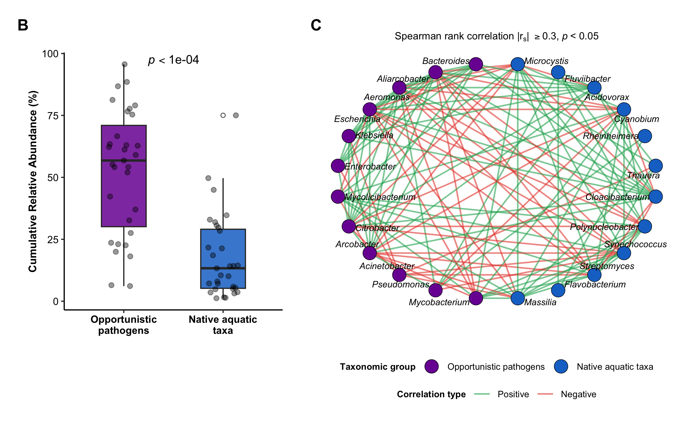<!-- -->

``` r
# Export SVG & TIFF
svglite::svglite("Panels_BC_LowerPage_Final.svg", width = 8.5, height = 5.2)
print(bottom_panels)
dev.off()
```

    ## quartz_off_screen 
    ##                 2

``` r
ggsave("Panels_BC_LowerPage_Final.tiff", plot = bottom_panels, width = 8.5, height = 5.2, dpi = 300, compression = "lzw")
```

------------------------------------------------------------------------

### Module 5. Spatial and Environmental Abundance Distribution Across Sampling Sites

This section performs non-parametric statistical evaluations across the
Top 20 harmonized bacterial genera (supporting **Figure 3**).
Differences across geographical regions (States) are assessed via
Kruskal-Wallis $H$-tests followed by Benjamini-Hochberg (FDR) adjusted
pairwise Wilcoxon rank-sum tests. Differences between water body types
(Lentic vs. Lotic) are evaluated using Wilcoxon rank-sum tests with FDR
correction. All analytical summaries are consolidated into a single
structured worksheet as **Table S6**.

``` r
# ------------------------------------------------------------------------------
# 1. LOAD DATA & FILTER STRICTLY AT GENUS LEVEL
# ------------------------------------------------------------------------------
genus_data_fig3 <- data_rel_taxa %>%
  filter(!Taxa %in% non_bacterial_taxa) %>%
  filter(Taxonomic_level == "Genus") %>%
  mutate(
    Sample_name   = str_trim(Sample_name),
    State         = str_trim(State),
    Effluent_type = str_trim(Effluent_type),
    Genus         = str_trim(Taxa)
  ) %>%
  group_by(Sample_name, State, Effluent_type, Genus) %>%
  summarise(Relative_abundance = sum(Relative_abundance, na.rm = TRUE), .groups = "drop")

# ------------------------------------------------------------------------------
# 2. SELECT TOP 20 GLOBAL GENERA BY MEAN ABUNDANCE
# ------------------------------------------------------------------------------
top_20_info <- genus_data_fig3 %>%
  group_by(Genus) %>%
  summarise(Mean_Abundance = mean(Relative_abundance, na.rm = TRUE), .groups = "drop") %>%
  arrange(desc(Mean_Abundance)) %>%
  slice(1:20) %>%
  mutate(
    Category = case_when(
      Genus %in% opportunistic_taxa ~ "Opportunistic pathogens",
      Genus %in% native_aquatic_taxa ~ "Native aquatic taxa",
      TRUE ~ "Other core taxa"
    )
  )

# Sort genera strictly by Mean Abundance within each category
top_20_info$Category <- factor( top_20_info$Category, 
  levels = c("Opportunistic pathogens", "Native aquatic taxa", "Other core taxa")
)

ordered_genera <- top_20_info %>%
  arrange(Category, desc(Mean_Abundance)) %>%
  pull(Genus)

# ------------------------------------------------------------------------------
# 3. PREPARE Z-SCORE MATRIX & NUMERICALLY SORT SITES WITHIN STATES
# ------------------------------------------------------------------------------
heatmap_df <- genus_data_fig3 %>%
  filter(Genus %in% ordered_genera)

matrix_wide <- heatmap_df %>%
  select(Sample_name, Genus, Relative_abundance) %>%
  pivot_wider(names_from = Sample_name, values_from = Relative_abundance, values_fill = 0)

mat_data <- as.matrix(matrix_wide[, -1])
rownames(mat_data) <- matrix_wide$Genus

# Sort rows matching category-then-abundance hierarchy
mat_data <- mat_data[ordered_genera, ]

# Row Z-score normalization
mat_zscore <- t(scale(t(mat_data)))
mat_zscore[is.na(mat_zscore)] <- 0

# Sort sites numerically within states
sample_info <- genus_data_fig3 %>%
  select(Sample_name, State, Effluent_type) %>%
  distinct() %>%
  mutate(
    site_prefix  = str_extract(Sample_name, "^[A-Za-z]+"),
    site_number  = as.numeric(str_extract(Sample_name, "[0-9]+")),
    state_factor = factor(State, levels = c("Mexico City", "Morelos", "State of Mexico", "Tlaxcala"))
  ) %>%
  arrange(state_factor, site_number)

mat_zscore <- mat_zscore[, sample_info$Sample_name]

# Row categories metadata dataframe
row_info <- data.frame(Genus = rownames(mat_zscore)) %>%
  left_join(top_20_info %>% select(Genus, Category), by = "Genus")

# ------------------------------------------------------------------------------
# 4. COLOR PALETTES AND ANNOTATIONS
# ------------------------------------------------------------------------------
category_colors <- c(
  "Opportunistic pathogens" = "#7b1fa2", # Purple
  "Native aquatic taxa"     = "#2F8FE4", # Prussian Blue
  "Other core taxa"         = "#f39c12"  # Amber/Yellow
)

effluent_colors <- c("Lentic" = "#a65628", "Lotic" = "#009688")
state_colors    <- c(
  "Mexico City"     = "#881146", 
  "Morelos"         = "#5c9ecc", 
  "State of Mexico" = "#e377c2", 
  "Tlaxcala"        = "#ffed00"
)

top_annotation <- HeatmapAnnotation(
  `Effluent Type` = sample_info$Effluent_type,
  State           = sample_info$State,
  col = list(
    `Effluent Type` = effluent_colors,
    State           = state_colors
  ),
  annotation_name_side = "right",
  annotation_name_gp   = gpar(fontsize = 8, fontface = "bold")
)

left_annotation <- rowAnnotation(
  Category             = row_info$Category,
  col                  = list(Category = category_colors),
  show_annotation_name = FALSE,
  show_legend          = FALSE 
)

category_legend <- Legend(
  title     = "Category",
  labels    = names(category_colors),
  legend_gp = gpar(fill = category_colors),
  title_gp  = gpar(fontsize = 9, fontface = "bold"),
  labels_gp = gpar(fontsize = 8)
)

col_fun <- colorRamp2(c(-2, 0, 2, 4, 6), c("#f7f7f7", "#d9d9d9", "#969696", "#525252", "#000000"))

# ------------------------------------------------------------------------------
# 5. RENDER HEATMAP AND EXPORT HIGH-RES FILES
# ------------------------------------------------------------------------------
ht <- Heatmap(
  mat_zscore,
  name                 = "Z-score",
  col                  = col_fun,
  rect_gp              = gpar(col = "white", lwd = 0.5),
  top_annotation       = top_annotation,
  left_annotation      = left_annotation,
  row_split            = row_info$Category,
  row_title            = NULL,
  cluster_rows         = FALSE,                
  cluster_columns      = FALSE,                
  show_column_names    = TRUE,
  column_names_gp      = gpar(fontsize = 7.5),
  row_names_gp         = gpar(fontsize = 9, fontface = "italic"),
  column_title         = NULL,
  heatmap_legend_param = list(
    title          = "Relative abundance profiles (Z-score normalized)",
    title_gp       = gpar(fontsize = 9.5, fontface = "bold"),
    direction      = "horizontal",
    title_position = "topcenter",
    legend_width   = unit(6, "cm")
  )
)

# Visualización en la salida del R Markdown
draw(
  ht, 
  heatmap_legend_side    = "top", 
  annotation_legend_side = "right",
  annotation_legend_list = list(category_legend)
)
```

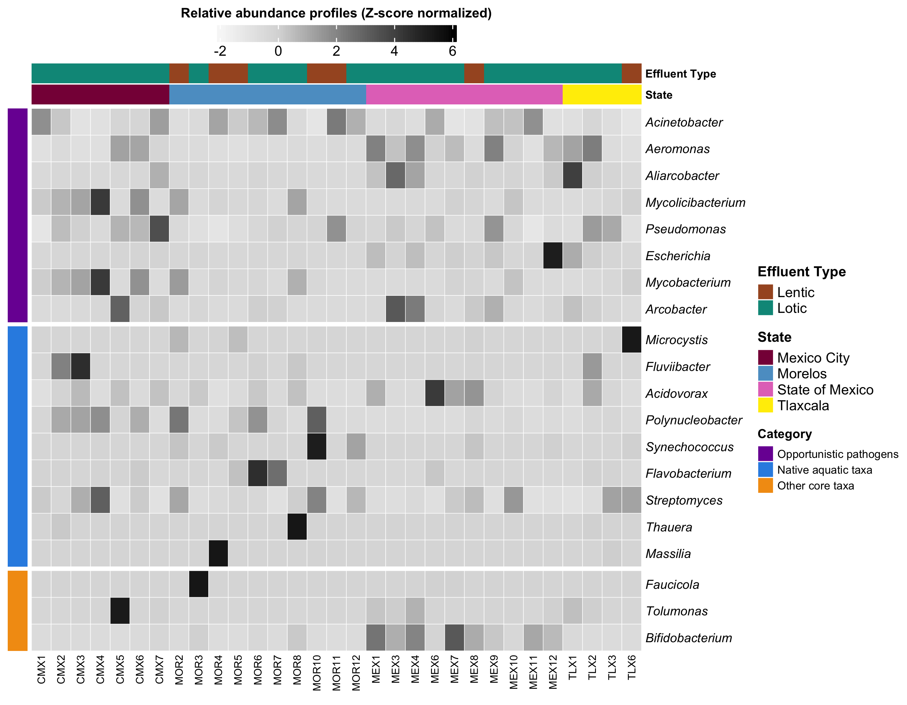<!-- -->

``` r
# Exportar en SVG
svglite::svglite("Figure3_Final.svg", width = 9.0, height = 7.0)
draw(
  ht, 
  heatmap_legend_side    = "top", 
  annotation_legend_side = "right",
  annotation_legend_list = list(category_legend)
)
dev.off()
```

    ## quartz_off_screen 
    ##                 2

``` r
# Export TIFF file (using direct graphics device for ComplexHeatmap)
tiff("Figure3_Final.tiff", width = 9.0, height = 7.0, units = "in", res = 300, compression = "lzw")
draw(
  ht, 
  heatmap_legend_side    = "top", 
  annotation_legend_side = "right",
  annotation_legend_list = list(category_legend)
)
dev.off()
```

    ## quartz_off_screen 
    ##                 2

``` r
# ------------------------------------------------------------------------------
# 6. Generate Supplementary Table S6
# ------------------------------------------------------------------------------

# 6.1 FILTER STRICTLY AT GENUS LEVEL & HARMONIZE METADATA

genus_data <- data_rel_taxa %>%
  filter(!Taxa %in% non_bacterial_taxa) %>%
  filter(Taxonomic_level == "Genus") %>%
  mutate(
    Sample_name   = str_trim(Sample_name),
    State         = str_trim(State),
    Effluent_type = str_trim(Effluent_type),
    Genus         = str_trim(Taxa)
  ) %>%
  group_by(Sample_name, State, Effluent_type, Genus) %>%
  summarise(Relative_abundance = sum(Relative_abundance, na.rm = TRUE), .groups = "drop")

# 6.2 HARMONIZED TAXONOMIC LISTS

opportunistic_taxa <- c(
  "Enterococcus", "Staphylococcus", "Klebsiella", "Acinetobacter", "Pseudomonas", 
  "Enterobacter", "Escherichia", "Salmonella", "Citrobacter", "Kluyvera", 
  "Aeromonas", "Vibrio", "Legionella", "Stenotrophomonas", "Serratia",
  "Arcobacter", "Aliarcobacter", "Campylobacter", "Helicobacter",
  "Mycobacterium", "Mycolicibacterium", "Mycobacteroides",
  "Clostridium", "Bacteroides", "Fusobacterium"
)

native_aquatic_taxa <- c(
  "Microcystis", "Synechococcus", "Cyanobium", "Planktothrix", "Anabaena", "Dolichospermum",
  "Polynucleobacter", "Limnohabitans", "Rhodoferax", "Curvibacter", "Variovorax", 
  "Thauera", "Acidovorax", "Comamonas", "Delftia", "Massilia", "Streptomyces",
  "Flavobacterium", "Chryseobacterium", "Cloacibacterium", "Fluviibacter",
  "Erythrobacter", "Phenylobacterium", "Methylopumilus", "Rheinheimera", "Desulfovibrio"
)


# 6.3 SELECT TOP 20 GLOBAL GENERA BY MEAN ABUNDANCE

top_20_genera <- genus_data %>%
  group_by(Genus) %>%
  summarise(Mean_Abundance = mean(Relative_abundance, na.rm = TRUE), .groups = "drop") %>%
  arrange(desc(Mean_Abundance)) %>%
  slice(1:20) %>%
  pull(Genus)

df_top20 <- genus_data %>%
  filter(Genus %in% top_20_genera) %>%
  mutate(
    Category = case_when(
      Genus %in% opportunistic_taxa ~ "Opportunistic pathogens",
      Genus %in% native_aquatic_taxa ~ "Native aquatic taxa",
      TRUE ~ "Other core taxa"
    )
  )

# 6.4 KRUSKAL-WALLIS H-TEST ACROSS STATES & POST-HOC WILCOXON

kw_state_results <- df_top20 %>%
  group_by(Genus, Category) %>%
  rstatix::kruskal_test(Relative_abundance ~ State) %>%
  rstatix::adjust_pvalue(method = "fdr") %>% 
  rstatix::add_significance("p.adj") %>%
  arrange(p.adj)

sig_state_genera <- kw_state_results %>% filter(p.adj < 0.05) %>% pull(Genus)

if(length(sig_state_genera) > 0) {
  posthoc_state_results <- df_top20 %>%
    filter(Genus %in% sig_state_genera) %>%
    group_by(Genus, Category) %>%
    rstatix::pairwise_wilcox_test(Relative_abundance ~ State, p.adjust.method = "fdr") %>%
    rstatix::add_significance("p.adj")
} else {
  posthoc_state_results <- data.frame(Note = "No genera showed significant differences across states after FDR correction.")
}

# 6.5 WILCOXON RANK-SUM TEST ACROSS EFFLUENT TYPES (LENTIC VS LOTIC)

wilcox_effluent_results <- df_top20 %>%
  group_by(Genus, Category) %>%
  rstatix::wilcox_test(Relative_abundance ~ Effluent_type) %>%
  rstatix::adjust_pvalue(method = "fdr") %>% 
  rstatix::add_significance("p.adj") %>%
  arrange(p.adj)

# 6.6 EXPORT CONSOLIDATED TABLE S6 TO A SINGLE EXCEL WORKSHEET

wb_s6 <- createWorkbook()
addWorksheet(wb_s6, "Table_S6_NonParametric_Stats")

# Title (row 1)
title_text <- "Table S6. Non-parametric Kruskal-Wallis tests of the top 20 most abundant genera across states and water body types. Wilcoxon rank-sum tests are also reported for pairwise comparisons among states and water body types"
writeData(wb_s6, "Table_S6_NonParametric_Stats", data.frame(Title = title_text), startCol = 1, startRow = 1, colNames = FALSE)

current_row <- 3

# Section 1: Kruskal-Wallis by state
writeData(wb_s6, "Table_S6_NonParametric_Stats", kw_state_results, startCol = 1, startRow = current_row, colNames = TRUE)
current_row <- current_row + nrow(kw_state_results) + 3

# Section 2: Subtitle and Post-hoc Wilcoxon by state
writeData(wb_s6, "Table_S6_NonParametric_Stats", data.frame(Subtitle = "Pairwise post hoc Wilcoxon tests across states"), startCol = 1, startRow = current_row, colNames = FALSE)
current_row <- current_row + 1

writeData(wb_s6, "Table_S6_NonParametric_Stats", posthoc_state_results, startCol = 1, startRow = current_row, colNames = TRUE)
current_row <- current_row + nrow(posthoc_state_results) + 3

# Section 3: Subtitle and Wilcoxon by water body type
writeData(wb_s6, "Table_S6_NonParametric_Stats", data.frame(Subtitle = "Pairwise Wilcoxon tests across water body types"), startCol = 1, startRow = current_row, colNames = FALSE)
current_row <- current_row + 1

writeData(wb_s6, "Table_S6_NonParametric_Stats", wilcox_effluent_results, startCol = 1, startRow = current_row, colNames = TRUE)

# Save Excel file as Table_S6
saveWorkbook(wb_s6, "Table_S6_Top20_NonParametric_Stats.xlsx", overwrite = TRUE)

cat("-> Table_S6_Top20_NonParametric_Stats.xlsx successfully generated as a single consolidated worksheet!\n")
```

    ## -> Table_S6_Top20_NonParametric_Stats.xlsx successfully generated as a single consolidated worksheet!

``` r
# 6.7 PRINT TABLE S6 TO HTML FORMAT

kable(kw_state_results, format = "html", caption = "Table S6 (Part 1): Kruskal-Wallis tests across states.") %>%
  kable_styling(bootstrap_options = c("striped", "hover", "condensed", "responsive"), full_width = FALSE, position = "center")
```

<table class="table table-striped table-hover table-condensed table-responsive" style="width: auto !important; margin-left: auto; margin-right: auto;">
<caption>
Table S6 (Part 1): Kruskal-Wallis tests across states.
</caption>
<thead>
<tr>
<th style="text-align:left;">
Genus
</th>
<th style="text-align:left;">
Category
</th>
<th style="text-align:left;">
.y.
</th>
<th style="text-align:right;">
n
</th>
<th style="text-align:right;">
statistic
</th>
<th style="text-align:right;">
df
</th>
<th style="text-align:right;">
p
</th>
<th style="text-align:left;">
method
</th>
<th style="text-align:right;">
p.adj
</th>
<th style="text-align:left;">
p.adj.signif
</th>
</tr>
</thead>
<tbody>
<tr>
<td style="text-align:left;">
Bifidobacterium
</td>
<td style="text-align:left;">
Other core taxa
</td>
<td style="text-align:left;">
Relative_abundance
</td>
<td style="text-align:right;">
31
</td>
<td style="text-align:right;">
17.7131336
</td>
<td style="text-align:right;">
3
</td>
<td style="text-align:right;">
0.000504
</td>
<td style="text-align:left;">
Kruskal-Wallis
</td>
<td style="text-align:right;">
0.0100800
</td>
<td style="text-align:left;">

- </td>
  </tr>
  <tr>
  <td style="text-align:left;">
  Escherichia
  </td>
  <td style="text-align:left;">
  Opportunistic pathogens
  </td>
  <td style="text-align:left;">
  Relative_abundance
  </td>
  <td style="text-align:right;">
  31
  </td>
  <td style="text-align:right;">
  14.2685772
  </td>
  <td style="text-align:right;">
  3
  </td>
  <td style="text-align:right;">
  0.002560
  </td>
  <td style="text-align:left;">
  Kruskal-Wallis
  </td>
  <td style="text-align:right;">
  0.0256000
  </td>
  <td style="text-align:left;">

  - </td>
    </tr>
    <tr>
    <td style="text-align:left;">
    Aliarcobacter
    </td>
    <td style="text-align:left;">
    Opportunistic pathogens
    </td>
    <td style="text-align:left;">
    Relative_abundance
    </td>
    <td style="text-align:right;">
    31
    </td>
    <td style="text-align:right;">
    10.4816820
    </td>
    <td style="text-align:right;">
    3
    </td>
    <td style="text-align:right;">
    0.014900
    </td>
    <td style="text-align:left;">
    Kruskal-Wallis
    </td>
    <td style="text-align:right;">
    0.0993333
    </td>
    <td style="text-align:left;">
    ns
    </td>
    </tr>
    <tr>
    <td style="text-align:left;">
    Polynucleobacter
    </td>
    <td style="text-align:left;">
    Native aquatic taxa
    </td>
    <td style="text-align:left;">
    Relative_abundance
    </td>
    <td style="text-align:right;">
    31
    </td>
    <td style="text-align:right;">
    8.2956221
    </td>
    <td style="text-align:right;">
    3
    </td>
    <td style="text-align:right;">
    0.040300
    </td>
    <td style="text-align:left;">
    Kruskal-Wallis
    </td>
    <td style="text-align:right;">
    0.2015000
    </td>
    <td style="text-align:left;">
    ns
    </td>
    </tr>
    <tr>
    <td style="text-align:left;">
    Aeromonas
    </td>
    <td style="text-align:left;">
    Opportunistic pathogens
    </td>
    <td style="text-align:left;">
    Relative_abundance
    </td>
    <td style="text-align:right;">
    31
    </td>
    <td style="text-align:right;">
    6.5346774
    </td>
    <td style="text-align:right;">
    3
    </td>
    <td style="text-align:right;">
    0.088300
    </td>
    <td style="text-align:left;">
    Kruskal-Wallis
    </td>
    <td style="text-align:right;">
    0.2550000
    </td>
    <td style="text-align:left;">
    ns
    </td>
    </tr>
    <tr>
    <td style="text-align:left;">
    Faucicola
    </td>
    <td style="text-align:left;">
    Other core taxa
    </td>
    <td style="text-align:left;">
    Relative_abundance
    </td>
    <td style="text-align:right;">
    31
    </td>
    <td style="text-align:right;">
    6.2116071
    </td>
    <td style="text-align:right;">
    3
    </td>
    <td style="text-align:right;">
    0.102000
    </td>
    <td style="text-align:left;">
    Kruskal-Wallis
    </td>
    <td style="text-align:right;">
    0.2550000
    </td>
    <td style="text-align:left;">
    ns
    </td>
    </tr>
    <tr>
    <td style="text-align:left;">
    Flavobacterium
    </td>
    <td style="text-align:left;">
    Native aquatic taxa
    </td>
    <td style="text-align:left;">
    Relative_abundance
    </td>
    <td style="text-align:right;">
    31
    </td>
    <td style="text-align:right;">
    6.2600806
    </td>
    <td style="text-align:right;">
    3
    </td>
    <td style="text-align:right;">
    0.099600
    </td>
    <td style="text-align:left;">
    Kruskal-Wallis
    </td>
    <td style="text-align:right;">
    0.2550000
    </td>
    <td style="text-align:left;">
    ns
    </td>
    </tr>
    <tr>
    <td style="text-align:left;">
    Tolumonas
    </td>
    <td style="text-align:left;">
    Other core taxa
    </td>
    <td style="text-align:left;">
    Relative_abundance
    </td>
    <td style="text-align:right;">
    31
    </td>
    <td style="text-align:right;">
    6.8981321
    </td>
    <td style="text-align:right;">
    3
    </td>
    <td style="text-align:right;">
    0.075200
    </td>
    <td style="text-align:left;">
    Kruskal-Wallis
    </td>
    <td style="text-align:right;">
    0.2550000
    </td>
    <td style="text-align:left;">
    ns
    </td>
    </tr>
    <tr>
    <td style="text-align:left;">
    Arcobacter
    </td>
    <td style="text-align:left;">
    Opportunistic pathogens
    </td>
    <td style="text-align:left;">
    Relative_abundance
    </td>
    <td style="text-align:right;">
    31
    </td>
    <td style="text-align:right;">
    5.0715726
    </td>
    <td style="text-align:right;">
    3
    </td>
    <td style="text-align:right;">
    0.167000
    </td>
    <td style="text-align:left;">
    Kruskal-Wallis
    </td>
    <td style="text-align:right;">
    0.3711111
    </td>
    <td style="text-align:left;">
    ns
    </td>
    </tr>
    <tr>
    <td style="text-align:left;">
    Mycobacterium
    </td>
    <td style="text-align:left;">
    Opportunistic pathogens
    </td>
    <td style="text-align:left;">
    Relative_abundance
    </td>
    <td style="text-align:right;">
    31
    </td>
    <td style="text-align:right;">
    4.1441820
    </td>
    <td style="text-align:right;">
    3
    </td>
    <td style="text-align:right;">
    0.246000
    </td>
    <td style="text-align:left;">
    Kruskal-Wallis
    </td>
    <td style="text-align:right;">
    0.4920000
    </td>
    <td style="text-align:left;">
    ns
    </td>
    </tr>
    <tr>
    <td style="text-align:left;">
    Acinetobacter
    </td>
    <td style="text-align:left;">
    Opportunistic pathogens
    </td>
    <td style="text-align:left;">
    Relative_abundance
    </td>
    <td style="text-align:right;">
    31
    </td>
    <td style="text-align:right;">
    3.7074885
    </td>
    <td style="text-align:right;">
    3
    </td>
    <td style="text-align:right;">
    0.295000
    </td>
    <td style="text-align:left;">
    Kruskal-Wallis
    </td>
    <td style="text-align:right;">
    0.5033333
    </td>
    <td style="text-align:left;">
    ns
    </td>
    </tr>
    <tr>
    <td style="text-align:left;">
    Mycolicibacterium
    </td>
    <td style="text-align:left;">
    Opportunistic pathogens
    </td>
    <td style="text-align:left;">
    Relative_abundance
    </td>
    <td style="text-align:right;">
    31
    </td>
    <td style="text-align:right;">
    3.6492512
    </td>
    <td style="text-align:right;">
    3
    </td>
    <td style="text-align:right;">
    0.302000
    </td>
    <td style="text-align:left;">
    Kruskal-Wallis
    </td>
    <td style="text-align:right;">
    0.5033333
    </td>
    <td style="text-align:left;">
    ns
    </td>
    </tr>
    <tr>
    <td style="text-align:left;">
    Acidovorax
    </td>
    <td style="text-align:left;">
    Native aquatic taxa
    </td>
    <td style="text-align:left;">
    Relative_abundance
    </td>
    <td style="text-align:right;">
    31
    </td>
    <td style="text-align:right;">
    2.3303571
    </td>
    <td style="text-align:right;">
    3
    </td>
    <td style="text-align:right;">
    0.507000
    </td>
    <td style="text-align:left;">
    Kruskal-Wallis
    </td>
    <td style="text-align:right;">
    0.6337500
    </td>
    <td style="text-align:left;">
    ns
    </td>
    </tr>
    <tr>
    <td style="text-align:left;">
    Fluviibacter
    </td>
    <td style="text-align:left;">
    Native aquatic taxa
    </td>
    <td style="text-align:left;">
    Relative_abundance
    </td>
    <td style="text-align:right;">
    31
    </td>
    <td style="text-align:right;">
    2.7628168
    </td>
    <td style="text-align:right;">
    3
    </td>
    <td style="text-align:right;">
    0.430000
    </td>
    <td style="text-align:left;">
    Kruskal-Wallis
    </td>
    <td style="text-align:right;">
    0.6337500
    </td>
    <td style="text-align:left;">
    ns
    </td>
    </tr>
    <tr>
    <td style="text-align:left;">
    Massilia
    </td>
    <td style="text-align:left;">
    Native aquatic taxa
    </td>
    <td style="text-align:left;">
    Relative_abundance
    </td>
    <td style="text-align:right;">
    31
    </td>
    <td style="text-align:right;">
    2.3536866
    </td>
    <td style="text-align:right;">
    3
    </td>
    <td style="text-align:right;">
    0.502000
    </td>
    <td style="text-align:left;">
    Kruskal-Wallis
    </td>
    <td style="text-align:right;">
    0.6337500
    </td>
    <td style="text-align:left;">
    ns
    </td>
    </tr>
    <tr>
    <td style="text-align:left;">
    Thauera
    </td>
    <td style="text-align:left;">
    Native aquatic taxa
    </td>
    <td style="text-align:left;">
    Relative_abundance
    </td>
    <td style="text-align:right;">
    31
    </td>
    <td style="text-align:right;">
    2.6072869
    </td>
    <td style="text-align:right;">
    3
    </td>
    <td style="text-align:right;">
    0.456000
    </td>
    <td style="text-align:left;">
    Kruskal-Wallis
    </td>
    <td style="text-align:right;">
    0.6337500
    </td>
    <td style="text-align:left;">
    ns
    </td>
    </tr>
    <tr>
    <td style="text-align:left;">
    Pseudomonas
    </td>
    <td style="text-align:left;">
    Opportunistic pathogens
    </td>
    <td style="text-align:left;">
    Relative_abundance
    </td>
    <td style="text-align:right;">
    31
    </td>
    <td style="text-align:right;">
    1.7956797
    </td>
    <td style="text-align:right;">
    3
    </td>
    <td style="text-align:right;">
    0.616000
    </td>
    <td style="text-align:left;">
    Kruskal-Wallis
    </td>
    <td style="text-align:right;">
    0.7247059
    </td>
    <td style="text-align:left;">
    ns
    </td>
    </tr>
    <tr>
    <td style="text-align:left;">
    Microcystis
    </td>
    <td style="text-align:left;">
    Native aquatic taxa
    </td>
    <td style="text-align:left;">
    Relative_abundance
    </td>
    <td style="text-align:right;">
    31
    </td>
    <td style="text-align:right;">
    1.0952687
    </td>
    <td style="text-align:right;">
    3
    </td>
    <td style="text-align:right;">
    0.778000
    </td>
    <td style="text-align:left;">
    Kruskal-Wallis
    </td>
    <td style="text-align:right;">
    0.8644444
    </td>
    <td style="text-align:left;">
    ns
    </td>
    </tr>
    <tr>
    <td style="text-align:left;">
    Streptomyces
    </td>
    <td style="text-align:left;">
    Native aquatic taxa
    </td>
    <td style="text-align:left;">
    Relative_abundance
    </td>
    <td style="text-align:right;">
    31
    </td>
    <td style="text-align:right;">
    0.8536866
    </td>
    <td style="text-align:right;">
    3
    </td>
    <td style="text-align:right;">
    0.837000
    </td>
    <td style="text-align:left;">
    Kruskal-Wallis
    </td>
    <td style="text-align:right;">
    0.8730000
    </td>
    <td style="text-align:left;">
    ns
    </td>
    </tr>
    <tr>
    <td style="text-align:left;">
    Synechococcus
    </td>
    <td style="text-align:left;">
    Native aquatic taxa
    </td>
    <td style="text-align:left;">
    Relative_abundance
    </td>
    <td style="text-align:right;">
    31
    </td>
    <td style="text-align:right;">
    0.6994528
    </td>
    <td style="text-align:right;">
    3
    </td>
    <td style="text-align:right;">
    0.873000
    </td>
    <td style="text-align:left;">
    Kruskal-Wallis
    </td>
    <td style="text-align:right;">
    0.8730000
    </td>
    <td style="text-align:left;">
    ns
    </td>
    </tr>
    </tbody>
    </table>

``` r
kable(posthoc_state_results, format = "html", caption = "Table S6 (Part 2): Pairwise post-hoc Wilcoxon tests across states.") %>%
  kable_styling(bootstrap_options = c("striped", "hover", "condensed", "responsive"), full_width = FALSE, position = "center")
```

<table class="table table-striped table-hover table-condensed table-responsive" style="width: auto !important; margin-left: auto; margin-right: auto;">
<caption>
Table S6 (Part 2): Pairwise post-hoc Wilcoxon tests across states.
</caption>
<thead>
<tr>
<th style="text-align:left;">
Genus
</th>
<th style="text-align:left;">
Category
</th>
<th style="text-align:left;">
.y.
</th>
<th style="text-align:left;">
group1
</th>
<th style="text-align:left;">
group2
</th>
<th style="text-align:right;">
n1
</th>
<th style="text-align:right;">
n2
</th>
<th style="text-align:right;">
statistic
</th>
<th style="text-align:right;">
p
</th>
<th style="text-align:right;">
p.adj
</th>
<th style="text-align:left;">
p.adj.signif
</th>
</tr>
</thead>
<tbody>
<tr>
<td style="text-align:left;">
Bifidobacterium
</td>
<td style="text-align:left;">
Other core taxa
</td>
<td style="text-align:left;">
Relative_abundance
</td>
<td style="text-align:left;">
Mexico City
</td>
<td style="text-align:left;">
Morelos
</td>
<td style="text-align:right;">
7
</td>
<td style="text-align:right;">
10
</td>
<td style="text-align:right;">
42
</td>
<td style="text-align:right;">
5.36e-01
</td>
<td style="text-align:right;">
0.778000
</td>
<td style="text-align:left;">
ns
</td>
</tr>
<tr>
<td style="text-align:left;">
Bifidobacterium
</td>
<td style="text-align:left;">
Other core taxa
</td>
<td style="text-align:left;">
Relative_abundance
</td>
<td style="text-align:left;">
Mexico City
</td>
<td style="text-align:left;">
State of Mexico
</td>
<td style="text-align:right;">
7
</td>
<td style="text-align:right;">
10
</td>
<td style="text-align:right;">
1
</td>
<td style="text-align:right;">
2.06e-04
</td>
<td style="text-align:right;">
0.000618
</td>
<td style="text-align:left;">
\*\*\*
</td>
</tr>
<tr>
<td style="text-align:left;">
Bifidobacterium
</td>
<td style="text-align:left;">
Other core taxa
</td>
<td style="text-align:left;">
Relative_abundance
</td>
<td style="text-align:left;">
Mexico City
</td>
<td style="text-align:left;">
Tlaxcala
</td>
<td style="text-align:right;">
7
</td>
<td style="text-align:right;">
4
</td>
<td style="text-align:right;">
17
</td>
<td style="text-align:right;">
6.48e-01
</td>
<td style="text-align:right;">
0.778000
</td>
<td style="text-align:left;">
ns
</td>
</tr>
<tr>
<td style="text-align:left;">
Bifidobacterium
</td>
<td style="text-align:left;">
Other core taxa
</td>
<td style="text-align:left;">
Relative_abundance
</td>
<td style="text-align:left;">
Morelos
</td>
<td style="text-align:left;">
State of Mexico
</td>
<td style="text-align:right;">
10
</td>
<td style="text-align:right;">
10
</td>
<td style="text-align:right;">
5
</td>
<td style="text-align:right;">
2.06e-04
</td>
<td style="text-align:right;">
0.000618
</td>
<td style="text-align:left;">
\*\*\*
</td>
</tr>
<tr>
<td style="text-align:left;">
Bifidobacterium
</td>
<td style="text-align:left;">
Other core taxa
</td>
<td style="text-align:left;">
Relative_abundance
</td>
<td style="text-align:left;">
Morelos
</td>
<td style="text-align:left;">
Tlaxcala
</td>
<td style="text-align:right;">
10
</td>
<td style="text-align:right;">
4
</td>
<td style="text-align:right;">
19
</td>
<td style="text-align:right;">
9.45e-01
</td>
<td style="text-align:right;">
0.945000
</td>
<td style="text-align:left;">
ns
</td>
</tr>
<tr>
<td style="text-align:left;">
Bifidobacterium
</td>
<td style="text-align:left;">
Other core taxa
</td>
<td style="text-align:left;">
Relative_abundance
</td>
<td style="text-align:left;">
State of Mexico
</td>
<td style="text-align:left;">
Tlaxcala
</td>
<td style="text-align:right;">
10
</td>
<td style="text-align:right;">
4
</td>
<td style="text-align:right;">
40
</td>
<td style="text-align:right;">
2.00e-03
</td>
<td style="text-align:right;">
0.004000
</td>
<td style="text-align:left;">
\*\*
</td>
</tr>
<tr>
<td style="text-align:left;">
Escherichia
</td>
<td style="text-align:left;">
Opportunistic pathogens
</td>
<td style="text-align:left;">
Relative_abundance
</td>
<td style="text-align:left;">
Mexico City
</td>
<td style="text-align:left;">
Morelos
</td>
<td style="text-align:right;">
7
</td>
<td style="text-align:right;">
10
</td>
<td style="text-align:right;">
48
</td>
<td style="text-align:right;">
2.30e-01
</td>
<td style="text-align:right;">
0.345000
</td>
<td style="text-align:left;">
ns
</td>
</tr>
<tr>
<td style="text-align:left;">
Escherichia
</td>
<td style="text-align:left;">
Opportunistic pathogens
</td>
<td style="text-align:left;">
Relative_abundance
</td>
<td style="text-align:left;">
Mexico City
</td>
<td style="text-align:left;">
State of Mexico
</td>
<td style="text-align:right;">
7
</td>
<td style="text-align:right;">
10
</td>
<td style="text-align:right;">
10
</td>
<td style="text-align:right;">
1.40e-02
</td>
<td style="text-align:right;">
0.041000
</td>
<td style="text-align:left;">

- </td>
  </tr>
  <tr>
  <td style="text-align:left;">
  Escherichia
  </td>
  <td style="text-align:left;">
  Opportunistic pathogens
  </td>
  <td style="text-align:left;">
  Relative_abundance
  </td>
  <td style="text-align:left;">
  Mexico City
  </td>
  <td style="text-align:left;">
  Tlaxcala
  </td>
  <td style="text-align:right;">
  7
  </td>
  <td style="text-align:right;">
  4
  </td>
  <td style="text-align:right;">
  9
  </td>
  <td style="text-align:right;">
  4.12e-01
  </td>
  <td style="text-align:right;">
  0.494000
  </td>
  <td style="text-align:left;">
  ns
  </td>
  </tr>
  <tr>
  <td style="text-align:left;">
  Escherichia
  </td>
  <td style="text-align:left;">
  Opportunistic pathogens
  </td>
  <td style="text-align:left;">
  Relative_abundance
  </td>
  <td style="text-align:left;">
  Morelos
  </td>
  <td style="text-align:left;">
  State of Mexico
  </td>
  <td style="text-align:right;">
  10
  </td>
  <td style="text-align:right;">
  10
  </td>
  <td style="text-align:right;">
  3
  </td>
  <td style="text-align:right;">
  7.58e-05
  </td>
  <td style="text-align:right;">
  0.000455
  </td>
  <td style="text-align:left;">
  \*\*\*
  </td>
  </tr>
  <tr>
  <td style="text-align:left;">
  Escherichia
  </td>
  <td style="text-align:left;">
  Opportunistic pathogens
  </td>
  <td style="text-align:left;">
  Relative_abundance
  </td>
  <td style="text-align:left;">
  Morelos
  </td>
  <td style="text-align:left;">
  Tlaxcala
  </td>
  <td style="text-align:right;">
  10
  </td>
  <td style="text-align:right;">
  4
  </td>
  <td style="text-align:right;">
  8
  </td>
  <td style="text-align:right;">
  1.06e-01
  </td>
  <td style="text-align:right;">
  0.212000
  </td>
  <td style="text-align:left;">
  ns
  </td>
  </tr>
  <tr>
  <td style="text-align:left;">
  Escherichia
  </td>
  <td style="text-align:left;">
  Opportunistic pathogens
  </td>
  <td style="text-align:left;">
  Relative_abundance
  </td>
  <td style="text-align:left;">
  State of Mexico
  </td>
  <td style="text-align:left;">
  Tlaxcala
  </td>
  <td style="text-align:right;">
  10
  </td>
  <td style="text-align:right;">
  4
  </td>
  <td style="text-align:right;">
  24
  </td>
  <td style="text-align:right;">
  6.35e-01
  </td>
  <td style="text-align:right;">
  0.635000
  </td>
  <td style="text-align:left;">
  ns
  </td>
  </tr>
  </tbody>
  </table>

``` r
kable(wilcox_effluent_results, format = "html", caption = "Table S6 (Part 3): Wilcoxon tests across water body types.") %>%
  kable_styling(bootstrap_options = c("striped", "hover", "condensed", "responsive"), full_width = FALSE, position = "center")
```

<table class="table table-striped table-hover table-condensed table-responsive" style="width: auto !important; margin-left: auto; margin-right: auto;">
<caption>
Table S6 (Part 3): Wilcoxon tests across water body types.
</caption>
<thead>
<tr>
<th style="text-align:left;">
Genus
</th>
<th style="text-align:left;">
Category
</th>
<th style="text-align:left;">
.y.
</th>
<th style="text-align:left;">
group1
</th>
<th style="text-align:left;">
group2
</th>
<th style="text-align:right;">
n1
</th>
<th style="text-align:right;">
n2
</th>
<th style="text-align:right;">
statistic
</th>
<th style="text-align:right;">
p
</th>
<th style="text-align:right;">
p.adj
</th>
<th style="text-align:left;">
p.adj.signif
</th>
</tr>
</thead>
<tbody>
<tr>
<td style="text-align:left;">
Microcystis
</td>
<td style="text-align:left;">
Native aquatic taxa
</td>
<td style="text-align:left;">
Relative_abundance
</td>
<td style="text-align:left;">
Lentic
</td>
<td style="text-align:left;">
Lotic
</td>
<td style="text-align:right;">
7
</td>
<td style="text-align:right;">
24
</td>
<td style="text-align:right;">
149.5
</td>
<td style="text-align:right;">
0.00156
</td>
<td style="text-align:right;">
0.0312000
</td>
<td style="text-align:left;">

- </td>
  </tr>
  <tr>
  <td style="text-align:left;">
  Aliarcobacter
  </td>
  <td style="text-align:left;">
  Opportunistic pathogens
  </td>
  <td style="text-align:left;">
  Relative_abundance
  </td>
  <td style="text-align:left;">
  Lentic
  </td>
  <td style="text-align:left;">
  Lotic
  </td>
  <td style="text-align:right;">
  7
  </td>
  <td style="text-align:right;">
  24
  </td>
  <td style="text-align:right;">
  35.0
  </td>
  <td style="text-align:right;">
  0.01940
  </td>
  <td style="text-align:right;">
  0.0554286
  </td>
  <td style="text-align:left;">
  ns
  </td>
  </tr>
  <tr>
  <td style="text-align:left;">
  Arcobacter
  </td>
  <td style="text-align:left;">
  Opportunistic pathogens
  </td>
  <td style="text-align:left;">
  Relative_abundance
  </td>
  <td style="text-align:left;">
  Lentic
  </td>
  <td style="text-align:left;">
  Lotic
  </td>
  <td style="text-align:right;">
  7
  </td>
  <td style="text-align:right;">
  24
  </td>
  <td style="text-align:right;">
  30.0
  </td>
  <td style="text-align:right;">
  0.00907
  </td>
  <td style="text-align:right;">
  0.0554286
  </td>
  <td style="text-align:left;">
  ns
  </td>
  </tr>
  <tr>
  <td style="text-align:left;">
  Bifidobacterium
  </td>
  <td style="text-align:left;">
  Other core taxa
  </td>
  <td style="text-align:left;">
  Relative_abundance
  </td>
  <td style="text-align:left;">
  Lentic
  </td>
  <td style="text-align:left;">
  Lotic
  </td>
  <td style="text-align:right;">
  7
  </td>
  <td style="text-align:right;">
  24
  </td>
  <td style="text-align:right;">
  34.0
  </td>
  <td style="text-align:right;">
  0.01680
  </td>
  <td style="text-align:right;">
  0.0554286
  </td>
  <td style="text-align:left;">
  ns
  </td>
  </tr>
  <tr>
  <td style="text-align:left;">
  Escherichia
  </td>
  <td style="text-align:left;">
  Opportunistic pathogens
  </td>
  <td style="text-align:left;">
  Relative_abundance
  </td>
  <td style="text-align:left;">
  Lentic
  </td>
  <td style="text-align:left;">
  Lotic
  </td>
  <td style="text-align:right;">
  7
  </td>
  <td style="text-align:right;">
  24
  </td>
  <td style="text-align:right;">
  28.0
  </td>
  <td style="text-align:right;">
  0.00650
  </td>
  <td style="text-align:right;">
  0.0554286
  </td>
  <td style="text-align:left;">
  ns
  </td>
  </tr>
  <tr>
  <td style="text-align:left;">
  Synechococcus
  </td>
  <td style="text-align:left;">
  Native aquatic taxa
  </td>
  <td style="text-align:left;">
  Relative_abundance
  </td>
  <td style="text-align:left;">
  Lentic
  </td>
  <td style="text-align:left;">
  Lotic
  </td>
  <td style="text-align:right;">
  7
  </td>
  <td style="text-align:right;">
  24
  </td>
  <td style="text-align:right;">
  135.0
  </td>
  <td style="text-align:right;">
  0.01450
  </td>
  <td style="text-align:right;">
  0.0554286
  </td>
  <td style="text-align:left;">
  ns
  </td>
  </tr>
  <tr>
  <td style="text-align:left;">
  Tolumonas
  </td>
  <td style="text-align:left;">
  Other core taxa
  </td>
  <td style="text-align:left;">
  Relative_abundance
  </td>
  <td style="text-align:left;">
  Lentic
  </td>
  <td style="text-align:left;">
  Lotic
  </td>
  <td style="text-align:right;">
  7
  </td>
  <td style="text-align:right;">
  24
  </td>
  <td style="text-align:right;">
  31.0
  </td>
  <td style="text-align:right;">
  0.01310
  </td>
  <td style="text-align:right;">
  0.0554286
  </td>
  <td style="text-align:left;">
  ns
  </td>
  </tr>
  <tr>
  <td style="text-align:left;">
  Massilia
  </td>
  <td style="text-align:left;">
  Native aquatic taxa
  </td>
  <td style="text-align:left;">
  Relative_abundance
  </td>
  <td style="text-align:left;">
  Lentic
  </td>
  <td style="text-align:left;">
  Lotic
  </td>
  <td style="text-align:right;">
  7
  </td>
  <td style="text-align:right;">
  24
  </td>
  <td style="text-align:right;">
  130.0
  </td>
  <td style="text-align:right;">
  0.02920
  </td>
  <td style="text-align:right;">
  0.0730000
  </td>
  <td style="text-align:left;">
  ns
  </td>
  </tr>
  <tr>
  <td style="text-align:left;">
  Aeromonas
  </td>
  <td style="text-align:left;">
  Opportunistic pathogens
  </td>
  <td style="text-align:left;">
  Relative_abundance
  </td>
  <td style="text-align:left;">
  Lentic
  </td>
  <td style="text-align:left;">
  Lotic
  </td>
  <td style="text-align:right;">
  7
  </td>
  <td style="text-align:right;">
  24
  </td>
  <td style="text-align:right;">
  42.0
  </td>
  <td style="text-align:right;">
  0.04830
  </td>
  <td style="text-align:right;">
  0.1073333
  </td>
  <td style="text-align:left;">
  ns
  </td>
  </tr>
  <tr>
  <td style="text-align:left;">
  Faucicola
  </td>
  <td style="text-align:left;">
  Other core taxa
  </td>
  <td style="text-align:left;">
  Relative_abundance
  </td>
  <td style="text-align:left;">
  Lentic
  </td>
  <td style="text-align:left;">
  Lotic
  </td>
  <td style="text-align:right;">
  7
  </td>
  <td style="text-align:right;">
  24
  </td>
  <td style="text-align:right;">
  48.0
  </td>
  <td style="text-align:right;">
  0.09400
  </td>
  <td style="text-align:right;">
  0.1880000
  </td>
  <td style="text-align:left;">
  ns
  </td>
  </tr>
  <tr>
  <td style="text-align:left;">
  Acidovorax
  </td>
  <td style="text-align:left;">
  Native aquatic taxa
  </td>
  <td style="text-align:left;">
  Relative_abundance
  </td>
  <td style="text-align:left;">
  Lentic
  </td>
  <td style="text-align:left;">
  Lotic
  </td>
  <td style="text-align:right;">
  7
  </td>
  <td style="text-align:right;">
  24
  </td>
  <td style="text-align:right;">
  52.0
  </td>
  <td style="text-align:right;">
  0.13900
  </td>
  <td style="text-align:right;">
  0.2527273
  </td>
  <td style="text-align:left;">
  ns
  </td>
  </tr>
  <tr>
  <td style="text-align:left;">
  Streptomyces
  </td>
  <td style="text-align:left;">
  Native aquatic taxa
  </td>
  <td style="text-align:left;">
  Relative_abundance
  </td>
  <td style="text-align:left;">
  Lentic
  </td>
  <td style="text-align:left;">
  Lotic
  </td>
  <td style="text-align:right;">
  7
  </td>
  <td style="text-align:right;">
  24
  </td>
  <td style="text-align:right;">
  114.0
  </td>
  <td style="text-align:right;">
  0.16700
  </td>
  <td style="text-align:right;">
  0.2783333
  </td>
  <td style="text-align:left;">
  ns
  </td>
  </tr>
  <tr>
  <td style="text-align:left;">
  Polynucleobacter
  </td>
  <td style="text-align:left;">
  Native aquatic taxa
  </td>
  <td style="text-align:left;">
  Relative_abundance
  </td>
  <td style="text-align:left;">
  Lentic
  </td>
  <td style="text-align:left;">
  Lotic
  </td>
  <td style="text-align:right;">
  7
  </td>
  <td style="text-align:right;">
  24
  </td>
  <td style="text-align:right;">
  112.0
  </td>
  <td style="text-align:right;">
  0.19900
  </td>
  <td style="text-align:right;">
  0.2842857
  </td>
  <td style="text-align:left;">
  ns
  </td>
  </tr>
  <tr>
  <td style="text-align:left;">
  Pseudomonas
  </td>
  <td style="text-align:left;">
  Opportunistic pathogens
  </td>
  <td style="text-align:left;">
  Relative_abundance
  </td>
  <td style="text-align:left;">
  Lentic
  </td>
  <td style="text-align:left;">
  Lotic
  </td>
  <td style="text-align:right;">
  7
  </td>
  <td style="text-align:right;">
  24
  </td>
  <td style="text-align:right;">
  56.0
  </td>
  <td style="text-align:right;">
  0.19900
  </td>
  <td style="text-align:right;">
  0.2842857
  </td>
  <td style="text-align:left;">
  ns
  </td>
  </tr>
  <tr>
  <td style="text-align:left;">
  Fluviibacter
  </td>
  <td style="text-align:left;">
  Native aquatic taxa
  </td>
  <td style="text-align:left;">
  Relative_abundance
  </td>
  <td style="text-align:left;">
  Lentic
  </td>
  <td style="text-align:left;">
  Lotic
  </td>
  <td style="text-align:right;">
  7
  </td>
  <td style="text-align:right;">
  24
  </td>
  <td style="text-align:right;">
  57.0
  </td>
  <td style="text-align:right;">
  0.21600
  </td>
  <td style="text-align:right;">
  0.2880000
  </td>
  <td style="text-align:left;">
  ns
  </td>
  </tr>
  <tr>
  <td style="text-align:left;">
  Acinetobacter
  </td>
  <td style="text-align:left;">
  Opportunistic pathogens
  </td>
  <td style="text-align:left;">
  Relative_abundance
  </td>
  <td style="text-align:left;">
  Lentic
  </td>
  <td style="text-align:left;">
  Lotic
  </td>
  <td style="text-align:right;">
  7
  </td>
  <td style="text-align:right;">
  24
  </td>
  <td style="text-align:right;">
  65.0
  </td>
  <td style="text-align:right;">
  0.39100
  </td>
  <td style="text-align:right;">
  0.4344444
  </td>
  <td style="text-align:left;">
  ns
  </td>
  </tr>
  <tr>
  <td style="text-align:left;">
  Mycobacterium
  </td>
  <td style="text-align:left;">
  Opportunistic pathogens
  </td>
  <td style="text-align:left;">
  Relative_abundance
  </td>
  <td style="text-align:left;">
  Lentic
  </td>
  <td style="text-align:left;">
  Lotic
  </td>
  <td style="text-align:right;">
  7
  </td>
  <td style="text-align:right;">
  24
  </td>
  <td style="text-align:right;">
  103.0
  </td>
  <td style="text-align:right;">
  0.39100
  </td>
  <td style="text-align:right;">
  0.4344444
  </td>
  <td style="text-align:left;">
  ns
  </td>
  </tr>
  <tr>
  <td style="text-align:left;">
  Thauera
  </td>
  <td style="text-align:left;">
  Native aquatic taxa
  </td>
  <td style="text-align:left;">
  Relative_abundance
  </td>
  <td style="text-align:left;">
  Lentic
  </td>
  <td style="text-align:left;">
  Lotic
  </td>
  <td style="text-align:right;">
  7
  </td>
  <td style="text-align:right;">
  24
  </td>
  <td style="text-align:right;">
  65.0
  </td>
  <td style="text-align:right;">
  0.39100
  </td>
  <td style="text-align:right;">
  0.4344444
  </td>
  <td style="text-align:left;">
  ns
  </td>
  </tr>
  <tr>
  <td style="text-align:left;">
  Mycolicibacterium
  </td>
  <td style="text-align:left;">
  Opportunistic pathogens
  </td>
  <td style="text-align:left;">
  Relative_abundance
  </td>
  <td style="text-align:left;">
  Lentic
  </td>
  <td style="text-align:left;">
  Lotic
  </td>
  <td style="text-align:right;">
  7
  </td>
  <td style="text-align:right;">
  24
  </td>
  <td style="text-align:right;">
  101.0
  </td>
  <td style="text-align:right;">
  0.44400
  </td>
  <td style="text-align:right;">
  0.4673684
  </td>
  <td style="text-align:left;">
  ns
  </td>
  </tr>
  <tr>
  <td style="text-align:left;">
  Flavobacterium
  </td>
  <td style="text-align:left;">
  Native aquatic taxa
  </td>
  <td style="text-align:left;">
  Relative_abundance
  </td>
  <td style="text-align:left;">
  Lentic
  </td>
  <td style="text-align:left;">
  Lotic
  </td>
  <td style="text-align:right;">
  7
  </td>
  <td style="text-align:right;">
  24
  </td>
  <td style="text-align:right;">
  75.0
  </td>
  <td style="text-align:right;">
  0.69500
  </td>
  <td style="text-align:right;">
  0.6950000
  </td>
  <td style="text-align:left;">
  ns
  </td>
  </tr>
  </tbody>
  </table>

------------------------------------------------------------------------

### Module 6. Clinical and Priority Bacterial Species Profiling (Figure 4)

This section constructs **Figure 4**, depicting the mean relative
abundance and spatial detection frequency (%) of target clinical and
emerging bacterial pathogens (including ESKAPE-like species and other
priority genera) across sampling regions. Outer facets group species by
clinical risk category, while inner facets organize taxa by bacterial
genus.

``` r
# ------------------------------------------------------------------------------
# 0. DEFINE TARGET SPECIES FOR PATHOGEN PROFILING
# ------------------------------------------------------------------------------
target_species <- c(
  "Acinetobacter baumannii", "Acinetobacter johnsonii", "Acinetobacter lwoffii",
  "Enterobacter cloacae", "Enterobacter hormaechei",
  "Klebsiella pneumoniae", "Klebsiella oxytoca",
  "Pseudomonas aeruginosa", "Pseudomonas putida",
  "Aeromonas media", "Aeromonas caviae", "Aeromonas veronii",
  "Aliarcobacter cryaerophilus", "Aliarcobacter butzleri",
  "Escherichia coli", "Escherichia albertii", "Escherichia fergusonii",
  "Mycobacterium tuberculosis", "Mycobacterium intracellulare", "Mycobacterium avium"
)

# ------------------------------------------------------------------------------
# 1. GENERATE TABLE S7 (PATHOGEN SPECIES ABUNDANCE AND FREQUENCY)
# ------------------------------------------------------------------------------
species_summary <- data_rel_taxa %>%
  filter(!Taxa %in% non_bacterial_taxa) %>%
  filter(Taxonomic_level == "Species" | Taxa %in% target_species) %>%
  mutate(
    Sample_name = str_trim(Sample_name),
    State       = str_trim(State),
    Species     = str_trim(Taxa)
  ) %>%
  filter(Species %in% target_species) %>%
  mutate(
    Genus = word(Species, 1),
    Group = case_when(
      Genus %in% c("Acinetobacter", "Enterobacter", "Klebsiella", "Pseudomonas") ~ "ESKAPE pathogens",
      TRUE ~ "Other priority clinical pathogens"
    )
  )

# Calculate total samples per state (n)
state_counts_s7 <- species_summary %>%
  distinct(Sample_name, State) %>%
  group_by(State) %>%
  summarise(N_samples = n(), .groups = "drop")

# Aggregate metrics by species and state
table_s7_data <- species_summary %>%
  group_by(Group, Genus, Species, State) %>%
  summarise(
    Mean_Relative_Abundance = mean(Relative_abundance, na.rm = TRUE),
    SD_Relative_Abundance   = sd(Relative_abundance, na.rm = TRUE),
    Samples_Detected        = sum(Relative_abundance > 0, na.rm = TRUE),
    .groups = "drop"
  ) %>%
  left_join(state_counts_s7, by = "State") %>%
  mutate(
    Detection_Frequency_Pct = (Samples_Detected / N_samples) * 100,
    Mean_Relative_Abundance = round(Mean_Relative_Abundance, 3),
    SD_Relative_Abundance   = round(coalesce(SD_Relative_Abundance, 0), 3),
    Detection_Frequency_Pct = round(Detection_Frequency_Pct, 1)
  ) %>%
  select(
    Group,
    Genus,
    Species,
    State,
    `Total Samples (n)`           = N_samples,
    `Mean Relative Abundance (%)` = Mean_Relative_Abundance,
    `SD (%)`                      = SD_Relative_Abundance,
    `Samples Detected`            = Samples_Detected,
    `Detection Frequency (%)`     = Detection_Frequency_Pct
  ) %>%
  arrange(factor(Group, levels = c("ESKAPE pathogens", "Other priority clinical pathogens")), Genus, Species, State)

# Export to Excel Workbook (Table S7)
wb_s7 <- createWorkbook()
addWorksheet(wb_s7, "Table_S7_Pathogens")

header_style <- createStyle(
  fontName = "Arial",
  fontSize = 11,
  textDecoration = "bold",
  halign = "center",
  valign = "center",
  fgFill = "#E0E0E0",
  border = "TopBottomLeftRight"
)

writeData(wb_s7, "Table_S7_Pathogens", table_s7_data, startRow = 1, startCol = 1)
addStyle(wb_s7, "Table_S7_Pathogens", header_style, rows = 1, cols = 1:ncol(table_s7_data), gridExpand = TRUE)
setColWidths(wb_s7, "Table_S7_Pathogens", cols = 1:ncol(table_s7_data), widths = "auto")

file_output_s7 <- "Table_S7_Pathogen_Species_Abundance_and_Frequency.xlsx"
saveWorkbook(wb_s7, file_output_s7, overwrite = TRUE)

cat("-> Table_S7_Pathogen_Species_Abundance_and_Frequency.xlsx generated successfully!\n")
```

    ## -> Table_S7_Pathogen_Species_Abundance_and_Frequency.xlsx generated successfully!

``` r
# ------------------------------------------------------------------------------
# 2. Render/Print the table visually in the HTML report
# ------------------------------------------------------------------------------
kable(table_s7_data, 
      format = "html", 
      caption = "Table S7. Pathogen species relative abundance and detection frequency across states.") %>%
  kable_styling(bootstrap_options = c("striped", "hover", "condensed", "responsive"), 
                full_width = FALSE,
                position = "center")
```

<table class="table table-striped table-hover table-condensed table-responsive" style="width: auto !important; margin-left: auto; margin-right: auto;">
<caption>
Table S7. Pathogen species relative abundance and detection frequency
across states.
</caption>
<thead>
<tr>
<th style="text-align:left;">
Group
</th>
<th style="text-align:left;">
Genus
</th>
<th style="text-align:left;">
Species
</th>
<th style="text-align:left;">
State
</th>
<th style="text-align:right;">
Total Samples (n)
</th>
<th style="text-align:right;">
Mean Relative Abundance (%)
</th>
<th style="text-align:right;">
SD (%)
</th>
<th style="text-align:right;">
Samples Detected
</th>
<th style="text-align:right;">
Detection Frequency (%)
</th>
</tr>
</thead>
<tbody>
<tr>
<td style="text-align:left;">
ESKAPE pathogens
</td>
<td style="text-align:left;">
Acinetobacter
</td>
<td style="text-align:left;">
Acinetobacter baumannii
</td>
<td style="text-align:left;">
Mexico City
</td>
<td style="text-align:right;">
7
</td>
<td style="text-align:right;">
1.176
</td>
<td style="text-align:right;">
0.948
</td>
<td style="text-align:right;">
7
</td>
<td style="text-align:right;">
100.0
</td>
</tr>
<tr>
<td style="text-align:left;">
ESKAPE pathogens
</td>
<td style="text-align:left;">
Acinetobacter
</td>
<td style="text-align:left;">
Acinetobacter baumannii
</td>
<td style="text-align:left;">
Morelos
</td>
<td style="text-align:right;">
10
</td>
<td style="text-align:right;">
1.385
</td>
<td style="text-align:right;">
0.775
</td>
<td style="text-align:right;">
10
</td>
<td style="text-align:right;">
100.0
</td>
</tr>
<tr>
<td style="text-align:left;">
ESKAPE pathogens
</td>
<td style="text-align:left;">
Acinetobacter
</td>
<td style="text-align:left;">
Acinetobacter baumannii
</td>
<td style="text-align:left;">
State of Mexico
</td>
<td style="text-align:right;">
10
</td>
<td style="text-align:right;">
1.503
</td>
<td style="text-align:right;">
1.444
</td>
<td style="text-align:right;">
10
</td>
<td style="text-align:right;">
100.0
</td>
</tr>
<tr>
<td style="text-align:left;">
ESKAPE pathogens
</td>
<td style="text-align:left;">
Acinetobacter
</td>
<td style="text-align:left;">
Acinetobacter baumannii
</td>
<td style="text-align:left;">
Tlaxcala
</td>
<td style="text-align:right;">
4
</td>
<td style="text-align:right;">
0.461
</td>
<td style="text-align:right;">
0.438
</td>
<td style="text-align:right;">
3
</td>
<td style="text-align:right;">
75.0
</td>
</tr>
<tr>
<td style="text-align:left;">
ESKAPE pathogens
</td>
<td style="text-align:left;">
Acinetobacter
</td>
<td style="text-align:left;">
Acinetobacter johnsonii
</td>
<td style="text-align:left;">
Mexico City
</td>
<td style="text-align:right;">
7
</td>
<td style="text-align:right;">
16.670
</td>
<td style="text-align:right;">
13.860
</td>
<td style="text-align:right;">
7
</td>
<td style="text-align:right;">
100.0
</td>
</tr>
<tr>
<td style="text-align:left;">
ESKAPE pathogens
</td>
<td style="text-align:left;">
Acinetobacter
</td>
<td style="text-align:left;">
Acinetobacter johnsonii
</td>
<td style="text-align:left;">
Morelos
</td>
<td style="text-align:right;">
10
</td>
<td style="text-align:right;">
18.531
</td>
<td style="text-align:right;">
21.012
</td>
<td style="text-align:right;">
10
</td>
<td style="text-align:right;">
100.0
</td>
</tr>
<tr>
<td style="text-align:left;">
ESKAPE pathogens
</td>
<td style="text-align:left;">
Acinetobacter
</td>
<td style="text-align:left;">
Acinetobacter johnsonii
</td>
<td style="text-align:left;">
State of Mexico
</td>
<td style="text-align:right;">
10
</td>
<td style="text-align:right;">
16.281
</td>
<td style="text-align:right;">
14.591
</td>
<td style="text-align:right;">
10
</td>
<td style="text-align:right;">
100.0
</td>
</tr>
<tr>
<td style="text-align:left;">
ESKAPE pathogens
</td>
<td style="text-align:left;">
Acinetobacter
</td>
<td style="text-align:left;">
Acinetobacter johnsonii
</td>
<td style="text-align:left;">
Tlaxcala
</td>
<td style="text-align:right;">
4
</td>
<td style="text-align:right;">
5.675
</td>
<td style="text-align:right;">
5.455
</td>
<td style="text-align:right;">
4
</td>
<td style="text-align:right;">
100.0
</td>
</tr>
<tr>
<td style="text-align:left;">
ESKAPE pathogens
</td>
<td style="text-align:left;">
Acinetobacter
</td>
<td style="text-align:left;">
Acinetobacter lwoffii
</td>
<td style="text-align:left;">
Mexico City
</td>
<td style="text-align:right;">
7
</td>
<td style="text-align:right;">
7.211
</td>
<td style="text-align:right;">
14.840
</td>
<td style="text-align:right;">
7
</td>
<td style="text-align:right;">
100.0
</td>
</tr>
<tr>
<td style="text-align:left;">
ESKAPE pathogens
</td>
<td style="text-align:left;">
Acinetobacter
</td>
<td style="text-align:left;">
Acinetobacter lwoffii
</td>
<td style="text-align:left;">
Morelos
</td>
<td style="text-align:right;">
10
</td>
<td style="text-align:right;">
6.697
</td>
<td style="text-align:right;">
10.643
</td>
<td style="text-align:right;">
10
</td>
<td style="text-align:right;">
100.0
</td>
</tr>
<tr>
<td style="text-align:left;">
ESKAPE pathogens
</td>
<td style="text-align:left;">
Acinetobacter
</td>
<td style="text-align:left;">
Acinetobacter lwoffii
</td>
<td style="text-align:left;">
State of Mexico
</td>
<td style="text-align:right;">
10
</td>
<td style="text-align:right;">
2.011
</td>
<td style="text-align:right;">
4.281
</td>
<td style="text-align:right;">
10
</td>
<td style="text-align:right;">
100.0
</td>
</tr>
<tr>
<td style="text-align:left;">
ESKAPE pathogens
</td>
<td style="text-align:left;">
Acinetobacter
</td>
<td style="text-align:left;">
Acinetobacter lwoffii
</td>
<td style="text-align:left;">
Tlaxcala
</td>
<td style="text-align:right;">
4
</td>
<td style="text-align:right;">
0.833
</td>
<td style="text-align:right;">
1.097
</td>
<td style="text-align:right;">
4
</td>
<td style="text-align:right;">
100.0
</td>
</tr>
<tr>
<td style="text-align:left;">
ESKAPE pathogens
</td>
<td style="text-align:left;">
Enterobacter
</td>
<td style="text-align:left;">
Enterobacter cloacae
</td>
<td style="text-align:left;">
Mexico City
</td>
<td style="text-align:right;">
7
</td>
<td style="text-align:right;">
0.023
</td>
<td style="text-align:right;">
0.027
</td>
<td style="text-align:right;">
7
</td>
<td style="text-align:right;">
100.0
</td>
</tr>
<tr>
<td style="text-align:left;">
ESKAPE pathogens
</td>
<td style="text-align:left;">
Enterobacter
</td>
<td style="text-align:left;">
Enterobacter cloacae
</td>
<td style="text-align:left;">
Morelos
</td>
<td style="text-align:right;">
10
</td>
<td style="text-align:right;">
0.006
</td>
<td style="text-align:right;">
0.005
</td>
<td style="text-align:right;">
10
</td>
<td style="text-align:right;">
100.0
</td>
</tr>
<tr>
<td style="text-align:left;">
ESKAPE pathogens
</td>
<td style="text-align:left;">
Enterobacter
</td>
<td style="text-align:left;">
Enterobacter cloacae
</td>
<td style="text-align:left;">
State of Mexico
</td>
<td style="text-align:right;">
10
</td>
<td style="text-align:right;">
0.026
</td>
<td style="text-align:right;">
0.026
</td>
<td style="text-align:right;">
10
</td>
<td style="text-align:right;">
100.0
</td>
</tr>
<tr>
<td style="text-align:left;">
ESKAPE pathogens
</td>
<td style="text-align:left;">
Enterobacter
</td>
<td style="text-align:left;">
Enterobacter cloacae
</td>
<td style="text-align:left;">
Tlaxcala
</td>
<td style="text-align:right;">
4
</td>
<td style="text-align:right;">
0.016
</td>
<td style="text-align:right;">
0.015
</td>
<td style="text-align:right;">
3
</td>
<td style="text-align:right;">
75.0
</td>
</tr>
<tr>
<td style="text-align:left;">
ESKAPE pathogens
</td>
<td style="text-align:left;">
Enterobacter
</td>
<td style="text-align:left;">
Enterobacter hormaechei
</td>
<td style="text-align:left;">
Mexico City
</td>
<td style="text-align:right;">
7
</td>
<td style="text-align:right;">
0.173
</td>
<td style="text-align:right;">
0.293
</td>
<td style="text-align:right;">
7
</td>
<td style="text-align:right;">
100.0
</td>
</tr>
<tr>
<td style="text-align:left;">
ESKAPE pathogens
</td>
<td style="text-align:left;">
Enterobacter
</td>
<td style="text-align:left;">
Enterobacter hormaechei
</td>
<td style="text-align:left;">
Morelos
</td>
<td style="text-align:right;">
10
</td>
<td style="text-align:right;">
0.046
</td>
<td style="text-align:right;">
0.043
</td>
<td style="text-align:right;">
9
</td>
<td style="text-align:right;">
90.0
</td>
</tr>
<tr>
<td style="text-align:left;">
ESKAPE pathogens
</td>
<td style="text-align:left;">
Enterobacter
</td>
<td style="text-align:left;">
Enterobacter hormaechei
</td>
<td style="text-align:left;">
State of Mexico
</td>
<td style="text-align:right;">
10
</td>
<td style="text-align:right;">
0.279
</td>
<td style="text-align:right;">
0.380
</td>
<td style="text-align:right;">
10
</td>
<td style="text-align:right;">
100.0
</td>
</tr>
<tr>
<td style="text-align:left;">
ESKAPE pathogens
</td>
<td style="text-align:left;">
Enterobacter
</td>
<td style="text-align:left;">
Enterobacter hormaechei
</td>
<td style="text-align:left;">
Tlaxcala
</td>
<td style="text-align:right;">
4
</td>
<td style="text-align:right;">
0.213
</td>
<td style="text-align:right;">
0.201
</td>
<td style="text-align:right;">
3
</td>
<td style="text-align:right;">
75.0
</td>
</tr>
<tr>
<td style="text-align:left;">
ESKAPE pathogens
</td>
<td style="text-align:left;">
Klebsiella
</td>
<td style="text-align:left;">
Klebsiella oxytoca
</td>
<td style="text-align:left;">
Mexico City
</td>
<td style="text-align:right;">
7
</td>
<td style="text-align:right;">
0.003
</td>
<td style="text-align:right;">
0.002
</td>
<td style="text-align:right;">
7
</td>
<td style="text-align:right;">
100.0
</td>
</tr>
<tr>
<td style="text-align:left;">
ESKAPE pathogens
</td>
<td style="text-align:left;">
Klebsiella
</td>
<td style="text-align:left;">
Klebsiella oxytoca
</td>
<td style="text-align:left;">
Morelos
</td>
<td style="text-align:right;">
10
</td>
<td style="text-align:right;">
0.001
</td>
<td style="text-align:right;">
0.001
</td>
<td style="text-align:right;">
7
</td>
<td style="text-align:right;">
70.0
</td>
</tr>
<tr>
<td style="text-align:left;">
ESKAPE pathogens
</td>
<td style="text-align:left;">
Klebsiella
</td>
<td style="text-align:left;">
Klebsiella oxytoca
</td>
<td style="text-align:left;">
State of Mexico
</td>
<td style="text-align:right;">
10
</td>
<td style="text-align:right;">
0.011
</td>
<td style="text-align:right;">
0.009
</td>
<td style="text-align:right;">
10
</td>
<td style="text-align:right;">
100.0
</td>
</tr>
<tr>
<td style="text-align:left;">
ESKAPE pathogens
</td>
<td style="text-align:left;">
Klebsiella
</td>
<td style="text-align:left;">
Klebsiella oxytoca
</td>
<td style="text-align:left;">
Tlaxcala
</td>
<td style="text-align:right;">
4
</td>
<td style="text-align:right;">
0.009
</td>
<td style="text-align:right;">
0.010
</td>
<td style="text-align:right;">
3
</td>
<td style="text-align:right;">
75.0
</td>
</tr>
<tr>
<td style="text-align:left;">
ESKAPE pathogens
</td>
<td style="text-align:left;">
Klebsiella
</td>
<td style="text-align:left;">
Klebsiella pneumoniae
</td>
<td style="text-align:left;">
Mexico City
</td>
<td style="text-align:right;">
7
</td>
<td style="text-align:right;">
0.096
</td>
<td style="text-align:right;">
0.050
</td>
<td style="text-align:right;">
7
</td>
<td style="text-align:right;">
100.0
</td>
</tr>
<tr>
<td style="text-align:left;">
ESKAPE pathogens
</td>
<td style="text-align:left;">
Klebsiella
</td>
<td style="text-align:left;">
Klebsiella pneumoniae
</td>
<td style="text-align:left;">
Morelos
</td>
<td style="text-align:right;">
10
</td>
<td style="text-align:right;">
0.109
</td>
<td style="text-align:right;">
0.146
</td>
<td style="text-align:right;">
10
</td>
<td style="text-align:right;">
100.0
</td>
</tr>
<tr>
<td style="text-align:left;">
ESKAPE pathogens
</td>
<td style="text-align:left;">
Klebsiella
</td>
<td style="text-align:left;">
Klebsiella pneumoniae
</td>
<td style="text-align:left;">
State of Mexico
</td>
<td style="text-align:right;">
10
</td>
<td style="text-align:right;">
0.316
</td>
<td style="text-align:right;">
0.214
</td>
<td style="text-align:right;">
10
</td>
<td style="text-align:right;">
100.0
</td>
</tr>
<tr>
<td style="text-align:left;">
ESKAPE pathogens
</td>
<td style="text-align:left;">
Klebsiella
</td>
<td style="text-align:left;">
Klebsiella pneumoniae
</td>
<td style="text-align:left;">
Tlaxcala
</td>
<td style="text-align:right;">
4
</td>
<td style="text-align:right;">
0.252
</td>
<td style="text-align:right;">
0.225
</td>
<td style="text-align:right;">
3
</td>
<td style="text-align:right;">
75.0
</td>
</tr>
<tr>
<td style="text-align:left;">
ESKAPE pathogens
</td>
<td style="text-align:left;">
Pseudomonas
</td>
<td style="text-align:left;">
Pseudomonas aeruginosa
</td>
<td style="text-align:left;">
Mexico City
</td>
<td style="text-align:right;">
7
</td>
<td style="text-align:right;">
0.318
</td>
<td style="text-align:right;">
0.144
</td>
<td style="text-align:right;">
7
</td>
<td style="text-align:right;">
100.0
</td>
</tr>
<tr>
<td style="text-align:left;">
ESKAPE pathogens
</td>
<td style="text-align:left;">
Pseudomonas
</td>
<td style="text-align:left;">
Pseudomonas aeruginosa
</td>
<td style="text-align:left;">
Morelos
</td>
<td style="text-align:right;">
10
</td>
<td style="text-align:right;">
0.314
</td>
<td style="text-align:right;">
0.188
</td>
<td style="text-align:right;">
10
</td>
<td style="text-align:right;">
100.0
</td>
</tr>
<tr>
<td style="text-align:left;">
ESKAPE pathogens
</td>
<td style="text-align:left;">
Pseudomonas
</td>
<td style="text-align:left;">
Pseudomonas aeruginosa
</td>
<td style="text-align:left;">
State of Mexico
</td>
<td style="text-align:right;">
10
</td>
<td style="text-align:right;">
0.285
</td>
<td style="text-align:right;">
0.145
</td>
<td style="text-align:right;">
10
</td>
<td style="text-align:right;">
100.0
</td>
</tr>
<tr>
<td style="text-align:left;">
ESKAPE pathogens
</td>
<td style="text-align:left;">
Pseudomonas
</td>
<td style="text-align:left;">
Pseudomonas aeruginosa
</td>
<td style="text-align:left;">
Tlaxcala
</td>
<td style="text-align:right;">
4
</td>
<td style="text-align:right;">
0.373
</td>
<td style="text-align:right;">
0.211
</td>
<td style="text-align:right;">
4
</td>
<td style="text-align:right;">
100.0
</td>
</tr>
<tr>
<td style="text-align:left;">
ESKAPE pathogens
</td>
<td style="text-align:left;">
Pseudomonas
</td>
<td style="text-align:left;">
Pseudomonas putida
</td>
<td style="text-align:left;">
Mexico City
</td>
<td style="text-align:right;">
7
</td>
<td style="text-align:right;">
0.093
</td>
<td style="text-align:right;">
0.047
</td>
<td style="text-align:right;">
7
</td>
<td style="text-align:right;">
100.0
</td>
</tr>
<tr>
<td style="text-align:left;">
ESKAPE pathogens
</td>
<td style="text-align:left;">
Pseudomonas
</td>
<td style="text-align:left;">
Pseudomonas putida
</td>
<td style="text-align:left;">
Morelos
</td>
<td style="text-align:right;">
10
</td>
<td style="text-align:right;">
0.104
</td>
<td style="text-align:right;">
0.052
</td>
<td style="text-align:right;">
10
</td>
<td style="text-align:right;">
100.0
</td>
</tr>
<tr>
<td style="text-align:left;">
ESKAPE pathogens
</td>
<td style="text-align:left;">
Pseudomonas
</td>
<td style="text-align:left;">
Pseudomonas putida
</td>
<td style="text-align:left;">
State of Mexico
</td>
<td style="text-align:right;">
10
</td>
<td style="text-align:right;">
0.109
</td>
<td style="text-align:right;">
0.090
</td>
<td style="text-align:right;">
10
</td>
<td style="text-align:right;">
100.0
</td>
</tr>
<tr>
<td style="text-align:left;">
ESKAPE pathogens
</td>
<td style="text-align:left;">
Pseudomonas
</td>
<td style="text-align:left;">
Pseudomonas putida
</td>
<td style="text-align:left;">
Tlaxcala
</td>
<td style="text-align:right;">
4
</td>
<td style="text-align:right;">
0.175
</td>
<td style="text-align:right;">
0.121
</td>
<td style="text-align:right;">
4
</td>
<td style="text-align:right;">
100.0
</td>
</tr>
<tr>
<td style="text-align:left;">
Other priority clinical pathogens
</td>
<td style="text-align:left;">
Aeromonas
</td>
<td style="text-align:left;">
Aeromonas caviae
</td>
<td style="text-align:left;">
Mexico City
</td>
<td style="text-align:right;">
7
</td>
<td style="text-align:right;">
1.403
</td>
<td style="text-align:right;">
1.688
</td>
<td style="text-align:right;">
7
</td>
<td style="text-align:right;">
100.0
</td>
</tr>
<tr>
<td style="text-align:left;">
Other priority clinical pathogens
</td>
<td style="text-align:left;">
Aeromonas
</td>
<td style="text-align:left;">
Aeromonas caviae
</td>
<td style="text-align:left;">
Morelos
</td>
<td style="text-align:right;">
10
</td>
<td style="text-align:right;">
0.829
</td>
<td style="text-align:right;">
0.648
</td>
<td style="text-align:right;">
10
</td>
<td style="text-align:right;">
100.0
</td>
</tr>
<tr>
<td style="text-align:left;">
Other priority clinical pathogens
</td>
<td style="text-align:left;">
Aeromonas
</td>
<td style="text-align:left;">
Aeromonas caviae
</td>
<td style="text-align:left;">
State of Mexico
</td>
<td style="text-align:right;">
10
</td>
<td style="text-align:right;">
3.298
</td>
<td style="text-align:right;">
2.608
</td>
<td style="text-align:right;">
10
</td>
<td style="text-align:right;">
100.0
</td>
</tr>
<tr>
<td style="text-align:left;">
Other priority clinical pathogens
</td>
<td style="text-align:left;">
Aeromonas
</td>
<td style="text-align:left;">
Aeromonas caviae
</td>
<td style="text-align:left;">
Tlaxcala
</td>
<td style="text-align:right;">
4
</td>
<td style="text-align:right;">
4.311
</td>
<td style="text-align:right;">
4.617
</td>
<td style="text-align:right;">
4
</td>
<td style="text-align:right;">
100.0
</td>
</tr>
<tr>
<td style="text-align:left;">
Other priority clinical pathogens
</td>
<td style="text-align:left;">
Aeromonas
</td>
<td style="text-align:left;">
Aeromonas media
</td>
<td style="text-align:left;">
Mexico City
</td>
<td style="text-align:right;">
7
</td>
<td style="text-align:right;">
2.939
</td>
<td style="text-align:right;">
4.453
</td>
<td style="text-align:right;">
7
</td>
<td style="text-align:right;">
100.0
</td>
</tr>
<tr>
<td style="text-align:left;">
Other priority clinical pathogens
</td>
<td style="text-align:left;">
Aeromonas
</td>
<td style="text-align:left;">
Aeromonas media
</td>
<td style="text-align:left;">
Morelos
</td>
<td style="text-align:right;">
10
</td>
<td style="text-align:right;">
0.238
</td>
<td style="text-align:right;">
0.238
</td>
<td style="text-align:right;">
10
</td>
<td style="text-align:right;">
100.0
</td>
</tr>
<tr>
<td style="text-align:left;">
Other priority clinical pathogens
</td>
<td style="text-align:left;">
Aeromonas
</td>
<td style="text-align:left;">
Aeromonas media
</td>
<td style="text-align:left;">
State of Mexico
</td>
<td style="text-align:right;">
10
</td>
<td style="text-align:right;">
4.347
</td>
<td style="text-align:right;">
3.686
</td>
<td style="text-align:right;">
10
</td>
<td style="text-align:right;">
100.0
</td>
</tr>
<tr>
<td style="text-align:left;">
Other priority clinical pathogens
</td>
<td style="text-align:left;">
Aeromonas
</td>
<td style="text-align:left;">
Aeromonas media
</td>
<td style="text-align:left;">
Tlaxcala
</td>
<td style="text-align:right;">
4
</td>
<td style="text-align:right;">
3.244
</td>
<td style="text-align:right;">
3.680
</td>
<td style="text-align:right;">
4
</td>
<td style="text-align:right;">
100.0
</td>
</tr>
<tr>
<td style="text-align:left;">
Other priority clinical pathogens
</td>
<td style="text-align:left;">
Aeromonas
</td>
<td style="text-align:left;">
Aeromonas veronii
</td>
<td style="text-align:left;">
Mexico City
</td>
<td style="text-align:right;">
7
</td>
<td style="text-align:right;">
0.317
</td>
<td style="text-align:right;">
0.388
</td>
<td style="text-align:right;">
7
</td>
<td style="text-align:right;">
100.0
</td>
</tr>
<tr>
<td style="text-align:left;">
Other priority clinical pathogens
</td>
<td style="text-align:left;">
Aeromonas
</td>
<td style="text-align:left;">
Aeromonas veronii
</td>
<td style="text-align:left;">
Morelos
</td>
<td style="text-align:right;">
10
</td>
<td style="text-align:right;">
0.409
</td>
<td style="text-align:right;">
0.455
</td>
<td style="text-align:right;">
10
</td>
<td style="text-align:right;">
100.0
</td>
</tr>
<tr>
<td style="text-align:left;">
Other priority clinical pathogens
</td>
<td style="text-align:left;">
Aeromonas
</td>
<td style="text-align:left;">
Aeromonas veronii
</td>
<td style="text-align:left;">
State of Mexico
</td>
<td style="text-align:right;">
10
</td>
<td style="text-align:right;">
0.534
</td>
<td style="text-align:right;">
0.488
</td>
<td style="text-align:right;">
10
</td>
<td style="text-align:right;">
100.0
</td>
</tr>
<tr>
<td style="text-align:left;">
Other priority clinical pathogens
</td>
<td style="text-align:left;">
Aeromonas
</td>
<td style="text-align:left;">
Aeromonas veronii
</td>
<td style="text-align:left;">
Tlaxcala
</td>
<td style="text-align:right;">
4
</td>
<td style="text-align:right;">
0.681
</td>
<td style="text-align:right;">
0.587
</td>
<td style="text-align:right;">
4
</td>
<td style="text-align:right;">
100.0
</td>
</tr>
<tr>
<td style="text-align:left;">
Other priority clinical pathogens
</td>
<td style="text-align:left;">
Aliarcobacter
</td>
<td style="text-align:left;">
Aliarcobacter butzleri
</td>
<td style="text-align:left;">
Mexico City
</td>
<td style="text-align:right;">
7
</td>
<td style="text-align:right;">
0.125
</td>
<td style="text-align:right;">
0.212
</td>
<td style="text-align:right;">
6
</td>
<td style="text-align:right;">
85.7
</td>
</tr>
<tr>
<td style="text-align:left;">
Other priority clinical pathogens
</td>
<td style="text-align:left;">
Aliarcobacter
</td>
<td style="text-align:left;">
Aliarcobacter butzleri
</td>
<td style="text-align:left;">
Morelos
</td>
<td style="text-align:right;">
10
</td>
<td style="text-align:right;">
0.037
</td>
<td style="text-align:right;">
0.058
</td>
<td style="text-align:right;">
6
</td>
<td style="text-align:right;">
60.0
</td>
</tr>
<tr>
<td style="text-align:left;">
Other priority clinical pathogens
</td>
<td style="text-align:left;">
Aliarcobacter
</td>
<td style="text-align:left;">
Aliarcobacter butzleri
</td>
<td style="text-align:left;">
State of Mexico
</td>
<td style="text-align:right;">
10
</td>
<td style="text-align:right;">
0.308
</td>
<td style="text-align:right;">
0.427
</td>
<td style="text-align:right;">
10
</td>
<td style="text-align:right;">
100.0
</td>
</tr>
<tr>
<td style="text-align:left;">
Other priority clinical pathogens
</td>
<td style="text-align:left;">
Aliarcobacter
</td>
<td style="text-align:left;">
Aliarcobacter butzleri
</td>
<td style="text-align:left;">
Tlaxcala
</td>
<td style="text-align:right;">
4
</td>
<td style="text-align:right;">
0.407
</td>
<td style="text-align:right;">
0.614
</td>
<td style="text-align:right;">
3
</td>
<td style="text-align:right;">
75.0
</td>
</tr>
<tr>
<td style="text-align:left;">
Other priority clinical pathogens
</td>
<td style="text-align:left;">
Aliarcobacter
</td>
<td style="text-align:left;">
Aliarcobacter cryaerophilus
</td>
<td style="text-align:left;">
Mexico City
</td>
<td style="text-align:right;">
7
</td>
<td style="text-align:right;">
1.891
</td>
<td style="text-align:right;">
3.880
</td>
<td style="text-align:right;">
7
</td>
<td style="text-align:right;">
100.0
</td>
</tr>
<tr>
<td style="text-align:left;">
Other priority clinical pathogens
</td>
<td style="text-align:left;">
Aliarcobacter
</td>
<td style="text-align:left;">
Aliarcobacter cryaerophilus
</td>
<td style="text-align:left;">
Morelos
</td>
<td style="text-align:right;">
10
</td>
<td style="text-align:right;">
0.474
</td>
<td style="text-align:right;">
0.620
</td>
<td style="text-align:right;">
10
</td>
<td style="text-align:right;">
100.0
</td>
</tr>
<tr>
<td style="text-align:left;">
Other priority clinical pathogens
</td>
<td style="text-align:left;">
Aliarcobacter
</td>
<td style="text-align:left;">
Aliarcobacter cryaerophilus
</td>
<td style="text-align:left;">
State of Mexico
</td>
<td style="text-align:right;">
10
</td>
<td style="text-align:right;">
6.180
</td>
<td style="text-align:right;">
8.487
</td>
<td style="text-align:right;">
10
</td>
<td style="text-align:right;">
100.0
</td>
</tr>
<tr>
<td style="text-align:left;">
Other priority clinical pathogens
</td>
<td style="text-align:left;">
Aliarcobacter
</td>
<td style="text-align:left;">
Aliarcobacter cryaerophilus
</td>
<td style="text-align:left;">
Tlaxcala
</td>
<td style="text-align:right;">
4
</td>
<td style="text-align:right;">
11.350
</td>
<td style="text-align:right;">
18.641
</td>
<td style="text-align:right;">
4
</td>
<td style="text-align:right;">
100.0
</td>
</tr>
<tr>
<td style="text-align:left;">
Other priority clinical pathogens
</td>
<td style="text-align:left;">
Escherichia
</td>
<td style="text-align:left;">
Escherichia albertii
</td>
<td style="text-align:left;">
Mexico City
</td>
<td style="text-align:right;">
7
</td>
<td style="text-align:right;">
0.001
</td>
<td style="text-align:right;">
0.001
</td>
<td style="text-align:right;">
6
</td>
<td style="text-align:right;">
85.7
</td>
</tr>
<tr>
<td style="text-align:left;">
Other priority clinical pathogens
</td>
<td style="text-align:left;">
Escherichia
</td>
<td style="text-align:left;">
Escherichia albertii
</td>
<td style="text-align:left;">
Morelos
</td>
<td style="text-align:right;">
10
</td>
<td style="text-align:right;">
0.000
</td>
<td style="text-align:right;">
0.001
</td>
<td style="text-align:right;">
4
</td>
<td style="text-align:right;">
40.0
</td>
</tr>
<tr>
<td style="text-align:left;">
Other priority clinical pathogens
</td>
<td style="text-align:left;">
Escherichia
</td>
<td style="text-align:left;">
Escherichia albertii
</td>
<td style="text-align:left;">
State of Mexico
</td>
<td style="text-align:right;">
10
</td>
<td style="text-align:right;">
0.006
</td>
<td style="text-align:right;">
0.008
</td>
<td style="text-align:right;">
10
</td>
<td style="text-align:right;">
100.0
</td>
</tr>
<tr>
<td style="text-align:left;">
Other priority clinical pathogens
</td>
<td style="text-align:left;">
Escherichia
</td>
<td style="text-align:left;">
Escherichia albertii
</td>
<td style="text-align:left;">
Tlaxcala
</td>
<td style="text-align:right;">
4
</td>
<td style="text-align:right;">
0.004
</td>
<td style="text-align:right;">
0.004
</td>
<td style="text-align:right;">
3
</td>
<td style="text-align:right;">
75.0
</td>
</tr>
<tr>
<td style="text-align:left;">
Other priority clinical pathogens
</td>
<td style="text-align:left;">
Escherichia
</td>
<td style="text-align:left;">
Escherichia coli
</td>
<td style="text-align:left;">
Mexico City
</td>
<td style="text-align:right;">
7
</td>
<td style="text-align:right;">
0.515
</td>
<td style="text-align:right;">
0.441
</td>
<td style="text-align:right;">
7
</td>
<td style="text-align:right;">
100.0
</td>
</tr>
<tr>
<td style="text-align:left;">
Other priority clinical pathogens
</td>
<td style="text-align:left;">
Escherichia
</td>
<td style="text-align:left;">
Escherichia coli
</td>
<td style="text-align:left;">
Morelos
</td>
<td style="text-align:right;">
10
</td>
<td style="text-align:right;">
0.257
</td>
<td style="text-align:right;">
0.194
</td>
<td style="text-align:right;">
10
</td>
<td style="text-align:right;">
100.0
</td>
</tr>
<tr>
<td style="text-align:left;">
Other priority clinical pathogens
</td>
<td style="text-align:left;">
Escherichia
</td>
<td style="text-align:left;">
Escherichia coli
</td>
<td style="text-align:left;">
State of Mexico
</td>
<td style="text-align:right;">
10
</td>
<td style="text-align:right;">
3.754
</td>
<td style="text-align:right;">
6.535
</td>
<td style="text-align:right;">
10
</td>
<td style="text-align:right;">
100.0
</td>
</tr>
<tr>
<td style="text-align:left;">
Other priority clinical pathogens
</td>
<td style="text-align:left;">
Escherichia
</td>
<td style="text-align:left;">
Escherichia coli
</td>
<td style="text-align:left;">
Tlaxcala
</td>
<td style="text-align:right;">
4
</td>
<td style="text-align:right;">
1.965
</td>
<td style="text-align:right;">
2.269
</td>
<td style="text-align:right;">
4
</td>
<td style="text-align:right;">
100.0
</td>
</tr>
<tr>
<td style="text-align:left;">
Other priority clinical pathogens
</td>
<td style="text-align:left;">
Escherichia
</td>
<td style="text-align:left;">
Escherichia fergusonii
</td>
<td style="text-align:left;">
Mexico City
</td>
<td style="text-align:right;">
7
</td>
<td style="text-align:right;">
0.001
</td>
<td style="text-align:right;">
0.001
</td>
<td style="text-align:right;">
4
</td>
<td style="text-align:right;">
57.1
</td>
</tr>
<tr>
<td style="text-align:left;">
Other priority clinical pathogens
</td>
<td style="text-align:left;">
Escherichia
</td>
<td style="text-align:left;">
Escherichia fergusonii
</td>
<td style="text-align:left;">
Morelos
</td>
<td style="text-align:right;">
10
</td>
<td style="text-align:right;">
0.000
</td>
<td style="text-align:right;">
0.001
</td>
<td style="text-align:right;">
3
</td>
<td style="text-align:right;">
30.0
</td>
</tr>
<tr>
<td style="text-align:left;">
Other priority clinical pathogens
</td>
<td style="text-align:left;">
Escherichia
</td>
<td style="text-align:left;">
Escherichia fergusonii
</td>
<td style="text-align:left;">
State of Mexico
</td>
<td style="text-align:right;">
10
</td>
<td style="text-align:right;">
0.012
</td>
<td style="text-align:right;">
0.024
</td>
<td style="text-align:right;">
10
</td>
<td style="text-align:right;">
100.0
</td>
</tr>
<tr>
<td style="text-align:left;">
Other priority clinical pathogens
</td>
<td style="text-align:left;">
Escherichia
</td>
<td style="text-align:left;">
Escherichia fergusonii
</td>
<td style="text-align:left;">
Tlaxcala
</td>
<td style="text-align:right;">
4
</td>
<td style="text-align:right;">
0.004
</td>
<td style="text-align:right;">
0.005
</td>
<td style="text-align:right;">
3
</td>
<td style="text-align:right;">
75.0
</td>
</tr>
<tr>
<td style="text-align:left;">
Other priority clinical pathogens
</td>
<td style="text-align:left;">
Mycobacterium
</td>
<td style="text-align:left;">
Mycobacterium avium
</td>
<td style="text-align:left;">
Mexico City
</td>
<td style="text-align:right;">
7
</td>
<td style="text-align:right;">
0.137
</td>
<td style="text-align:right;">
0.133
</td>
<td style="text-align:right;">
6
</td>
<td style="text-align:right;">
85.7
</td>
</tr>
<tr>
<td style="text-align:left;">
Other priority clinical pathogens
</td>
<td style="text-align:left;">
Mycobacterium
</td>
<td style="text-align:left;">
Mycobacterium avium
</td>
<td style="text-align:left;">
Morelos
</td>
<td style="text-align:right;">
10
</td>
<td style="text-align:right;">
0.041
</td>
<td style="text-align:right;">
0.054
</td>
<td style="text-align:right;">
10
</td>
<td style="text-align:right;">
100.0
</td>
</tr>
<tr>
<td style="text-align:left;">
Other priority clinical pathogens
</td>
<td style="text-align:left;">
Mycobacterium
</td>
<td style="text-align:left;">
Mycobacterium avium
</td>
<td style="text-align:left;">
State of Mexico
</td>
<td style="text-align:right;">
10
</td>
<td style="text-align:right;">
0.017
</td>
<td style="text-align:right;">
0.026
</td>
<td style="text-align:right;">
10
</td>
<td style="text-align:right;">
100.0
</td>
</tr>
<tr>
<td style="text-align:left;">
Other priority clinical pathogens
</td>
<td style="text-align:left;">
Mycobacterium
</td>
<td style="text-align:left;">
Mycobacterium avium
</td>
<td style="text-align:left;">
Tlaxcala
</td>
<td style="text-align:right;">
4
</td>
<td style="text-align:right;">
0.025
</td>
<td style="text-align:right;">
0.037
</td>
<td style="text-align:right;">
3
</td>
<td style="text-align:right;">
75.0
</td>
</tr>
<tr>
<td style="text-align:left;">
Other priority clinical pathogens
</td>
<td style="text-align:left;">
Mycobacterium
</td>
<td style="text-align:left;">
Mycobacterium intracellulare
</td>
<td style="text-align:left;">
Mexico City
</td>
<td style="text-align:right;">
7
</td>
<td style="text-align:right;">
0.263
</td>
<td style="text-align:right;">
0.274
</td>
<td style="text-align:right;">
6
</td>
<td style="text-align:right;">
85.7
</td>
</tr>
<tr>
<td style="text-align:left;">
Other priority clinical pathogens
</td>
<td style="text-align:left;">
Mycobacterium
</td>
<td style="text-align:left;">
Mycobacterium intracellulare
</td>
<td style="text-align:left;">
Morelos
</td>
<td style="text-align:right;">
10
</td>
<td style="text-align:right;">
0.083
</td>
<td style="text-align:right;">
0.135
</td>
<td style="text-align:right;">
8
</td>
<td style="text-align:right;">
80.0
</td>
</tr>
<tr>
<td style="text-align:left;">
Other priority clinical pathogens
</td>
<td style="text-align:left;">
Mycobacterium
</td>
<td style="text-align:left;">
Mycobacterium intracellulare
</td>
<td style="text-align:left;">
State of Mexico
</td>
<td style="text-align:right;">
10
</td>
<td style="text-align:right;">
0.038
</td>
<td style="text-align:right;">
0.063
</td>
<td style="text-align:right;">
8
</td>
<td style="text-align:right;">
80.0
</td>
</tr>
<tr>
<td style="text-align:left;">
Other priority clinical pathogens
</td>
<td style="text-align:left;">
Mycobacterium
</td>
<td style="text-align:left;">
Mycobacterium intracellulare
</td>
<td style="text-align:left;">
Tlaxcala
</td>
<td style="text-align:right;">
4
</td>
<td style="text-align:right;">
0.056
</td>
<td style="text-align:right;">
0.065
</td>
<td style="text-align:right;">
3
</td>
<td style="text-align:right;">
75.0
</td>
</tr>
<tr>
<td style="text-align:left;">
Other priority clinical pathogens
</td>
<td style="text-align:left;">
Mycobacterium
</td>
<td style="text-align:left;">
Mycobacterium tuberculosis
</td>
<td style="text-align:left;">
Mexico City
</td>
<td style="text-align:right;">
7
</td>
<td style="text-align:right;">
0.397
</td>
<td style="text-align:right;">
0.505
</td>
<td style="text-align:right;">
5
</td>
<td style="text-align:right;">
71.4
</td>
</tr>
<tr>
<td style="text-align:left;">
Other priority clinical pathogens
</td>
<td style="text-align:left;">
Mycobacterium
</td>
<td style="text-align:left;">
Mycobacterium tuberculosis
</td>
<td style="text-align:left;">
Morelos
</td>
<td style="text-align:right;">
10
</td>
<td style="text-align:right;">
0.151
</td>
<td style="text-align:right;">
0.386
</td>
<td style="text-align:right;">
5
</td>
<td style="text-align:right;">
50.0
</td>
</tr>
<tr>
<td style="text-align:left;">
Other priority clinical pathogens
</td>
<td style="text-align:left;">
Mycobacterium
</td>
<td style="text-align:left;">
Mycobacterium tuberculosis
</td>
<td style="text-align:left;">
State of Mexico
</td>
<td style="text-align:right;">
10
</td>
<td style="text-align:right;">
0.020
</td>
<td style="text-align:right;">
0.042
</td>
<td style="text-align:right;">
4
</td>
<td style="text-align:right;">
40.0
</td>
</tr>
<tr>
<td style="text-align:left;">
Other priority clinical pathogens
</td>
<td style="text-align:left;">
Mycobacterium
</td>
<td style="text-align:left;">
Mycobacterium tuberculosis
</td>
<td style="text-align:left;">
Tlaxcala
</td>
<td style="text-align:right;">
4
</td>
<td style="text-align:right;">
0.012
</td>
<td style="text-align:right;">
0.019
</td>
<td style="text-align:right;">
2
</td>
<td style="text-align:right;">
50.0
</td>
</tr>
</tbody>
</table>

------------------------------------------------------------------------

### Module 7. Bacterial Community Dissimilarity and Beta Diversity (Figure 5)

This section constructs **Figure 5**, depicting the Principal
Coordinates Analysis (PCoA) based on the Bray-Curtis distance matrix at
the genus level. Panel A evaluates multivariate community structuring
across geographical regions (States), while Panel B compares
dissimilarity between water body types (Lentic vs. Lotic). Statistical
significance and group dispersion variance are calculated via PERMANOVA
(`adonis2`) and PERMDISP (`betadisper`), respectively.

``` r
# ------------------------------------------------------------------------------
# 1. LOAD BRAY-CURTIS MATRIX & METADATA DERIVATION
# ------------------------------------------------------------------------------
bray_matrix <- read.csv("Table_Article_BrayCurtis_Matrix_Genus.csv", row.names = 1, check.names = FALSE)
bray_dist   <- as.dist(bray_matrix)

metadata <- data_rel_taxa %>%
  mutate(
    Sample_name = str_replace(Sample_name, "^([A-Z]+)0*", "\\1")
  ) %>%
  select(Sample_name, State, Effluent_type) %>%
  distinct()

sample_names <- rownames(as.matrix(bray_dist))

metadata <- metadata %>%
  filter(Sample_name %in% sample_names) %>%
  arrange(match(Sample_name, sample_names))

metadata$State <- factor(metadata$State, levels = c("Mexico City", "Morelos", "State of Mexico", "Tlaxcala"))

# ------------------------------------------------------------------------------
# 2. PCOA EIGENVALUE CALCULATION
# ------------------------------------------------------------------------------
pcoa_res    <- cmdscale(bray_dist, k = 2, eig = TRUE)
pcoa_points <- as.data.frame(pcoa_res$points)
colnames(pcoa_points) <- c("PCoA1", "PCoA2")

var_pcoa1 <- round((pcoa_res$eig[1] / sum(pcoa_res$eig)) * 100, 1)
var_pcoa2 <- round((pcoa_res$eig[2] / sum(pcoa_res$eig)) * 100, 1)

pcoa_data <- cbind(metadata, pcoa_points)

# ------------------------------------------------------------------------------
# 3. PERMANOVA & PERMDISP STATISTICAL TESTS
# ------------------------------------------------------------------------------
set.seed(123)
perm_state <- adonis2(bray_dist ~ State, data = metadata, permutations = 999)
r2_state   <- round(perm_state$R2[1], 3) 
p_state    <- perm_state$`Pr(>F)`[1]

disp_state   <- betadisper(bray_dist, metadata$State)
p_disp_state <- round(permutest(disp_state, permutations = 999)$tab$`Pr(>F)`[1], 3)

sub_state <- paste0("PERMANOVA: R² = ", r2_state, " (p = ", sprintf("%.3f", p_state), 
                    ") | PERMDISP: p = ", sprintf("%.3f", p_disp_state))

set.seed(123)
perm_effluent <- adonis2(bray_dist ~ Effluent_type, data = metadata, permutations = 999)
r2_effluent   <- round(perm_effluent$R2[1], 3) 
p_effluent    <- perm_effluent$`Pr(>F)`[1]

disp_effluent   <- betadisper(bray_dist, metadata$Effluent_type)
p_disp_effluent <- round(permutest(disp_effluent, permutations = 999)$tab$`Pr(>F)`[1], 3)

sub_effluent <- paste0("PERMANOVA: R² = ", r2_effluent, " (p = ", sprintf("%.3f", p_effluent), 
                       ") | PERMDISP: p = ", sprintf("%.3f", p_disp_effluent))

# ------------------------------------------------------------------------------
# 4. PALETTES AND THEME
# ------------------------------------------------------------------------------
state_colors <- c(
  "Mexico City"     = "#8BCEBA", 
  "Morelos"         = "#A5B6D9", 
  "State of Mexico" = "#EFC24A", 
  "Tlaxcala"        = "#9D559E"
)

wbt_colors <- c(
  "Lentic" = "#E8685D", 
  "Lotic"  = "#86C186"
)

theme_pcoa <- theme_bw(base_size = 11, base_family = "sans") +
  theme(
    plot.title        = element_text(face = "bold", size = 12, hjust = 0.5),
    plot.subtitle     = element_text(size = 9, hjust = 0.5, color = "grey20"),
    axis.title        = element_text(size = 10, face = "bold"),
    axis.text         = element_text(size = 9, color = "grey10"),
    panel.grid.major  = element_line(color = "grey92", linewidth = 0.4),
    panel.grid.minor  = element_blank(),
    panel.border      = element_rect(color = "grey50", fill = NA, linewidth = 0.7),
    legend.title      = element_text(size = 9.5, face = "bold"),
    legend.text       = element_text(size = 9),
    legend.background = element_blank()
  )

# ------------------------------------------------------------------------------
# 5. BUILD PANELS & COMBINE
# ------------------------------------------------------------------------------
pA <- ggplot(pcoa_data, aes(x = PCoA1, y = PCoA2, color = State, fill = State)) +
  stat_ellipse(geom = "polygon", alpha = 0.18, level = 0.95, linetype = 2, linewidth = 0.6) +
  geom_point(size = 3, alpha = 0.85, shape = 21, stroke = 0.6, color = "grey15") +
  scale_color_manual(values = state_colors, name = "State") +
  scale_fill_manual(values = state_colors, name = "State") +
  labs(
    title    = "State",
    subtitle = sub_state,
    x        = paste0("PCoA1 (Bray-Curtis: ", var_pcoa1, "%)"),
    y        = paste0("PCoA2 (Bray-Curtis: ", var_pcoa2, "%)")
  ) +
  theme_pcoa

pB <- ggplot(pcoa_data, aes(x = PCoA1, y = PCoA2, color = Effluent_type, fill = Effluent_type)) +
  stat_ellipse(geom = "polygon", alpha = 0.18, level = 0.95, linetype = 2, linewidth = 0.6) +
  geom_point(size = 3, alpha = 0.85, shape = 21, stroke = 0.6, color = "grey15") +
  scale_color_manual(values = wbt_colors, name = "Water body type") +
  scale_fill_manual(values = wbt_colors, name = "Water body type") +
  labs(
    title    = "Water body type",
    subtitle = sub_effluent,
    x        = paste0("PCoA1 (Bray-Curtis: ", var_pcoa1, "%)"),
    y        = paste0("PCoA2 (Bray-Curtis: ", var_pcoa2, "%)")
  ) +
  theme_pcoa

fig5 <- (pA | pB) + 
  plot_annotation(tag_levels = 'A') & 
  theme(plot.tag = element_text(face = "bold", size = 14))

# Display plot in output
print(fig5)
```

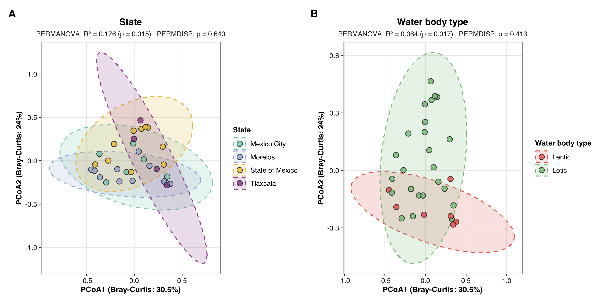<!-- -->

``` r
# ------------------------------------------------------------------------------
# 6. EXPORT OUTPUT FILES
# ------------------------------------------------------------------------------
svglite::svglite("Figure_5.svg", width = 11, height = 5.5)
print(fig5)
dev.off()
```

    ## quartz_off_screen 
    ##                 2

``` r
ggsave("Figure_5.tiff", plot = fig5, width = 11, height = 5.5, dpi = 300, compression = "lzw")
```

------------------------------------------------------------------------

### Module 8. Resistome Beta Diversity and Community Dissimilarity (Figure 6)

This section constructs **Figure 6**, depicting the Principal
Coordinates Analysis (PCoA) of the aquatic resistome based on
Bray-Curtis dissimilarity calculated from RPKG abundance matrices of
antimicrobial resistance genes (ARGs). Panel A evaluates geographic
separation across States, while Panel B compares resistome dissimilarity
between water body types (Lentic vs. Lotic). Statistical significance
and dispersion variance are calculated using PERMANOVA (`adonis2`) and
PERMDISP (`betadisper`).

``` r
# ------------------------------------------------------------------------------
# 1. LOAD DATA & BUILD RESISTOME MATRICES
# ------------------------------------------------------------------------------
arg_df <- read.xlsx("Resistome.xlsx") %>%
  mutate(
    Sample_name   = str_trim(Sample_name),
    Gene          = str_trim(`gene_unif_final_manual`),
    State         = str_trim(State),
    Effluent_type = str_trim(Effluent_type)
  )

arg_abundance_matrix <- arg_df %>%
  group_by(Sample_name, Gene) %>%
  summarise(RPKG = sum(RPKG, na.rm = TRUE), .groups = "drop") %>%
  pivot_wider(names_from = Gene, values_from = RPKG, values_fill = 0)

metadata_arg <- arg_df %>%
  select(Sample_name, State, Effluent_type) %>%
  distinct() %>%
  filter(!is.na(State) & !is.na(Effluent_type) & State != "" & Effluent_type != "")

common_samples <- intersect(arg_abundance_matrix$Sample_name, metadata_arg$Sample_name)

metadata_arg <- metadata_arg %>%
  filter(Sample_name %in% common_samples) %>%
  arrange(match(Sample_name, common_samples))

arg_mat_df <- arg_abundance_matrix %>%
  filter(Sample_name %in% common_samples) %>%
  arrange(match(Sample_name, common_samples))

arg_mat <- as.matrix(arg_mat_df[, -1])
rownames(arg_mat) <- arg_mat_df$Sample_name

arg_dist <- vegdist(arg_mat, method = "bray")

# ------------------------------------------------------------------------------
# 2. PCOA & STATISTICAL TESTS (PERMANOVA & PERMDISP)
# ------------------------------------------------------------------------------
pcoa_res    <- cmdscale(arg_dist, k = 2, eig = TRUE)
pcoa_points <- as.data.frame(pcoa_res$points)
colnames(pcoa_points) <- c("PCoA1", "PCoA2")

var_pcoa1 <- round((pcoa_res$eig[1] / sum(pcoa_res$eig)) * 100, 1)
var_pcoa2 <- round((pcoa_res$eig[2] / sum(pcoa_res$eig)) * 100, 1)

pcoa_data <- cbind(metadata_arg, pcoa_points)

set.seed(123)
perm_state <- adonis2(arg_dist ~ State, data = metadata_arg, permutations = 999)
mod_state  <- betadisper(arg_dist, metadata_arg$State)
disp_state <- permutest(mod_state, permutations = 999)
sub_state  <- paste0("PERMANOVA: R² = ", round(perm_state$R2[1], 3), 
                     " (p = ", sprintf("%.3f", perm_state$`Pr(>F)`[1]), 
                     ") | PERMDISP: p = ", sprintf("%.3f", disp_state$tab$`Pr(>F)`[1]))

set.seed(123)
perm_effluent <- adonis2(arg_dist ~ Effluent_type, data = metadata_arg, permutations = 999)
mod_effluent  <- betadisper(arg_dist, metadata_arg$Effluent_type)
disp_effluent <- permutest(mod_effluent, permutations = 999)
sub_effluent  <- paste0("PERMANOVA: R² = ", round(perm_effluent$R2[1], 3), 
                        " (p = ", sprintf("%.3f", perm_effluent$`Pr(>F)`[1]), 
                        ") | PERMDISP: p = ", sprintf("%.3f", disp_effluent$tab$`Pr(>F)`[1]))

# ------------------------------------------------------------------------------
# 3. PALETTES AND THEME
# ------------------------------------------------------------------------------
state_colors <- c("Mexico City" = "#8BCEBA", "Morelos" = "#A5B6D9", "State of Mexico" = "#EFC24A", "Tlaxcala" = "#9D559E")
wbt_colors   <- c("Lentic" = "#E8685D", "Lotic" = "#86C186")

theme_pcoa <- theme_bw(base_size = 10, base_family = "sans") +
  theme(
    plot.title       = element_text(face = "bold", size = 11, hjust = 0.5),
    plot.subtitle    = element_text(size = 8.5, hjust = 0.5, color = "grey20"),
    axis.title       = element_text(size = 9.5, face = "bold"),
    axis.text        = element_text(size = 8.5, color = "grey10"),
    panel.grid.major = element_line(color = "grey92", linewidth = 0.4),
    panel.grid.minor = element_blank(),
    panel.border     = element_rect(color = "grey50", fill = NA, linewidth = 0.6),
    legend.title     = element_text(size = 9, face = "bold"),
    legend.text      = element_text(size = 8.5)
  )

# ------------------------------------------------------------------------------
# 4. BUILD GGPLOT PANELS & COMBINE
# ------------------------------------------------------------------------------
pA <- ggplot(pcoa_data, aes(x = PCoA1, y = PCoA2, color = State, fill = State)) +
  stat_ellipse(geom = "polygon", alpha = 0.18, level = 0.95, linetype = 2, linewidth = 0.6) +
  geom_point(position = position_jitter(width = 0.015, height = 0.015, seed = 123), 
             size = 3, alpha = 0.85, shape = 21, stroke = 0.6, color = "grey15") +
  scale_color_manual(values = state_colors, name = "State") +
  scale_fill_manual(values = state_colors, name = "State") +
  labs(title = "Resistome by State", subtitle = sub_state, 
       x = paste0("PCoA1 (", var_pcoa1, "%)"), y = paste0("PCoA2 (", var_pcoa2, "%)")) + 
  theme_pcoa

pB <- ggplot(pcoa_data, aes(x = PCoA1, y = PCoA2, color = Effluent_type, fill = Effluent_type)) +
  stat_ellipse(geom = "polygon", alpha = 0.18, level = 0.95, linetype = 2, linewidth = 0.6) +
  geom_point(position = position_jitter(width = 0.015, height = 0.015, seed = 123), 
             size = 3, alpha = 0.85, shape = 21, stroke = 0.6, color = "grey15") +
  scale_color_manual(values = wbt_colors, name = "Water body type") +
  scale_fill_manual(values = wbt_colors, name = "Water body type") +
  labs(title = "Resistome by Water body type", subtitle = sub_effluent, 
       x = paste0("PCoA1 (", var_pcoa1, "%)"), y = paste0("PCoA2 (", var_pcoa2, "%)")) + 
  theme_pcoa

fig6 <- pA + pB + plot_annotation(tag_levels = 'A') & theme(plot.tag = element_text(face = "bold", size = 13))

# Display plot in document output
print(fig6)
```

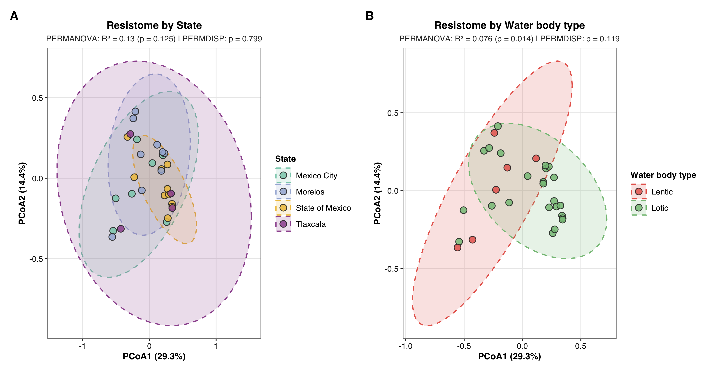<!-- -->

``` r
# ------------------------------------------------------------------------------
# 5. EXPORT HIGH-RESOLUTION FILES & DISPLAY IN PLOTS TAB
# ------------------------------------------------------------------------------
# A. Exportar SVG
svglite::svglite("Figure_6_Resistome_PCoA.svg", width = 10.5, height = 5.5)
print(fig6)
dev.off()
```

    ## quartz_off_screen 
    ##                 2

``` r
# B. Exportar TIFF (300 DPI, compresión LZW)
ggsave("Figure_6_Resistome_PCoA.tiff", plot = fig6, width = 10.5, height = 5.5, dpi = 300, compression = "lzw")

# C. Imprimir AL FINAL para renderizar en la pestaña Plots de RStudio
print(fig6)
```

<!-- -->

------------------------------------------------------------------------

### Module 9. Abundance and Spatial Profiling of Top 50 Antimicrobial Resistance Genes (Figure 7 & Table S7)

This section constructs **Figure 7**, profiling the Top 50 most abundant
antimicrobial resistance genes (ARGs) ranked by total RPKG values and
their spatial detection frequencies across water body types (Lentic
vs. Lotic). Additionally, it generates **Table S7** and **Figure S4**.
Table S7 is a two-tab Excel workbook detailing state-level ARG abundance
metrics (mean RPKG, standard deviation, detection frequency) and global
cumulative resistome contribution rankings. Figure S4 presents the
spatial profiling of the top 50 AMR genes.

``` r
# ------------------------------------------------------------------------------
# 1. LOAD RESISTOME DATA & CALCULATE GLOBAL METRICS
# ------------------------------------------------------------------------------
arg_df_raw <- read.xlsx("Resistome.xlsx") %>%
  mutate(
    Sample_name   = str_trim(Sample_name),
    Gene          = str_trim(`gene_unif_final_manual`),
    Class         = str_trim(refined_class),
    State         = str_trim(State),
    Effluent_type = str_trim(Effluent_type),
    RPKG          = as.numeric(RPKG)
  )

# Calculate global resistome sum
total_resistome_rpkg <- sum(arg_df_raw$RPKG, na.rm = TRUE)

# ------------------------------------------------------------------------------
# 2. CALCULATE RESISTOME CONTRIBUTION (%) BY WATER BODY TYPE
# ------------------------------------------------------------------------------
water_body_totals <- arg_df_raw %>%
  filter(Sample_name != "MOR10") %>%
  group_by(Effluent_type) %>%
  summarise(
    Sum_RPKG = sum(RPKG, na.rm = TRUE),
    Sample_N = n_distinct(Sample_name),
    .groups = "drop"
  ) %>%
  mutate(
    Pct_Resistome = (Sum_RPKG / total_resistome_rpkg) * 100,
    Water_Body_Label = sprintf("%s\n(n=%d; %.1f%%)", Effluent_type, Sample_N, Pct_Resistome)
  )

water_body_labels <- setNames(water_body_totals$Water_Body_Label, water_body_totals$Effluent_type)
water_body_counts <- setNames(water_body_totals$Sample_N, water_body_totals$Effluent_type)

lotic_label  <- water_body_labels["Lotic"]
lentic_label <- water_body_labels["Lentic"]
ordered_water_levels <- c(lotic_label, lentic_label)

# ------------------------------------------------------------------------------
# 3. DEFINE STATE DENOMINATORS & LABELS
# ------------------------------------------------------------------------------
state_counts <- c(
  "Mexico City"     = 7,
  "Morelos"         = 9,
  "State of Mexico" = 10,
  "Tlaxcala"        = 4
)

state_labels <- c(
  "Mexico City"     = "Mexico City\n(n=7)",
  "Morelos"         = "Morelos\n(n=9)",
  "State of Mexico" = "State of Mexico\n(n=10)",
  "Tlaxcala"        = "Tlaxcala\n(n=4)"
)

arg_df <- arg_df_raw %>%
  mutate(
    Water_Body_Label = water_body_labels[Effluent_type],
    Water_Body_Label = factor(Water_Body_Label, levels = ordered_water_levels),
    State_Label      = state_labels[State],
    State_Label      = factor(State_Label, levels = unname(state_labels)),
    Class_clean      = str_replace_all(Class, "(?i)\\s*resistance|\\s*resistant", ""),
    Class_clean      = str_wrap(Class_clean, width = 22)
  )

# ------------------------------------------------------------------------------
# 4. AUDIT TOP 50 ARGs & EXPORT SUMMARY TABLES
# ------------------------------------------------------------------------------
sample_level_args <- arg_df %>%
  group_by(Sample_name, State, State_Label, Effluent_type, Water_Body_Label, Class_clean, Gene) %>%
  summarise(RPKG_Sample = sum(RPKG, na.rm = TRUE), .groups = "drop")

top50_summary <- sample_level_args %>%
  group_by(Gene, Class_clean) %>%
  summarise(
    Total_RPKG = sum(RPKG_Sample, na.rm = TRUE),
    Mean_RPKG  = mean(RPKG_Sample, na.rm = TRUE),
    .groups = "drop"
  ) %>%
  slice_max(order_by = Total_RPKG, n = 50) %>%
  arrange(desc(Total_RPKG)) %>%
  mutate(
    Percentage_of_Total_RPKG = (Total_RPKG / total_resistome_rpkg) * 100,
    Cumulative_Percentage    = cumsum(Percentage_of_Total_RPKG)
  )

write.xlsx(top50_summary, "Table_Figure_6_Top50_ARG_Abundance.xlsx")
write.csv(top50_summary, "Table_Figure_6_Top50_ARG_Abundance.csv", row.names = FALSE)

# ------------------------------------------------------------------------------
# 5. CLASS PERCENTAGES AND HTML FORMATTING FUNCTION
# ------------------------------------------------------------------------------
class_subtotals <- arg_df %>%
  group_by(Class_clean) %>%
  summarise(Class_Total_RPKG = sum(RPKG, na.rm = TRUE), .groups = "drop") %>%
  mutate(
    Class_Pct = (Class_Total_RPKG / total_resistome_rpkg) * 100,
    Class_label = paste0("<span style='font-size:10.5pt;'><b>", Class_clean, "</b></span><br><span style='font-size:8.5pt;color:#222222;'>(" , sprintf("%.1f", Class_Pct), "%)</span>")
  ) %>%
  arrange(desc(Class_Total_RPKG))

class_label_order <- class_subtotals$Class_label
top_args <- top50_summary$Gene

format_gene_exact <- function(gene) {
  case_when(
    gene == "blaICR"    ~ "<i>bla</i><sub>ICR</sub>",
    gene == "blaOXA-2"  ~ "<i>bla</i><sub>OXA-2</sub>",
    gene == "blaOXA"    ~ "<i>bla</i><sub>OXA</sub>",
    gene == "blaGES-1"  ~ "<i>bla</i><sub>GES-1</sub>",
    gene == "blaOXA-10" ~ "<i>bla</i><sub>OXA-10</sub>",
    
    gene == "qacEdelta1"     ~ "<i>qacEdelta1</i>",
    gene == "AAC(6')-Ib-CR"  ~ "<i>aac(6')-Ib-cr</i>",
    gene == "ANT(3'')"       ~ "<i>ant(3'')</i>",
    gene == "APH(6)-Id"      ~ "<i>aph(6)-Id</i>",
    gene == "APH(3'')-Ib"     ~ "<i>aph(3'')-Ib</i>",
    gene == "APH(3'')-III"    ~ "<i>aph(3'')-III</i>",
    gene == "AAC(6')"         ~ "<i>aac(6')</i>",
    
    gene %in% c("qnrB19-1", "qnrb19-1", "QnrB19-1") ~ "<i>qnrB19-1</i>",
    gene %in% c("qnrVC", "qnrvc", "QnrVC")         ~ "<i>qnrVC</i>",
    gene %in% c("qnrS", "qnrs", "QnrS")             ~ "<i>qnrS</i>",
    gene %in% c("tet(C)", "tet(c)", "Tet(C)")       ~ "<i>tet(C)</i>",
    gene %in% c("tet(E)", "tet(e)", "Tet(E)")       ~ "<i>tet(E)</i>",
    gene %in% c("tet(39)", "tet(39)")               ~ "<i>tet(39)</i>",
    
    gene %in% c("mtrA", "mtra", "MtrA")             ~ "<i>mtrA</i>",
    gene %in% c("dfrA", "dfra", "DfrA")             ~ "<i>dfrA</i>",
    gene %in% c("rbpA", "rbpa", "RbpA")             ~ "<i>rbpA</i>",
    gene %in% c("msrE", "msre", "MsrE")             ~ "<i>msrE</i>",
    gene %in% c("mphE-1", "mphe-1")                 ~ "<i>mphE-1</i>",
    gene %in% c("mphA", "mpha")                     ~ "<i>mphA</i>",
    gene %in% c("ermB", "ermb")                     ~ "<i>ermB</i>",
    gene %in% c("cmlA5", "cmla5")                   ~ "<i>cmlA5</i>",
    gene %in% c("catB3", "catb3")                   ~ "<i>catB3</i>",
    gene %in% c("mexT", "mext", "MexT")             ~ "<i>mexT</i>",
    
    TRUE ~ paste0("<i>", gene, "</i>")
  )
}

# ------------------------------------------------------------------------------
# 6. BUILD FIGURE 7 (WATER BODY TYPE: LOTIC VS LENTIC WITH %)
# ------------------------------------------------------------------------------
arg_profile_water <- sample_level_args %>%
  filter(Gene %in% top_args) %>%
  left_join(class_subtotals, by = "Class_clean") %>%
  mutate(Class_label = factor(Class_label, levels = class_label_order)) %>%
  group_by(Class_label, Gene, Effluent_type, Water_Body_Label) %>%
  summarise(
    Mean_RPKG      = mean(RPKG_Sample, na.rm = TRUE),
    Detection_Freq = (sum(RPKG_Sample > 0) / water_body_counts[unique(Effluent_type)]) * 100,
    .groups = "drop"
  ) %>%
  filter(!is.na(Water_Body_Label) & Detection_Freq > 0) %>%
  mutate(Gene_formatted = format_gene_exact(Gene))

fig7 <- ggplot(arg_profile_water, aes(x = Water_Body_Label, y = reorder(Gene_formatted, Mean_RPKG))) +
  geom_point(
    aes(size = Detection_Freq, fill = Mean_RPKG), 
    shape = 21, color = "grey15", stroke = 0.5
  ) +
  facet_nested(
    Class_label ~ ., 
    scales = "free_y", space = "free_y", switch = "y",
    nest_line = element_line(color = "grey50", linewidth = 0.5),
    strip = strip_nested(
      text_y = list(element_markdown(angle = 0, color = "black")),
      background_y = list(element_blank())
    )
  ) +
  scale_fill_gradientn(
    colors = c("#ffffe5", "#fff7bc", "#fec44f", "#fe9929", "#cc4c02", "#8c2d04"),
    name = "Mean RPKG"
  ) +
  scale_size_continuous(
    range = c(2.5, 7.0),
    limits = c(0, 100),
    breaks = c(25, 50, 75, 100),
    labels = c("25%", "50%", "75%", "100%"),
    name = "Detection\nfrequency (%)"
  ) +
  theme_bw(base_size = 10, base_family = "sans") +
  theme(
    axis.title = element_blank(),
    axis.text.x = element_text(angle = 0, hjust = 0.5, size = 10.5, face = "bold", color = "black"),
    axis.text.y = element_markdown(size = 9.0, color = "black"),
    strip.placement = "outside",
    strip.background = element_blank(),
    panel.grid.major = element_line(color = "grey92", linewidth = 0.4),
    panel.grid.minor = element_blank(),
    panel.border = element_rect(color = "grey50", fill = NA, linewidth = 0.6),
    legend.title = element_text(size = 9.5, face = "bold"),
    legend.text = element_text(size = 9.0),
    legend.position = "right"
  )

# Display plot in document output
print(fig7)
```

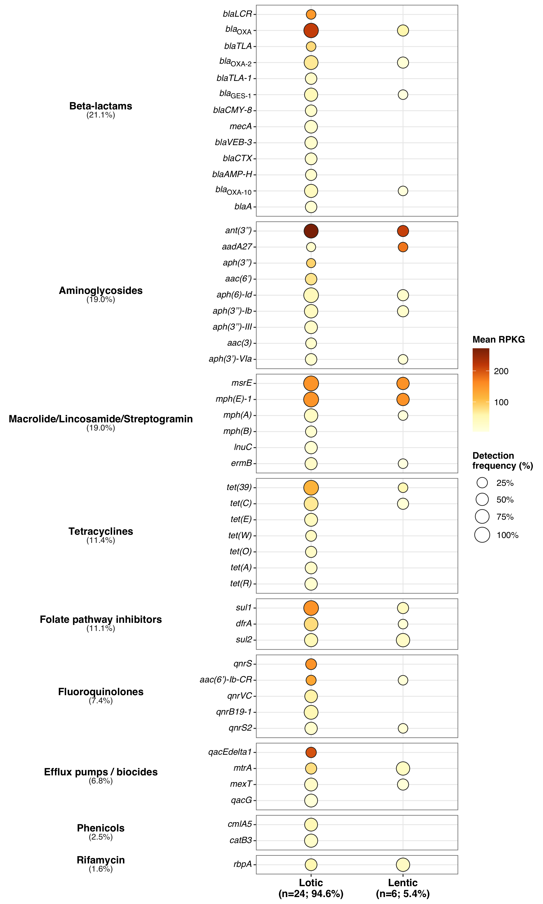<!-- -->

``` r
# Export Figure 7
svglite::svglite("Figure_7_Resistome_Profile_Lentic_vs_Lotic_Pct.svg", width = 7.8, height = 13.0)
print(fig7)
dev.off()
```

    ## quartz_off_screen 
    ##                 2

``` r
ggsave("Figure_7_Resistome_Profile_Lentic_vs_Lotic_Pct.tiff", plot = fig7, width = 7.8, height = 13.0, dpi = 300, compression = "lzw")

# ------------------------------------------------------------------------------
# 7. GENERATE TABLE S8 (UNIQUE ARGS RANKED BY TOTAL RPKG & CONTRIBUTION)
# ------------------------------------------------------------------------------
clean_args_s8 <- arg_df_raw %>%
  mutate(
    Drug_Class  = str_trim(refined_class),
    ARG_Gene    = str_trim(`gene_unif_final_manual`)
  )

sample_level_args_s8 <- clean_args_s8 %>%
  group_by(Sample_name, Drug_Class, ARG_Gene) %>%
  summarise(RPKG_Sample = sum(RPKG, na.rm = TRUE), .groups = "drop")

all_samples_s8 <- clean_args_s8 %>% select(Sample_name) %>% distinct()
unique_arg_pairs_s8 <- clean_args_s8 %>% select(Drug_Class, ARG_Gene) %>% distinct()

full_grid_s8 <- expand.grid(
  Sample_name = all_samples_s8$Sample_name,
  ARG_Gene    = unique_arg_pairs_s8$ARG_Gene,
  stringsAsFactors = FALSE
) %>%
  left_join(all_samples_s8, by = "Sample_name") %>%
  left_join(unique_arg_pairs_s8, by = "ARG_Gene") %>%
  left_join(sample_level_args_s8, by = c("Sample_name", "Drug_Class", "ARG_Gene")) %>%
  mutate(RPKG_Sample = ifelse(is.na(RPKG_Sample), 0, RPKG_Sample))

# Single table with unique ARGs ranked by global contribution
table_s8_unique <- full_grid_s8 %>%
  group_by(Drug_Class, ARG_Gene) %>%
  summarise(
    Samples_Detected_Global = sum(RPKG_Sample > 0),
    Total_RPKG              = sum(RPKG_Sample),
    Mean_RPKG               = mean(RPKG_Sample),
    .groups                 = "drop"
  ) %>%
  arrange(desc(Total_RPKG)) %>%
  mutate(
    Rank                        = row_number(),
    Global_Resistome_Total      = sum(Total_RPKG, na.rm = TRUE),
    RPKG_Contribution_Pct       = (Total_RPKG / Global_Resistome_Total) * 100,
    Cumulative_RPKG             = cumsum(Total_RPKG),
    Cumulative_Contribution_Pct = cumsum(RPKG_Contribution_Pct)
  ) %>%
  select(
    Rank,
    `Drug Class`                = Drug_Class,
    `ARG Gene`                  = ARG_Gene,
    `Samples Detected (Global)` = Samples_Detected_Global,
    `Total RPKG`                = Total_RPKG,
    `Contribution (%)`          = RPKG_Contribution_Pct,
    `Cumulative RPKG`           = Cumulative_RPKG,
    `Cumulative Contribution (%)` = Cumulative_Contribution_Pct
  ) %>%
  mutate(
    `Total RPKG`                = round(`Total RPKG`, 2),
    `Contribution (%)`          = round(`Contribution (%)`, 2),
    `Cumulative RPKG`           = round(`Cumulative RPKG`, 2),
    `Cumulative Contribution (%)` = round(`Cumulative Contribution (%)`, 2)
  )

# Export workbook with a single clean worksheet
wb_s8 <- createWorkbook()
addWorksheet(wb_s8, "Table_S8_Unique_ARGs")
writeData(wb_s8, "Table_S8_Unique_ARGs", table_s8_unique)
saveWorkbook(wb_s8, "Table_S8_ARG_Profiles_RPKG.xlsx", overwrite = TRUE)

cat("-> Table_S8_ARG_Profiles_RPKG.xlsx generated successfully with a single focused worksheet!\n")
```

    ## -> Table_S8_ARG_Profiles_RPKG.xlsx generated successfully with a single focused worksheet!

``` r
# ------------------------------------------------------------------------------
# 8. Render/Print the table visually in the HTML report
# ------------------------------------------------------------------------------
kable(table_s8_unique, 
      format = "html", 
      caption = "Table S8. Relative contribution of the 203 unique antimicrobial resistance genes to the total resistome abundance (RPKG-normalized).") %>%
  kable_styling(bootstrap_options = c("striped", "hover", "condensed", "responsive"), 
                full_width = FALSE,
                position = "center")
```

<table class="table table-striped table-hover table-condensed table-responsive" style="width: auto !important; margin-left: auto; margin-right: auto;">
<caption>
Table S8. Relative contribution of the 203 unique antimicrobial
resistance genes to the total resistome abundance (RPKG-normalized).
</caption>
<thead>
<tr>
<th style="text-align:right;">
Rank
</th>
<th style="text-align:left;">
Drug Class
</th>
<th style="text-align:left;">
ARG Gene
</th>
<th style="text-align:right;">
Samples Detected (Global)
</th>
<th style="text-align:right;">
Total RPKG
</th>
<th style="text-align:right;">
Contribution (%)
</th>
<th style="text-align:right;">
Cumulative RPKG
</th>
<th style="text-align:right;">
Cumulative Contribution (%)
</th>
</tr>
</thead>
<tbody>
<tr>
<td style="text-align:right;">
1
</td>
<td style="text-align:left;">
Aminoglycosides
</td>
<td style="text-align:left;">
ant(3’’)
</td>
<td style="text-align:right;">
21
</td>
<td style="text-align:right;">
5598.91
</td>
<td style="text-align:right;">
10.73
</td>
<td style="text-align:right;">
5598.91
</td>
<td style="text-align:right;">
10.73
</td>
</tr>
<tr>
<td style="text-align:right;">
2
</td>
<td style="text-align:left;">
Beta-lactams
</td>
<td style="text-align:left;">
blaOXA
</td>
<td style="text-align:right;">
23
</td>
<td style="text-align:right;">
4639.97
</td>
<td style="text-align:right;">
8.89
</td>
<td style="text-align:right;">
10238.88
</td>
<td style="text-align:right;">
19.63
</td>
</tr>
<tr>
<td style="text-align:right;">
3
</td>
<td style="text-align:left;">
Macrolide/Lincosamide/Streptogramin
</td>
<td style="text-align:left;">
mph(E)-1
</td>
<td style="text-align:right;">
26
</td>
<td style="text-align:right;">
3916.88
</td>
<td style="text-align:right;">
7.51
</td>
<td style="text-align:right;">
14155.76
</td>
<td style="text-align:right;">
27.13
</td>
</tr>
<tr>
<td style="text-align:right;">
4
</td>
<td style="text-align:left;">
Macrolide/Lincosamide/Streptogramin
</td>
<td style="text-align:left;">
msrE
</td>
<td style="text-align:right;">
26
</td>
<td style="text-align:right;">
3916.88
</td>
<td style="text-align:right;">
7.51
</td>
<td style="text-align:right;">
18072.63
</td>
<td style="text-align:right;">
34.64
</td>
</tr>
<tr>
<td style="text-align:right;">
5
</td>
<td style="text-align:left;">
Folate pathway inhibitors
</td>
<td style="text-align:left;">
sul1
</td>
<td style="text-align:right;">
24
</td>
<td style="text-align:right;">
3419.09
</td>
<td style="text-align:right;">
6.55
</td>
<td style="text-align:right;">
21491.73
</td>
<td style="text-align:right;">
41.19
</td>
</tr>
<tr>
<td style="text-align:right;">
6
</td>
<td style="text-align:left;">
Tetracyclines
</td>
<td style="text-align:left;">
tet(39)
</td>
<td style="text-align:right;">
23
</td>
<td style="text-align:right;">
2651.69
</td>
<td style="text-align:right;">
5.08
</td>
<td style="text-align:right;">
24143.42
</td>
<td style="text-align:right;">
46.28
</td>
</tr>
<tr>
<td style="text-align:right;">
7
</td>
<td style="text-align:left;">
Folate pathway inhibitors
</td>
<td style="text-align:left;">
dfrA
</td>
<td style="text-align:right;">
18
</td>
<td style="text-align:right;">
1384.33
</td>
<td style="text-align:right;">
2.65
</td>
<td style="text-align:right;">
25527.75
</td>
<td style="text-align:right;">
48.93
</td>
</tr>
<tr>
<td style="text-align:right;">
8
</td>
<td style="text-align:left;">
Tetracyclines
</td>
<td style="text-align:left;">
tet(C)
</td>
<td style="text-align:right;">
20
</td>
<td style="text-align:right;">
1271.12
</td>
<td style="text-align:right;">
2.44
</td>
<td style="text-align:right;">
26798.87
</td>
<td style="text-align:right;">
51.37
</td>
</tr>
<tr>
<td style="text-align:right;">
9
</td>
<td style="text-align:left;">
Beta-lactams
</td>
<td style="text-align:left;">
blaOXA-2
</td>
<td style="text-align:right;">
20
</td>
<td style="text-align:right;">
1270.05
</td>
<td style="text-align:right;">
2.43
</td>
<td style="text-align:right;">
28068.92
</td>
<td style="text-align:right;">
53.80
</td>
</tr>
<tr>
<td style="text-align:right;">
10
</td>
<td style="text-align:left;">
Efflux pumps / biocides
</td>
<td style="text-align:left;">
qacEdelta1
</td>
<td style="text-align:right;">
6
</td>
<td style="text-align:right;">
1201.02
</td>
<td style="text-align:right;">
2.30
</td>
<td style="text-align:right;">
29269.94
</td>
<td style="text-align:right;">
56.10
</td>
</tr>
<tr>
<td style="text-align:right;">
11
</td>
<td style="text-align:left;">
Fluoroquinolones
</td>
<td style="text-align:left;">
qnrS
</td>
<td style="text-align:right;">
7
</td>
<td style="text-align:right;">
1063.39
</td>
<td style="text-align:right;">
2.04
</td>
<td style="text-align:right;">
30333.33
</td>
<td style="text-align:right;">
58.14
</td>
</tr>
<tr>
<td style="text-align:right;">
12
</td>
<td style="text-align:left;">
Aminoglycosides
</td>
<td style="text-align:left;">
aph(6)-Id
</td>
<td style="text-align:right;">
24
</td>
<td style="text-align:right;">
1025.70
</td>
<td style="text-align:right;">
1.97
</td>
<td style="text-align:right;">
31359.04
</td>
<td style="text-align:right;">
60.11
</td>
</tr>
<tr>
<td style="text-align:right;">
13
</td>
<td style="text-align:left;">
Fluoroquinolones
</td>
<td style="text-align:left;">
qnrB19-1
</td>
<td style="text-align:right;">
18
</td>
<td style="text-align:right;">
911.07
</td>
<td style="text-align:right;">
1.75
</td>
<td style="text-align:right;">
32270.10
</td>
<td style="text-align:right;">
61.85
</td>
</tr>
<tr>
<td style="text-align:right;">
14
</td>
<td style="text-align:left;">
Folate pathway inhibitors
</td>
<td style="text-align:left;">
sul2
</td>
<td style="text-align:right;">
19
</td>
<td style="text-align:right;">
834.71
</td>
<td style="text-align:right;">
1.60
</td>
<td style="text-align:right;">
33104.82
</td>
<td style="text-align:right;">
63.45
</td>
</tr>
<tr>
<td style="text-align:right;">
15
</td>
<td style="text-align:left;">
Fluoroquinolones
</td>
<td style="text-align:left;">
qnrVC
</td>
<td style="text-align:right;">
13
</td>
<td style="text-align:right;">
793.02
</td>
<td style="text-align:right;">
1.52
</td>
<td style="text-align:right;">
33897.83
</td>
<td style="text-align:right;">
64.97
</td>
</tr>
<tr>
<td style="text-align:right;">
16
</td>
<td style="text-align:left;">
Efflux pumps / biocides
</td>
<td style="text-align:left;">
mtrA
</td>
<td style="text-align:right;">
12
</td>
<td style="text-align:right;">
770.88
</td>
<td style="text-align:right;">
1.48
</td>
<td style="text-align:right;">
34668.71
</td>
<td style="text-align:right;">
66.45
</td>
</tr>
<tr>
<td style="text-align:right;">
17
</td>
<td style="text-align:left;">
Beta-lactams
</td>
<td style="text-align:left;">
blaGES-1
</td>
<td style="text-align:right;">
16
</td>
<td style="text-align:right;">
703.30
</td>
<td style="text-align:right;">
1.35
</td>
<td style="text-align:right;">
35372.01
</td>
<td style="text-align:right;">
67.80
</td>
</tr>
<tr>
<td style="text-align:right;">
18
</td>
<td style="text-align:left;">
Phenicols
</td>
<td style="text-align:left;">
cmlA5
</td>
<td style="text-align:right;">
14
</td>
<td style="text-align:right;">
682.94
</td>
<td style="text-align:right;">
1.31
</td>
<td style="text-align:right;">
36054.95
</td>
<td style="text-align:right;">
69.11
</td>
</tr>
<tr>
<td style="text-align:right;">
19
</td>
<td style="text-align:left;">
Rifamycin
</td>
<td style="text-align:left;">
rbpA
</td>
<td style="text-align:right;">
14
</td>
<td style="text-align:right;">
676.57
</td>
<td style="text-align:right;">
1.30
</td>
<td style="text-align:right;">
36731.52
</td>
<td style="text-align:right;">
70.40
</td>
</tr>
<tr>
<td style="text-align:right;">
20
</td>
<td style="text-align:left;">
Fluoroquinolones
</td>
<td style="text-align:left;">
aac(6’)-Ib-CR
</td>
<td style="text-align:right;">
6
</td>
<td style="text-align:right;">
670.92
</td>
<td style="text-align:right;">
1.29
</td>
<td style="text-align:right;">
37402.44
</td>
<td style="text-align:right;">
71.69
</td>
</tr>
<tr>
<td style="text-align:right;">
21
</td>
<td style="text-align:left;">
Aminoglycosides
</td>
<td style="text-align:left;">
aac(6’)
</td>
<td style="text-align:right;">
9
</td>
<td style="text-align:right;">
661.07
</td>
<td style="text-align:right;">
1.27
</td>
<td style="text-align:right;">
38063.51
</td>
<td style="text-align:right;">
72.96
</td>
</tr>
<tr>
<td style="text-align:right;">
22
</td>
<td style="text-align:left;">
Aminoglycosides
</td>
<td style="text-align:left;">
aph(3’’)-Ib
</td>
<td style="text-align:right;">
18
</td>
<td style="text-align:right;">
642.11
</td>
<td style="text-align:right;">
1.23
</td>
<td style="text-align:right;">
38705.62
</td>
<td style="text-align:right;">
74.19
</td>
</tr>
<tr>
<td style="text-align:right;">
23
</td>
<td style="text-align:left;">
Beta-lactams
</td>
<td style="text-align:left;">
blaLCR
</td>
<td style="text-align:right;">
4
</td>
<td style="text-align:right;">
583.42
</td>
<td style="text-align:right;">
1.12
</td>
<td style="text-align:right;">
39289.04
</td>
<td style="text-align:right;">
75.31
</td>
</tr>
<tr>
<td style="text-align:right;">
24
</td>
<td style="text-align:left;">
Beta-lactams
</td>
<td style="text-align:left;">
blaOXA-10
</td>
<td style="text-align:right;">
16
</td>
<td style="text-align:right;">
575.99
</td>
<td style="text-align:right;">
1.10
</td>
<td style="text-align:right;">
39865.03
</td>
<td style="text-align:right;">
76.41
</td>
</tr>
<tr>
<td style="text-align:right;">
25
</td>
<td style="text-align:left;">
Tetracyclines
</td>
<td style="text-align:left;">
tet(E)
</td>
<td style="text-align:right;">
14
</td>
<td style="text-align:right;">
538.65
</td>
<td style="text-align:right;">
1.03
</td>
<td style="text-align:right;">
40403.67
</td>
<td style="text-align:right;">
77.44
</td>
</tr>
<tr>
<td style="text-align:right;">
26
</td>
<td style="text-align:left;">
Macrolide/Lincosamide/Streptogramin
</td>
<td style="text-align:left;">
mph(A)
</td>
<td style="text-align:right;">
17
</td>
<td style="text-align:right;">
535.89
</td>
<td style="text-align:right;">
1.03
</td>
<td style="text-align:right;">
40939.57
</td>
<td style="text-align:right;">
78.47
</td>
</tr>
<tr>
<td style="text-align:right;">
27
</td>
<td style="text-align:left;">
Efflux pumps / biocides
</td>
<td style="text-align:left;">
mexT
</td>
<td style="text-align:right;">
16
</td>
<td style="text-align:right;">
428.26
</td>
<td style="text-align:right;">
0.82
</td>
<td style="text-align:right;">
41367.83
</td>
<td style="text-align:right;">
79.29
</td>
</tr>
<tr>
<td style="text-align:right;">
28
</td>
<td style="text-align:left;">
Phenicols
</td>
<td style="text-align:left;">
catB3
</td>
<td style="text-align:right;">
15
</td>
<td style="text-align:right;">
391.51
</td>
<td style="text-align:right;">
0.75
</td>
<td style="text-align:right;">
41759.34
</td>
<td style="text-align:right;">
80.04
</td>
</tr>
<tr>
<td style="text-align:right;">
29
</td>
<td style="text-align:left;">
Aminoglycosides
</td>
<td style="text-align:left;">
aph(3’’)-III
</td>
<td style="text-align:right;">
13
</td>
<td style="text-align:right;">
387.02
</td>
<td style="text-align:right;">
0.74
</td>
<td style="text-align:right;">
42146.36
</td>
<td style="text-align:right;">
80.78
</td>
</tr>
<tr>
<td style="text-align:right;">
30
</td>
<td style="text-align:left;">
Macrolide/Lincosamide/Streptogramin
</td>
<td style="text-align:left;">
ermB
</td>
<td style="text-align:right;">
12
</td>
<td style="text-align:right;">
328.97
</td>
<td style="text-align:right;">
0.63
</td>
<td style="text-align:right;">
42475.33
</td>
<td style="text-align:right;">
81.41
</td>
</tr>
<tr>
<td style="text-align:right;">
31
</td>
<td style="text-align:left;">
Beta-lactams
</td>
<td style="text-align:left;">
blaTLA
</td>
<td style="text-align:right;">
4
</td>
<td style="text-align:right;">
327.67
</td>
<td style="text-align:right;">
0.63
</td>
<td style="text-align:right;">
42803.00
</td>
<td style="text-align:right;">
82.04
</td>
</tr>
<tr>
<td style="text-align:right;">
32
</td>
<td style="text-align:left;">
Fluoroquinolones
</td>
<td style="text-align:left;">
qnrS2
</td>
<td style="text-align:right;">
13
</td>
<td style="text-align:right;">
310.99
</td>
<td style="text-align:right;">
0.60
</td>
<td style="text-align:right;">
43113.99
</td>
<td style="text-align:right;">
82.64
</td>
</tr>
<tr>
<td style="text-align:right;">
33
</td>
<td style="text-align:left;">
Beta-lactams
</td>
<td style="text-align:left;">
mecA
</td>
<td style="text-align:right;">
13
</td>
<td style="text-align:right;">
309.58
</td>
<td style="text-align:right;">
0.59
</td>
<td style="text-align:right;">
43423.57
</td>
<td style="text-align:right;">
83.23
</td>
</tr>
<tr>
<td style="text-align:right;">
34
</td>
<td style="text-align:left;">
Beta-lactams
</td>
<td style="text-align:left;">
blaVEB-3
</td>
<td style="text-align:right;">
12
</td>
<td style="text-align:right;">
281.58
</td>
<td style="text-align:right;">
0.54
</td>
<td style="text-align:right;">
43705.15
</td>
<td style="text-align:right;">
83.77
</td>
</tr>
<tr>
<td style="text-align:right;">
35
</td>
<td style="text-align:left;">
Tetracyclines
</td>
<td style="text-align:left;">
tet(A)
</td>
<td style="text-align:right;">
10
</td>
<td style="text-align:right;">
280.81
</td>
<td style="text-align:right;">
0.54
</td>
<td style="text-align:right;">
43985.96
</td>
<td style="text-align:right;">
84.31
</td>
</tr>
<tr>
<td style="text-align:right;">
36
</td>
<td style="text-align:left;">
Aminoglycosides
</td>
<td style="text-align:left;">
aph(3’’)
</td>
<td style="text-align:right;">
3
</td>
<td style="text-align:right;">
265.09
</td>
<td style="text-align:right;">
0.51
</td>
<td style="text-align:right;">
44251.05
</td>
<td style="text-align:right;">
84.82
</td>
</tr>
<tr>
<td style="text-align:right;">
37
</td>
<td style="text-align:left;">
Beta-lactams
</td>
<td style="text-align:left;">
blaTLA-1
</td>
<td style="text-align:right;">
9
</td>
<td style="text-align:right;">
253.59
</td>
<td style="text-align:right;">
0.49
</td>
<td style="text-align:right;">
44504.64
</td>
<td style="text-align:right;">
85.30
</td>
</tr>
<tr>
<td style="text-align:right;">
38
</td>
<td style="text-align:left;">
Tetracyclines
</td>
<td style="text-align:left;">
tet(W)
</td>
<td style="text-align:right;">
7
</td>
<td style="text-align:right;">
251.91
</td>
<td style="text-align:right;">
0.48
</td>
<td style="text-align:right;">
44756.55
</td>
<td style="text-align:right;">
85.79
</td>
</tr>
<tr>
<td style="text-align:right;">
39
</td>
<td style="text-align:left;">
Aminoglycosides
</td>
<td style="text-align:left;">
aadA27
</td>
<td style="text-align:right;">
4
</td>
<td style="text-align:right;">
248.86
</td>
<td style="text-align:right;">
0.48
</td>
<td style="text-align:right;">
45005.41
</td>
<td style="text-align:right;">
86.26
</td>
</tr>
<tr>
<td style="text-align:right;">
40
</td>
<td style="text-align:left;">
Tetracyclines
</td>
<td style="text-align:left;">
tet(O)
</td>
<td style="text-align:right;">
8
</td>
<td style="text-align:right;">
245.22
</td>
<td style="text-align:right;">
0.47
</td>
<td style="text-align:right;">
45250.64
</td>
<td style="text-align:right;">
86.73
</td>
</tr>
<tr>
<td style="text-align:right;">
41
</td>
<td style="text-align:left;">
Tetracyclines
</td>
<td style="text-align:left;">
tet(R)
</td>
<td style="text-align:right;">
12
</td>
<td style="text-align:right;">
244.18
</td>
<td style="text-align:right;">
0.47
</td>
<td style="text-align:right;">
45494.81
</td>
<td style="text-align:right;">
87.20
</td>
</tr>
<tr>
<td style="text-align:right;">
42
</td>
<td style="text-align:left;">
Beta-lactams
</td>
<td style="text-align:left;">
blaCTX
</td>
<td style="text-align:right;">
10
</td>
<td style="text-align:right;">
230.76
</td>
<td style="text-align:right;">
0.44
</td>
<td style="text-align:right;">
45725.57
</td>
<td style="text-align:right;">
87.64
</td>
</tr>
<tr>
<td style="text-align:right;">
43
</td>
<td style="text-align:left;">
Beta-lactams
</td>
<td style="text-align:left;">
blaCMY-8
</td>
<td style="text-align:right;">
9
</td>
<td style="text-align:right;">
230.06
</td>
<td style="text-align:right;">
0.44
</td>
<td style="text-align:right;">
45955.63
</td>
<td style="text-align:right;">
88.08
</td>
</tr>
<tr>
<td style="text-align:right;">
44
</td>
<td style="text-align:left;">
Macrolide/Lincosamide/Streptogramin
</td>
<td style="text-align:left;">
lnuC
</td>
<td style="text-align:right;">
12
</td>
<td style="text-align:right;">
227.30
</td>
<td style="text-align:right;">
0.44
</td>
<td style="text-align:right;">
46182.93
</td>
<td style="text-align:right;">
88.52
</td>
</tr>
<tr>
<td style="text-align:right;">
45
</td>
<td style="text-align:left;">
Efflux pumps / biocides
</td>
<td style="text-align:left;">
floR
</td>
<td style="text-align:right;">
14
</td>
<td style="text-align:right;">
199.70
</td>
<td style="text-align:right;">
0.38
</td>
<td style="text-align:right;">
46382.63
</td>
<td style="text-align:right;">
88.90
</td>
</tr>
<tr>
<td style="text-align:right;">
46
</td>
<td style="text-align:left;">
Aminoglycosides
</td>
<td style="text-align:left;">
aph(3’)-VIa
</td>
<td style="text-align:right;">
10
</td>
<td style="text-align:right;">
195.35
</td>
<td style="text-align:right;">
0.37
</td>
<td style="text-align:right;">
46577.97
</td>
<td style="text-align:right;">
89.28
</td>
</tr>
<tr>
<td style="text-align:right;">
47
</td>
<td style="text-align:left;">
Beta-lactams
</td>
<td style="text-align:left;">
blaAMP-H
</td>
<td style="text-align:right;">
8
</td>
<td style="text-align:right;">
182.68
</td>
<td style="text-align:right;">
0.35
</td>
<td style="text-align:right;">
46760.66
</td>
<td style="text-align:right;">
89.63
</td>
</tr>
<tr>
<td style="text-align:right;">
48
</td>
<td style="text-align:left;">
Aminoglycosides
</td>
<td style="text-align:left;">
aac(3)
</td>
<td style="text-align:right;">
7
</td>
<td style="text-align:right;">
170.69
</td>
<td style="text-align:right;">
0.33
</td>
<td style="text-align:right;">
46931.34
</td>
<td style="text-align:right;">
89.95
</td>
</tr>
<tr>
<td style="text-align:right;">
49
</td>
<td style="text-align:left;">
Efflux pumps / biocides
</td>
<td style="text-align:left;">
qacG
</td>
<td style="text-align:right;">
14
</td>
<td style="text-align:right;">
169.30
</td>
<td style="text-align:right;">
0.32
</td>
<td style="text-align:right;">
47100.65
</td>
<td style="text-align:right;">
90.28
</td>
</tr>
<tr>
<td style="text-align:right;">
50
</td>
<td style="text-align:left;">
Beta-lactams
</td>
<td style="text-align:left;">
blaA
</td>
<td style="text-align:right;">
9
</td>
<td style="text-align:right;">
167.00
</td>
<td style="text-align:right;">
0.32
</td>
<td style="text-align:right;">
47267.64
</td>
<td style="text-align:right;">
90.60
</td>
</tr>
<tr>
<td style="text-align:right;">
51
</td>
<td style="text-align:left;">
Macrolide/Lincosamide/Streptogramin
</td>
<td style="text-align:left;">
mph(B)
</td>
<td style="text-align:right;">
8
</td>
<td style="text-align:right;">
158.92
</td>
<td style="text-align:right;">
0.30
</td>
<td style="text-align:right;">
47426.56
</td>
<td style="text-align:right;">
90.90
</td>
</tr>
<tr>
<td style="text-align:right;">
52
</td>
<td style="text-align:left;">
Aminoglycosides
</td>
<td style="text-align:left;">
aac(6’)-Ib9
</td>
<td style="text-align:right;">
5
</td>
<td style="text-align:right;">
157.43
</td>
<td style="text-align:right;">
0.30
</td>
<td style="text-align:right;">
47583.99
</td>
<td style="text-align:right;">
91.21
</td>
</tr>
<tr>
<td style="text-align:right;">
53
</td>
<td style="text-align:left;">
Beta-lactams
</td>
<td style="text-align:left;">
rcp-1
</td>
<td style="text-align:right;">
7
</td>
<td style="text-align:right;">
142.14
</td>
<td style="text-align:right;">
0.27
</td>
<td style="text-align:right;">
47726.13
</td>
<td style="text-align:right;">
91.48
</td>
</tr>
<tr>
<td style="text-align:right;">
54
</td>
<td style="text-align:left;">
Rifamycin
</td>
<td style="text-align:left;">
arr
</td>
<td style="text-align:right;">
7
</td>
<td style="text-align:right;">
140.31
</td>
<td style="text-align:right;">
0.27
</td>
<td style="text-align:right;">
47866.44
</td>
<td style="text-align:right;">
91.75
</td>
</tr>
<tr>
<td style="text-align:right;">
55
</td>
<td style="text-align:left;">
Beta-lactams
</td>
<td style="text-align:left;">
blaTEM-1
</td>
<td style="text-align:right;">
6
</td>
<td style="text-align:right;">
140.17
</td>
<td style="text-align:right;">
0.27
</td>
<td style="text-align:right;">
48006.61
</td>
<td style="text-align:right;">
92.02
</td>
</tr>
<tr>
<td style="text-align:right;">
56
</td>
<td style="text-align:left;">
Beta-lactams
</td>
<td style="text-align:left;">
blaOXA-283
</td>
<td style="text-align:right;">
1
</td>
<td style="text-align:right;">
139.46
</td>
<td style="text-align:right;">
0.27
</td>
<td style="text-align:right;">
48146.07
</td>
<td style="text-align:right;">
92.28
</td>
</tr>
<tr>
<td style="text-align:right;">
57
</td>
<td style="text-align:left;">
Tetracyclines
</td>
<td style="text-align:left;">
tet(G)
</td>
<td style="text-align:right;">
12
</td>
<td style="text-align:right;">
138.40
</td>
<td style="text-align:right;">
0.27
</td>
<td style="text-align:right;">
48284.48
</td>
<td style="text-align:right;">
92.55
</td>
</tr>
<tr>
<td style="text-align:right;">
58
</td>
<td style="text-align:left;">
Phenicols
</td>
<td style="text-align:left;">
floR
</td>
<td style="text-align:right;">
8
</td>
<td style="text-align:right;">
132.39
</td>
<td style="text-align:right;">
0.25
</td>
<td style="text-align:right;">
48416.87
</td>
<td style="text-align:right;">
92.80
</td>
</tr>
<tr>
<td style="text-align:right;">
59
</td>
<td style="text-align:left;">
Aminoglycosides
</td>
<td style="text-align:left;">
aph(3’)
</td>
<td style="text-align:right;">
9
</td>
<td style="text-align:right;">
126.35
</td>
<td style="text-align:right;">
0.24
</td>
<td style="text-align:right;">
48543.22
</td>
<td style="text-align:right;">
93.04
</td>
</tr>
<tr>
<td style="text-align:right;">
60
</td>
<td style="text-align:left;">
Efflux pumps / biocides
</td>
<td style="text-align:left;">
mef(A)
</td>
<td style="text-align:right;">
7
</td>
<td style="text-align:right;">
121.18
</td>
<td style="text-align:right;">
0.23
</td>
<td style="text-align:right;">
48664.40
</td>
<td style="text-align:right;">
93.28
</td>
</tr>
<tr>
<td style="text-align:right;">
61
</td>
<td style="text-align:left;">
Tetracyclines
</td>
<td style="text-align:left;">
tet(40)
</td>
<td style="text-align:right;">
7
</td>
<td style="text-align:right;">
117.03
</td>
<td style="text-align:right;">
0.22
</td>
<td style="text-align:right;">
48781.43
</td>
<td style="text-align:right;">
93.50
</td>
</tr>
<tr>
<td style="text-align:right;">
62
</td>
<td style="text-align:left;">
Macrolide/Lincosamide/Streptogramin
</td>
<td style="text-align:left;">
lnuB
</td>
<td style="text-align:right;">
11
</td>
<td style="text-align:right;">
116.11
</td>
<td style="text-align:right;">
0.22
</td>
<td style="text-align:right;">
48897.54
</td>
<td style="text-align:right;">
93.72
</td>
</tr>
<tr>
<td style="text-align:right;">
63
</td>
<td style="text-align:left;">
Beta-lactams
</td>
<td style="text-align:left;">
blaCFXA-2
</td>
<td style="text-align:right;">
4
</td>
<td style="text-align:right;">
112.85
</td>
<td style="text-align:right;">
0.22
</td>
<td style="text-align:right;">
49010.39
</td>
<td style="text-align:right;">
93.94
</td>
</tr>
<tr>
<td style="text-align:right;">
64
</td>
<td style="text-align:left;">
Macrolide/Lincosamide/Streptogramin
</td>
<td style="text-align:left;">
mphG
</td>
<td style="text-align:right;">
10
</td>
<td style="text-align:right;">
111.11
</td>
<td style="text-align:right;">
0.21
</td>
<td style="text-align:right;">
49121.50
</td>
<td style="text-align:right;">
94.15
</td>
</tr>
<tr>
<td style="text-align:right;">
65
</td>
<td style="text-align:left;">
Tetracyclines
</td>
<td style="text-align:left;">
tet(Q)
</td>
<td style="text-align:right;">
6
</td>
<td style="text-align:right;">
108.64
</td>
<td style="text-align:right;">
0.21
</td>
<td style="text-align:right;">
49230.14
</td>
<td style="text-align:right;">
94.36
</td>
</tr>
<tr>
<td style="text-align:right;">
66
</td>
<td style="text-align:left;">
Folate pathway inhibitors
</td>
<td style="text-align:left;">
dfrF
</td>
<td style="text-align:right;">
9
</td>
<td style="text-align:right;">
99.99
</td>
<td style="text-align:right;">
0.19
</td>
<td style="text-align:right;">
49330.13
</td>
<td style="text-align:right;">
94.55
</td>
</tr>
<tr>
<td style="text-align:right;">
67
</td>
<td style="text-align:left;">
Beta-lactams
</td>
<td style="text-align:left;">
blaGES-5-1
</td>
<td style="text-align:right;">
1
</td>
<td style="text-align:right;">
96.63
</td>
<td style="text-align:right;">
0.19
</td>
<td style="text-align:right;">
49426.76
</td>
<td style="text-align:right;">
94.74
</td>
</tr>
<tr>
<td style="text-align:right;">
68
</td>
<td style="text-align:left;">
Macrolide/Lincosamide/Streptogramin
</td>
<td style="text-align:left;">
mef(C)
</td>
<td style="text-align:right;">
8
</td>
<td style="text-align:right;">
91.49
</td>
<td style="text-align:right;">
0.18
</td>
<td style="text-align:right;">
49518.25
</td>
<td style="text-align:right;">
94.91
</td>
</tr>
<tr>
<td style="text-align:right;">
69
</td>
<td style="text-align:left;">
Efflux pumps / biocides
</td>
<td style="text-align:left;">
qacF
</td>
<td style="text-align:right;">
8
</td>
<td style="text-align:right;">
88.25
</td>
<td style="text-align:right;">
0.17
</td>
<td style="text-align:right;">
49606.50
</td>
<td style="text-align:right;">
95.08
</td>
</tr>
<tr>
<td style="text-align:right;">
70
</td>
<td style="text-align:left;">
Beta-lactams
</td>
<td style="text-align:left;">
blaVEB-1
</td>
<td style="text-align:right;">
2
</td>
<td style="text-align:right;">
86.32
</td>
<td style="text-align:right;">
0.17
</td>
<td style="text-align:right;">
49692.82
</td>
<td style="text-align:right;">
95.25
</td>
</tr>
<tr>
<td style="text-align:right;">
71
</td>
<td style="text-align:left;">
Efflux pumps / biocides
</td>
<td style="text-align:left;">
lsa
</td>
<td style="text-align:right;">
6
</td>
<td style="text-align:right;">
84.13
</td>
<td style="text-align:right;">
0.16
</td>
<td style="text-align:right;">
49776.95
</td>
<td style="text-align:right;">
95.41
</td>
</tr>
<tr>
<td style="text-align:right;">
72
</td>
<td style="text-align:left;">
Efflux pumps / biocides
</td>
<td style="text-align:left;">
mel
</td>
<td style="text-align:right;">
3
</td>
<td style="text-align:right;">
83.32
</td>
<td style="text-align:right;">
0.16
</td>
<td style="text-align:right;">
49860.27
</td>
<td style="text-align:right;">
95.57
</td>
</tr>
<tr>
<td style="text-align:right;">
73
</td>
<td style="text-align:left;">
Aminoglycosides
</td>
<td style="text-align:left;">
ant(2’’)-Ia
</td>
<td style="text-align:right;">
6
</td>
<td style="text-align:right;">
75.60
</td>
<td style="text-align:right;">
0.14
</td>
<td style="text-align:right;">
49935.87
</td>
<td style="text-align:right;">
95.71
</td>
</tr>
<tr>
<td style="text-align:right;">
74
</td>
<td style="text-align:left;">
Macrolide/Lincosamide/Streptogramin
</td>
<td style="text-align:left;">
mphF
</td>
<td style="text-align:right;">
5
</td>
<td style="text-align:right;">
71.60
</td>
<td style="text-align:right;">
0.14
</td>
<td style="text-align:right;">
50007.47
</td>
<td style="text-align:right;">
95.85
</td>
</tr>
<tr>
<td style="text-align:right;">
75
</td>
<td style="text-align:left;">
Macrolide/Lincosamide/Streptogramin
</td>
<td style="text-align:left;">
ermX
</td>
<td style="text-align:right;">
7
</td>
<td style="text-align:right;">
69.43
</td>
<td style="text-align:right;">
0.13
</td>
<td style="text-align:right;">
50076.90
</td>
<td style="text-align:right;">
95.98
</td>
</tr>
<tr>
<td style="text-align:right;">
76
</td>
<td style="text-align:left;">
Efflux pumps / biocides
</td>
<td style="text-align:left;">
ereA
</td>
<td style="text-align:right;">
5
</td>
<td style="text-align:right;">
60.04
</td>
<td style="text-align:right;">
0.12
</td>
<td style="text-align:right;">
50136.94
</td>
<td style="text-align:right;">
96.10
</td>
</tr>
<tr>
<td style="text-align:right;">
77
</td>
<td style="text-align:left;">
Efflux pumps / biocides
</td>
<td style="text-align:left;">
mvrC
</td>
<td style="text-align:right;">
8
</td>
<td style="text-align:right;">
56.98
</td>
<td style="text-align:right;">
0.11
</td>
<td style="text-align:right;">
50193.92
</td>
<td style="text-align:right;">
96.21
</td>
</tr>
<tr>
<td style="text-align:right;">
78
</td>
<td style="text-align:left;">
Aminoglycosides
</td>
<td style="text-align:left;">
aph(3’’)-Ib-5
</td>
<td style="text-align:right;">
2
</td>
<td style="text-align:right;">
54.94
</td>
<td style="text-align:right;">
0.11
</td>
<td style="text-align:right;">
50248.86
</td>
<td style="text-align:right;">
96.31
</td>
</tr>
<tr>
<td style="text-align:right;">
79
</td>
<td style="text-align:left;">
Efflux pumps / biocides
</td>
<td style="text-align:left;">
mexW
</td>
<td style="text-align:right;">
4
</td>
<td style="text-align:right;">
50.49
</td>
<td style="text-align:right;">
0.10
</td>
<td style="text-align:right;">
50299.35
</td>
<td style="text-align:right;">
96.41
</td>
</tr>
<tr>
<td style="text-align:right;">
80
</td>
<td style="text-align:left;">
Macrolide/Lincosamide/Streptogramin
</td>
<td style="text-align:left;">
lnuA
</td>
<td style="text-align:right;">
8
</td>
<td style="text-align:right;">
49.46
</td>
<td style="text-align:right;">
0.09
</td>
<td style="text-align:right;">
50348.81
</td>
<td style="text-align:right;">
96.50
</td>
</tr>
<tr>
<td style="text-align:right;">
81
</td>
<td style="text-align:left;">
Tetracyclines
</td>
<td style="text-align:left;">
tet(U)
</td>
<td style="text-align:right;">
3
</td>
<td style="text-align:right;">
48.28
</td>
<td style="text-align:right;">
0.09
</td>
<td style="text-align:right;">
50397.09
</td>
<td style="text-align:right;">
96.60
</td>
</tr>
<tr>
<td style="text-align:right;">
82
</td>
<td style="text-align:left;">
Efflux pumps / biocides
</td>
<td style="text-align:left;">
mexK
</td>
<td style="text-align:right;">
2
</td>
<td style="text-align:right;">
47.93
</td>
<td style="text-align:right;">
0.09
</td>
<td style="text-align:right;">
50445.02
</td>
<td style="text-align:right;">
96.69
</td>
</tr>
<tr>
<td style="text-align:right;">
83
</td>
<td style="text-align:left;">
Beta-lactams
</td>
<td style="text-align:left;">
blaCMY-61
</td>
<td style="text-align:right;">
1
</td>
<td style="text-align:right;">
47.19
</td>
<td style="text-align:right;">
0.09
</td>
<td style="text-align:right;">
50492.20
</td>
<td style="text-align:right;">
96.78
</td>
</tr>
<tr>
<td style="text-align:right;">
84
</td>
<td style="text-align:left;">
Fluoroquinolones
</td>
<td style="text-align:left;">
qnrVC1
</td>
<td style="text-align:right;">
4
</td>
<td style="text-align:right;">
44.66
</td>
<td style="text-align:right;">
0.09
</td>
<td style="text-align:right;">
50536.86
</td>
<td style="text-align:right;">
96.87
</td>
</tr>
<tr>
<td style="text-align:right;">
85
</td>
<td style="text-align:left;">
Aminoglycosides
</td>
<td style="text-align:left;">
ant(2’’)-Ia-13
</td>
<td style="text-align:right;">
3
</td>
<td style="text-align:right;">
41.90
</td>
<td style="text-align:right;">
0.08
</td>
<td style="text-align:right;">
50578.76
</td>
<td style="text-align:right;">
96.95
</td>
</tr>
<tr>
<td style="text-align:right;">
86
</td>
<td style="text-align:left;">
Phenicols
</td>
<td style="text-align:left;">
catQ
</td>
<td style="text-align:right;">
5
</td>
<td style="text-align:right;">
40.54
</td>
<td style="text-align:right;">
0.08
</td>
<td style="text-align:right;">
50619.30
</td>
<td style="text-align:right;">
97.02
</td>
</tr>
<tr>
<td style="text-align:right;">
87
</td>
<td style="text-align:left;">
Beta-lactams
</td>
<td style="text-align:left;">
blaCPHA-5
</td>
<td style="text-align:right;">
1
</td>
<td style="text-align:right;">
37.67
</td>
<td style="text-align:right;">
0.07
</td>
<td style="text-align:right;">
50656.97
</td>
<td style="text-align:right;">
97.10
</td>
</tr>
<tr>
<td style="text-align:right;">
88
</td>
<td style="text-align:left;">
Macrolide/Lincosamide/Streptogramin
</td>
<td style="text-align:left;">
ereD
</td>
<td style="text-align:right;">
3
</td>
<td style="text-align:right;">
36.61
</td>
<td style="text-align:right;">
0.07
</td>
<td style="text-align:right;">
50693.58
</td>
<td style="text-align:right;">
97.17
</td>
</tr>
<tr>
<td style="text-align:right;">
89
</td>
<td style="text-align:left;">
Macrolide/Lincosamide/Streptogramin
</td>
<td style="text-align:left;">
ereB
</td>
<td style="text-align:right;">
2
</td>
<td style="text-align:right;">
35.88
</td>
<td style="text-align:right;">
0.07
</td>
<td style="text-align:right;">
50729.46
</td>
<td style="text-align:right;">
97.23
</td>
</tr>
<tr>
<td style="text-align:right;">
90
</td>
<td style="text-align:left;">
Macrolide/Lincosamide/Streptogramin
</td>
<td style="text-align:left;">
ermF-3
</td>
<td style="text-align:right;">
2
</td>
<td style="text-align:right;">
35.75
</td>
<td style="text-align:right;">
0.07
</td>
<td style="text-align:right;">
50765.21
</td>
<td style="text-align:right;">
97.30
</td>
</tr>
<tr>
<td style="text-align:right;">
91
</td>
<td style="text-align:left;">
Efflux pumps / biocides
</td>
<td style="text-align:left;">
tet(B)
</td>
<td style="text-align:right;">
4
</td>
<td style="text-align:right;">
35.52
</td>
<td style="text-align:right;">
0.07
</td>
<td style="text-align:right;">
50800.73
</td>
<td style="text-align:right;">
97.37
</td>
</tr>
<tr>
<td style="text-align:right;">
92
</td>
<td style="text-align:left;">
Beta-lactams
</td>
<td style="text-align:left;">
kpnE
</td>
<td style="text-align:right;">
7
</td>
<td style="text-align:right;">
34.83
</td>
<td style="text-align:right;">
0.07
</td>
<td style="text-align:right;">
50835.56
</td>
<td style="text-align:right;">
97.44
</td>
</tr>
<tr>
<td style="text-align:right;">
93
</td>
<td style="text-align:left;">
Aminoglycosides
</td>
<td style="text-align:left;">
ant6-Ia
</td>
<td style="text-align:right;">
3
</td>
<td style="text-align:right;">
33.42
</td>
<td style="text-align:right;">
0.06
</td>
<td style="text-align:right;">
50868.98
</td>
<td style="text-align:right;">
97.50
</td>
</tr>
<tr>
<td style="text-align:right;">
94
</td>
<td style="text-align:left;">
Macrolide/Lincosamide/Streptogramin
</td>
<td style="text-align:left;">
cfr
</td>
<td style="text-align:right;">
4
</td>
<td style="text-align:right;">
33.34
</td>
<td style="text-align:right;">
0.06
</td>
<td style="text-align:right;">
50902.33
</td>
<td style="text-align:right;">
97.57
</td>
</tr>
<tr>
<td style="text-align:right;">
95
</td>
<td style="text-align:left;">
Phenicols
</td>
<td style="text-align:left;">
cmxA
</td>
<td style="text-align:right;">
4
</td>
<td style="text-align:right;">
32.03
</td>
<td style="text-align:right;">
0.06
</td>
<td style="text-align:right;">
50934.36
</td>
<td style="text-align:right;">
97.63
</td>
</tr>
<tr>
<td style="text-align:right;">
96
</td>
<td style="text-align:left;">
Aminoglycosides
</td>
<td style="text-align:left;">
aadA1
</td>
<td style="text-align:right;">
4
</td>
<td style="text-align:right;">
31.57
</td>
<td style="text-align:right;">
0.06
</td>
<td style="text-align:right;">
50965.93
</td>
<td style="text-align:right;">
97.69
</td>
</tr>
<tr>
<td style="text-align:right;">
97
</td>
<td style="text-align:left;">
Aminoglycosides
</td>
<td style="text-align:left;">
aac(3)-Ia
</td>
<td style="text-align:right;">
5
</td>
<td style="text-align:right;">
31.12
</td>
<td style="text-align:right;">
0.06
</td>
<td style="text-align:right;">
50997.05
</td>
<td style="text-align:right;">
97.75
</td>
</tr>
<tr>
<td style="text-align:right;">
98
</td>
<td style="text-align:left;">
Tetracyclines
</td>
<td style="text-align:left;">
tet(L)
</td>
<td style="text-align:right;">
4
</td>
<td style="text-align:right;">
30.05
</td>
<td style="text-align:right;">
0.06
</td>
<td style="text-align:right;">
51027.10
</td>
<td style="text-align:right;">
97.80
</td>
</tr>
<tr>
<td style="text-align:right;">
99
</td>
<td style="text-align:left;">
Efflux pumps / biocides
</td>
<td style="text-align:left;">
tet(D)
</td>
<td style="text-align:right;">
4
</td>
<td style="text-align:right;">
30.01
</td>
<td style="text-align:right;">
0.06
</td>
<td style="text-align:right;">
51057.11
</td>
<td style="text-align:right;">
97.86
</td>
</tr>
<tr>
<td style="text-align:right;">
100
</td>
<td style="text-align:left;">
Phenicols
</td>
<td style="text-align:left;">
cmlB1
</td>
<td style="text-align:right;">
3
</td>
<td style="text-align:right;">
29.81
</td>
<td style="text-align:right;">
0.06
</td>
<td style="text-align:right;">
51086.92
</td>
<td style="text-align:right;">
97.92
</td>
</tr>
<tr>
<td style="text-align:right;">
101
</td>
<td style="text-align:left;">
Efflux pumps / biocides
</td>
<td style="text-align:left;">
ttgB
</td>
<td style="text-align:right;">
3
</td>
<td style="text-align:right;">
29.04
</td>
<td style="text-align:right;">
0.06
</td>
<td style="text-align:right;">
51115.96
</td>
<td style="text-align:right;">
97.97
</td>
</tr>
<tr>
<td style="text-align:right;">
102
</td>
<td style="text-align:left;">
Tetracyclines
</td>
<td style="text-align:left;">
tet(B)
</td>
<td style="text-align:right;">
4
</td>
<td style="text-align:right;">
28.59
</td>
<td style="text-align:right;">
0.05
</td>
<td style="text-align:right;">
51144.55
</td>
<td style="text-align:right;">
98.03
</td>
</tr>
<tr>
<td style="text-align:right;">
103
</td>
<td style="text-align:left;">
Efflux pumps / biocides
</td>
<td style="text-align:left;">
kpnO
</td>
<td style="text-align:right;">
4
</td>
<td style="text-align:right;">
28.42
</td>
<td style="text-align:right;">
0.05
</td>
<td style="text-align:right;">
51172.98
</td>
<td style="text-align:right;">
98.08
</td>
</tr>
<tr>
<td style="text-align:right;">
104
</td>
<td style="text-align:left;">
Beta-lactams
</td>
<td style="text-align:left;">
blaCMY-4
</td>
<td style="text-align:right;">
1
</td>
<td style="text-align:right;">
27.42
</td>
<td style="text-align:right;">
0.05
</td>
<td style="text-align:right;">
51200.40
</td>
<td style="text-align:right;">
98.14
</td>
</tr>
<tr>
<td style="text-align:right;">
105
</td>
<td style="text-align:left;">
Beta-lactams
</td>
<td style="text-align:left;">
blaCMY
</td>
<td style="text-align:right;">
2
</td>
<td style="text-align:right;">
26.34
</td>
<td style="text-align:right;">
0.05
</td>
<td style="text-align:right;">
51226.74
</td>
<td style="text-align:right;">
98.19
</td>
</tr>
<tr>
<td style="text-align:right;">
106
</td>
<td style="text-align:left;">
Macrolide/Lincosamide/Streptogramin
</td>
<td style="text-align:left;">
ereA2
</td>
<td style="text-align:right;">
2
</td>
<td style="text-align:right;">
26.27
</td>
<td style="text-align:right;">
0.05
</td>
<td style="text-align:right;">
51253.00
</td>
<td style="text-align:right;">
98.24
</td>
</tr>
<tr>
<td style="text-align:right;">
107
</td>
<td style="text-align:left;">
Macrolide/Lincosamide/Streptogramin
</td>
<td style="text-align:left;">
mef(B)
</td>
<td style="text-align:right;">
3
</td>
<td style="text-align:right;">
24.83
</td>
<td style="text-align:right;">
0.05
</td>
<td style="text-align:right;">
51277.84
</td>
<td style="text-align:right;">
98.29
</td>
</tr>
<tr>
<td style="text-align:right;">
108
</td>
<td style="text-align:left;">
Beta-lactams
</td>
<td style="text-align:left;">
blaCARB-8-ou
</td>
<td style="text-align:right;">
1
</td>
<td style="text-align:right;">
21.80
</td>
<td style="text-align:right;">
0.04
</td>
<td style="text-align:right;">
51299.64
</td>
<td style="text-align:right;">
98.33
</td>
</tr>
<tr>
<td style="text-align:right;">
109
</td>
<td style="text-align:left;">
Beta-lactams
</td>
<td style="text-align:left;">
blaCFXA-6
</td>
<td style="text-align:right;">
1
</td>
<td style="text-align:right;">
21.39
</td>
<td style="text-align:right;">
0.04
</td>
<td style="text-align:right;">
51321.03
</td>
<td style="text-align:right;">
98.37
</td>
</tr>
<tr>
<td style="text-align:right;">
110
</td>
<td style="text-align:left;">
Aminoglycosides
</td>
<td style="text-align:left;">
ant6
</td>
<td style="text-align:right;">
4
</td>
<td style="text-align:right;">
21.24
</td>
<td style="text-align:right;">
0.04
</td>
<td style="text-align:right;">
51342.27
</td>
<td style="text-align:right;">
98.41
</td>
</tr>
<tr>
<td style="text-align:right;">
111
</td>
<td style="text-align:left;">
Efflux pumps / biocides
</td>
<td style="text-align:left;">
tet(G)
</td>
<td style="text-align:right;">
2
</td>
<td style="text-align:right;">
20.38
</td>
<td style="text-align:right;">
0.04
</td>
<td style="text-align:right;">
51362.65
</td>
<td style="text-align:right;">
98.45
</td>
</tr>
<tr>
<td style="text-align:right;">
112
</td>
<td style="text-align:left;">
Aminoglycosides
</td>
<td style="text-align:left;">
ant(9)-Ia
</td>
<td style="text-align:right;">
4
</td>
<td style="text-align:right;">
19.83
</td>
<td style="text-align:right;">
0.04
</td>
<td style="text-align:right;">
51382.48
</td>
<td style="text-align:right;">
98.49
</td>
</tr>
<tr>
<td style="text-align:right;">
113
</td>
<td style="text-align:left;">
Efflux pumps / biocides
</td>
<td style="text-align:left;">
lnuP
</td>
<td style="text-align:right;">
5
</td>
<td style="text-align:right;">
19.35
</td>
<td style="text-align:right;">
0.04
</td>
<td style="text-align:right;">
51401.83
</td>
<td style="text-align:right;">
98.52
</td>
</tr>
<tr>
<td style="text-align:right;">
114
</td>
<td style="text-align:left;">
Tetracyclines
</td>
<td style="text-align:left;">
tet(X3)
</td>
<td style="text-align:right;">
2
</td>
<td style="text-align:right;">
19.22
</td>
<td style="text-align:right;">
0.04
</td>
<td style="text-align:right;">
51421.06
</td>
<td style="text-align:right;">
98.56
</td>
</tr>
<tr>
<td style="text-align:right;">
115
</td>
<td style="text-align:left;">
Macrolide/Lincosamide/Streptogramin
</td>
<td style="text-align:left;">
lnuF
</td>
<td style="text-align:right;">
2
</td>
<td style="text-align:right;">
18.44
</td>
<td style="text-align:right;">
0.04
</td>
<td style="text-align:right;">
51439.50
</td>
<td style="text-align:right;">
98.60
</td>
</tr>
<tr>
<td style="text-align:right;">
116
</td>
<td style="text-align:left;">
Beta-lactams
</td>
<td style="text-align:left;">
blaBRO-2
</td>
<td style="text-align:right;">
2
</td>
<td style="text-align:right;">
18.26
</td>
<td style="text-align:right;">
0.03
</td>
<td style="text-align:right;">
51457.76
</td>
<td style="text-align:right;">
98.63
</td>
</tr>
<tr>
<td style="text-align:right;">
117
</td>
<td style="text-align:left;">
Fluoroquinolones
</td>
<td style="text-align:left;">
qnrD
</td>
<td style="text-align:right;">
2
</td>
<td style="text-align:right;">
18.25
</td>
<td style="text-align:right;">
0.03
</td>
<td style="text-align:right;">
51476.01
</td>
<td style="text-align:right;">
98.67
</td>
</tr>
<tr>
<td style="text-align:right;">
118
</td>
<td style="text-align:left;">
Beta-lactams
</td>
<td style="text-align:left;">
blaOXA-211
</td>
<td style="text-align:right;">
2
</td>
<td style="text-align:right;">
18.19
</td>
<td style="text-align:right;">
0.03
</td>
<td style="text-align:right;">
51494.20
</td>
<td style="text-align:right;">
98.70
</td>
</tr>
<tr>
<td style="text-align:right;">
119
</td>
<td style="text-align:left;">
Phenicols
</td>
<td style="text-align:left;">
cfr(C)
</td>
<td style="text-align:right;">
2
</td>
<td style="text-align:right;">
17.41
</td>
<td style="text-align:right;">
0.03
</td>
<td style="text-align:right;">
51511.61
</td>
<td style="text-align:right;">
98.73
</td>
</tr>
<tr>
<td style="text-align:right;">
120
</td>
<td style="text-align:left;">
Beta-lactams
</td>
<td style="text-align:left;">
blaACT
</td>
<td style="text-align:right;">
1
</td>
<td style="text-align:right;">
17.37
</td>
<td style="text-align:right;">
0.03
</td>
<td style="text-align:right;">
51528.98
</td>
<td style="text-align:right;">
98.77
</td>
</tr>
<tr>
<td style="text-align:right;">
121
</td>
<td style="text-align:left;">
Beta-lactams
</td>
<td style="text-align:left;">
blaPER
</td>
<td style="text-align:right;">
1
</td>
<td style="text-align:right;">
17.09
</td>
<td style="text-align:right;">
0.03
</td>
<td style="text-align:right;">
51546.07
</td>
<td style="text-align:right;">
98.80
</td>
</tr>
<tr>
<td style="text-align:right;">
122
</td>
<td style="text-align:left;">
Beta-lactams
</td>
<td style="text-align:left;">
blaCARB
</td>
<td style="text-align:right;">
2
</td>
<td style="text-align:right;">
16.99
</td>
<td style="text-align:right;">
0.03
</td>
<td style="text-align:right;">
51563.06
</td>
<td style="text-align:right;">
98.83
</td>
</tr>
<tr>
<td style="text-align:right;">
123
</td>
<td style="text-align:left;">
Efflux pumps / biocides
</td>
<td style="text-align:left;">
cmlA
</td>
<td style="text-align:right;">
2
</td>
<td style="text-align:right;">
16.61
</td>
<td style="text-align:right;">
0.03
</td>
<td style="text-align:right;">
51579.67
</td>
<td style="text-align:right;">
98.86
</td>
</tr>
<tr>
<td style="text-align:right;">
124
</td>
<td style="text-align:left;">
Aminoglycosides
</td>
<td style="text-align:left;">
ant(6)-Ia
</td>
<td style="text-align:right;">
2
</td>
<td style="text-align:right;">
16.59
</td>
<td style="text-align:right;">
0.03
</td>
<td style="text-align:right;">
51596.26
</td>
<td style="text-align:right;">
98.90
</td>
</tr>
<tr>
<td style="text-align:right;">
125
</td>
<td style="text-align:left;">
Beta-lactams
</td>
<td style="text-align:left;">
blaLCR-1
</td>
<td style="text-align:right;">
1
</td>
<td style="text-align:right;">
16.41
</td>
<td style="text-align:right;">
0.03
</td>
<td style="text-align:right;">
51612.68
</td>
<td style="text-align:right;">
98.93
</td>
</tr>
<tr>
<td style="text-align:right;">
126
</td>
<td style="text-align:left;">
Efflux pumps / biocides
</td>
<td style="text-align:left;">
oxqA
</td>
<td style="text-align:right;">
2
</td>
<td style="text-align:right;">
15.35
</td>
<td style="text-align:right;">
0.03
</td>
<td style="text-align:right;">
51628.03
</td>
<td style="text-align:right;">
98.96
</td>
</tr>
<tr>
<td style="text-align:right;">
127
</td>
<td style="text-align:left;">
Beta-lactams
</td>
<td style="text-align:left;">
blaCARB-49
</td>
<td style="text-align:right;">
1
</td>
<td style="text-align:right;">
15.32
</td>
<td style="text-align:right;">
0.03
</td>
<td style="text-align:right;">
51643.35
</td>
<td style="text-align:right;">
98.99
</td>
</tr>
<tr>
<td style="text-align:right;">
128
</td>
<td style="text-align:left;">
Beta-lactams
</td>
<td style="text-align:left;">
blaPER-1
</td>
<td style="text-align:right;">
2
</td>
<td style="text-align:right;">
14.61
</td>
<td style="text-align:right;">
0.03
</td>
<td style="text-align:right;">
51657.97
</td>
<td style="text-align:right;">
99.01
</td>
</tr>
<tr>
<td style="text-align:right;">
129
</td>
<td style="text-align:left;">
Efflux pumps / biocides
</td>
<td style="text-align:left;">
ramA
</td>
<td style="text-align:right;">
4
</td>
<td style="text-align:right;">
14.51
</td>
<td style="text-align:right;">
0.03
</td>
<td style="text-align:right;">
51672.47
</td>
<td style="text-align:right;">
99.04
</td>
</tr>
<tr>
<td style="text-align:right;">
130
</td>
<td style="text-align:left;">
Efflux pumps / biocides
</td>
<td style="text-align:left;">
emhC
</td>
<td style="text-align:right;">
1
</td>
<td style="text-align:right;">
14.06
</td>
<td style="text-align:right;">
0.03
</td>
<td style="text-align:right;">
51686.53
</td>
<td style="text-align:right;">
99.07
</td>
</tr>
<tr>
<td style="text-align:right;">
131
</td>
<td style="text-align:left;">
Rifamycin
</td>
<td style="text-align:left;">
arr3
</td>
<td style="text-align:right;">
1
</td>
<td style="text-align:right;">
13.54
</td>
<td style="text-align:right;">
0.03
</td>
<td style="text-align:right;">
51700.07
</td>
<td style="text-align:right;">
99.09
</td>
</tr>
<tr>
<td style="text-align:right;">
132
</td>
<td style="text-align:left;">
Aminoglycosides
</td>
<td style="text-align:left;">
aac(6’)-Ib10
</td>
<td style="text-align:right;">
2
</td>
<td style="text-align:right;">
13.40
</td>
<td style="text-align:right;">
0.03
</td>
<td style="text-align:right;">
51713.47
</td>
<td style="text-align:right;">
99.12
</td>
</tr>
<tr>
<td style="text-align:right;">
133
</td>
<td style="text-align:left;">
Aminoglycosides
</td>
<td style="text-align:left;">
aadS
</td>
<td style="text-align:right;">
3
</td>
<td style="text-align:right;">
13.29
</td>
<td style="text-align:right;">
0.03
</td>
<td style="text-align:right;">
51726.77
</td>
<td style="text-align:right;">
99.15
</td>
</tr>
<tr>
<td style="text-align:right;">
134
</td>
<td style="text-align:left;">
Macrolide/Lincosamide/Streptogramin
</td>
<td style="text-align:left;">
ermF
</td>
<td style="text-align:right;">
2
</td>
<td style="text-align:right;">
13.22
</td>
<td style="text-align:right;">
0.03
</td>
<td style="text-align:right;">
51739.99
</td>
<td style="text-align:right;">
99.17
</td>
</tr>
<tr>
<td style="text-align:right;">
135
</td>
<td style="text-align:left;">
Aminoglycosides
</td>
<td style="text-align:left;">
aadA2
</td>
<td style="text-align:right;">
1
</td>
<td style="text-align:right;">
13.12
</td>
<td style="text-align:right;">
0.03
</td>
<td style="text-align:right;">
51753.11
</td>
<td style="text-align:right;">
99.20
</td>
</tr>
<tr>
<td style="text-align:right;">
136
</td>
<td style="text-align:left;">
Beta-lactams
</td>
<td style="text-align:left;">
blaCEPH-3
</td>
<td style="text-align:right;">
1
</td>
<td style="text-align:right;">
13.12
</td>
<td style="text-align:right;">
0.03
</td>
<td style="text-align:right;">
51766.23
</td>
<td style="text-align:right;">
99.22
</td>
</tr>
<tr>
<td style="text-align:right;">
137
</td>
<td style="text-align:left;">
Rifamycin
</td>
<td style="text-align:left;">
arr-8
</td>
<td style="text-align:right;">
1
</td>
<td style="text-align:right;">
12.70
</td>
<td style="text-align:right;">
0.02
</td>
<td style="text-align:right;">
51778.93
</td>
<td style="text-align:right;">
99.25
</td>
</tr>
<tr>
<td style="text-align:right;">
138
</td>
<td style="text-align:left;">
Beta-lactams
</td>
<td style="text-align:left;">
blaOXA-282
</td>
<td style="text-align:right;">
1
</td>
<td style="text-align:right;">
12.24
</td>
<td style="text-align:right;">
0.02
</td>
<td style="text-align:right;">
51791.16
</td>
<td style="text-align:right;">
99.27
</td>
</tr>
<tr>
<td style="text-align:right;">
139
</td>
<td style="text-align:left;">
Beta-lactams
</td>
<td style="text-align:left;">
blaCARB-2-1
</td>
<td style="text-align:right;">
1
</td>
<td style="text-align:right;">
11.65
</td>
<td style="text-align:right;">
0.02
</td>
<td style="text-align:right;">
51802.81
</td>
<td style="text-align:right;">
99.29
</td>
</tr>
<tr>
<td style="text-align:right;">
140
</td>
<td style="text-align:left;">
Efflux pumps / biocides
</td>
<td style="text-align:left;">
oxqB
</td>
<td style="text-align:right;">
2
</td>
<td style="text-align:right;">
11.64
</td>
<td style="text-align:right;">
0.02
</td>
<td style="text-align:right;">
51814.45
</td>
<td style="text-align:right;">
99.31
</td>
</tr>
<tr>
<td style="text-align:right;">
141
</td>
<td style="text-align:left;">
Tetracyclines
</td>
<td style="text-align:left;">
tet(S)
</td>
<td style="text-align:right;">
1
</td>
<td style="text-align:right;">
11.26
</td>
<td style="text-align:right;">
0.02
</td>
<td style="text-align:right;">
51825.72
</td>
<td style="text-align:right;">
99.34
</td>
</tr>
<tr>
<td style="text-align:right;">
142
</td>
<td style="text-align:left;">
Aminoglycosides
</td>
<td style="text-align:left;">
ant9
</td>
<td style="text-align:right;">
1
</td>
<td style="text-align:right;">
11.01
</td>
<td style="text-align:right;">
0.02
</td>
<td style="text-align:right;">
51836.73
</td>
<td style="text-align:right;">
99.36
</td>
</tr>
<tr>
<td style="text-align:right;">
143
</td>
<td style="text-align:left;">
Macrolide/Lincosamide/Streptogramin
</td>
<td style="text-align:left;">
ermQ
</td>
<td style="text-align:right;">
4
</td>
<td style="text-align:right;">
10.71
</td>
<td style="text-align:right;">
0.02
</td>
<td style="text-align:right;">
51847.45
</td>
<td style="text-align:right;">
99.38
</td>
</tr>
<tr>
<td style="text-align:right;">
144
</td>
<td style="text-align:left;">
Polymyxin
</td>
<td style="text-align:left;">
mcr-3.1
</td>
<td style="text-align:right;">
2
</td>
<td style="text-align:right;">
10.66
</td>
<td style="text-align:right;">
0.02
</td>
<td style="text-align:right;">
51858.11
</td>
<td style="text-align:right;">
99.40
</td>
</tr>
<tr>
<td style="text-align:right;">
145
</td>
<td style="text-align:left;">
Beta-lactams
</td>
<td style="text-align:left;">
blaAER
</td>
<td style="text-align:right;">
2
</td>
<td style="text-align:right;">
10.55
</td>
<td style="text-align:right;">
0.02
</td>
<td style="text-align:right;">
51868.66
</td>
<td style="text-align:right;">
99.42
</td>
</tr>
<tr>
<td style="text-align:right;">
146
</td>
<td style="text-align:left;">
Aminoglycosides
</td>
<td style="text-align:left;">
aadA3
</td>
<td style="text-align:right;">
1
</td>
<td style="text-align:right;">
10.52
</td>
<td style="text-align:right;">
0.02
</td>
<td style="text-align:right;">
51879.18
</td>
<td style="text-align:right;">
99.44
</td>
</tr>
<tr>
<td style="text-align:right;">
147
</td>
<td style="text-align:left;">
Macrolide/Lincosamide/Streptogramin
</td>
<td style="text-align:left;">
mef(En2)
</td>
<td style="text-align:right;">
1
</td>
<td style="text-align:right;">
10.45
</td>
<td style="text-align:right;">
0.02
</td>
<td style="text-align:right;">
51889.64
</td>
<td style="text-align:right;">
99.46
</td>
</tr>
<tr>
<td style="text-align:right;">
148
</td>
<td style="text-align:left;">
Aminoglycosides
</td>
<td style="text-align:left;">
ant(4’)-Ib
</td>
<td style="text-align:right;">
1
</td>
<td style="text-align:right;">
9.79
</td>
<td style="text-align:right;">
0.02
</td>
<td style="text-align:right;">
51899.43
</td>
<td style="text-align:right;">
99.48
</td>
</tr>
<tr>
<td style="text-align:right;">
149
</td>
<td style="text-align:left;">
Beta-lactams
</td>
<td style="text-align:left;">
blaTEM-104
</td>
<td style="text-align:right;">
1
</td>
<td style="text-align:right;">
9.70
</td>
<td style="text-align:right;">
0.02
</td>
<td style="text-align:right;">
51909.13
</td>
<td style="text-align:right;">
99.50
</td>
</tr>
<tr>
<td style="text-align:right;">
150
</td>
<td style="text-align:left;">
Efflux pumps / biocides
</td>
<td style="text-align:left;">
SMR
</td>
<td style="text-align:right;">
1
</td>
<td style="text-align:right;">
9.68
</td>
<td style="text-align:right;">
0.02
</td>
<td style="text-align:right;">
51918.80
</td>
<td style="text-align:right;">
99.51
</td>
</tr>
<tr>
<td style="text-align:right;">
151
</td>
<td style="text-align:left;">
Beta-lactams
</td>
<td style="text-align:left;">
blaCPHA
</td>
<td style="text-align:right;">
2
</td>
<td style="text-align:right;">
9.47
</td>
<td style="text-align:right;">
0.02
</td>
<td style="text-align:right;">
51928.27
</td>
<td style="text-align:right;">
99.53
</td>
</tr>
<tr>
<td style="text-align:right;">
152
</td>
<td style="text-align:left;">
Efflux pumps / biocides
</td>
<td style="text-align:left;">
mexE
</td>
<td style="text-align:right;">
1
</td>
<td style="text-align:right;">
9.23
</td>
<td style="text-align:right;">
0.02
</td>
<td style="text-align:right;">
51937.50
</td>
<td style="text-align:right;">
99.55
</td>
</tr>
<tr>
<td style="text-align:right;">
153
</td>
<td style="text-align:left;">
Beta-lactams
</td>
<td style="text-align:left;">
blaFOX-4
</td>
<td style="text-align:right;">
1
</td>
<td style="text-align:right;">
8.85
</td>
<td style="text-align:right;">
0.02
</td>
<td style="text-align:right;">
51946.35
</td>
<td style="text-align:right;">
99.57
</td>
</tr>
<tr>
<td style="text-align:right;">
154
</td>
<td style="text-align:left;">
Fluoroquinolones
</td>
<td style="text-align:left;">
qnrB35
</td>
<td style="text-align:right;">
1
</td>
<td style="text-align:right;">
8.81
</td>
<td style="text-align:right;">
0.02
</td>
<td style="text-align:right;">
51955.17
</td>
<td style="text-align:right;">
99.58
</td>
</tr>
<tr>
<td style="text-align:right;">
155
</td>
<td style="text-align:left;">
Efflux pumps / biocides
</td>
<td style="text-align:left;">
mphN
</td>
<td style="text-align:right;">
1
</td>
<td style="text-align:right;">
8.30
</td>
<td style="text-align:right;">
0.02
</td>
<td style="text-align:right;">
51963.46
</td>
<td style="text-align:right;">
99.60
</td>
</tr>
<tr>
<td style="text-align:right;">
156
</td>
<td style="text-align:left;">
Folate pathway inhibitors
</td>
<td style="text-align:left;">
dfrA3
</td>
<td style="text-align:right;">
2
</td>
<td style="text-align:right;">
8.18
</td>
<td style="text-align:right;">
0.02
</td>
<td style="text-align:right;">
51971.64
</td>
<td style="text-align:right;">
99.62
</td>
</tr>
<tr>
<td style="text-align:right;">
157
</td>
<td style="text-align:left;">
Beta-lactams
</td>
<td style="text-align:left;">
blaILES
</td>
<td style="text-align:right;">
1
</td>
<td style="text-align:right;">
8.10
</td>
<td style="text-align:right;">
0.02
</td>
<td style="text-align:right;">
51979.74
</td>
<td style="text-align:right;">
99.63
</td>
</tr>
<tr>
<td style="text-align:right;">
158
</td>
<td style="text-align:left;">
Beta-lactams
</td>
<td style="text-align:left;">
blaLHK-6
</td>
<td style="text-align:right;">
1
</td>
<td style="text-align:right;">
7.45
</td>
<td style="text-align:right;">
0.01
</td>
<td style="text-align:right;">
51987.19
</td>
<td style="text-align:right;">
99.64
</td>
</tr>
<tr>
<td style="text-align:right;">
159
</td>
<td style="text-align:left;">
Efflux pumps / biocides
</td>
<td style="text-align:left;">
qacH
</td>
<td style="text-align:right;">
2
</td>
<td style="text-align:right;">
7.34
</td>
<td style="text-align:right;">
0.01
</td>
<td style="text-align:right;">
51994.53
</td>
<td style="text-align:right;">
99.66
</td>
</tr>
<tr>
<td style="text-align:right;">
160
</td>
<td style="text-align:left;">
Macrolide/Lincosamide/Streptogramin
</td>
<td style="text-align:left;">
msrD
</td>
<td style="text-align:right;">
1
</td>
<td style="text-align:right;">
7.33
</td>
<td style="text-align:right;">
0.01
</td>
<td style="text-align:right;">
52001.86
</td>
<td style="text-align:right;">
99.67
</td>
</tr>
<tr>
<td style="text-align:right;">
161
</td>
<td style="text-align:left;">
Beta-lactams
</td>
<td style="text-align:left;">
blaA1
</td>
<td style="text-align:right;">
2
</td>
<td style="text-align:right;">
7.19
</td>
<td style="text-align:right;">
0.01
</td>
<td style="text-align:right;">
52009.05
</td>
<td style="text-align:right;">
99.69
</td>
</tr>
<tr>
<td style="text-align:right;">
162
</td>
<td style="text-align:left;">
Beta-lactams
</td>
<td style="text-align:left;">
blaKPC
</td>
<td style="text-align:right;">
1
</td>
<td style="text-align:right;">
7.07
</td>
<td style="text-align:right;">
0.01
</td>
<td style="text-align:right;">
52016.13
</td>
<td style="text-align:right;">
99.70
</td>
</tr>
<tr>
<td style="text-align:right;">
163
</td>
<td style="text-align:left;">
Beta-lactams
</td>
<td style="text-align:left;">
blaCTX-3
</td>
<td style="text-align:right;">
2
</td>
<td style="text-align:right;">
6.91
</td>
<td style="text-align:right;">
0.01
</td>
<td style="text-align:right;">
52023.03
</td>
<td style="text-align:right;">
99.71
</td>
</tr>
<tr>
<td style="text-align:right;">
164
</td>
<td style="text-align:left;">
Tetracyclines
</td>
<td style="text-align:left;">
tet(33)
</td>
<td style="text-align:right;">
2
</td>
<td style="text-align:right;">
6.46
</td>
<td style="text-align:right;">
0.01
</td>
<td style="text-align:right;">
52029.49
</td>
<td style="text-align:right;">
99.73
</td>
</tr>
<tr>
<td style="text-align:right;">
165
</td>
<td style="text-align:left;">
Folate pathway inhibitors
</td>
<td style="text-align:left;">
dfrB
</td>
<td style="text-align:right;">
2
</td>
<td style="text-align:right;">
6.35
</td>
<td style="text-align:right;">
0.01
</td>
<td style="text-align:right;">
52035.84
</td>
<td style="text-align:right;">
99.74
</td>
</tr>
<tr>
<td style="text-align:right;">
166
</td>
<td style="text-align:left;">
Beta-lactams
</td>
<td style="text-align:left;">
blaCTX-139
</td>
<td style="text-align:right;">
1
</td>
<td style="text-align:right;">
6.28
</td>
<td style="text-align:right;">
0.01
</td>
<td style="text-align:right;">
52042.12
</td>
<td style="text-align:right;">
99.75
</td>
</tr>
<tr>
<td style="text-align:right;">
167
</td>
<td style="text-align:left;">
Aminoglycosides
</td>
<td style="text-align:left;">
aac6-33
</td>
<td style="text-align:right;">
1
</td>
<td style="text-align:right;">
6.21
</td>
<td style="text-align:right;">
0.01
</td>
<td style="text-align:right;">
52048.33
</td>
<td style="text-align:right;">
99.76
</td>
</tr>
<tr>
<td style="text-align:right;">
168
</td>
<td style="text-align:left;">
Polymyxin
</td>
<td style="text-align:left;">
mcr-5.1
</td>
<td style="text-align:right;">
1
</td>
<td style="text-align:right;">
5.75
</td>
<td style="text-align:right;">
0.01
</td>
<td style="text-align:right;">
52054.08
</td>
<td style="text-align:right;">
99.77
</td>
</tr>
<tr>
<td style="text-align:right;">
169
</td>
<td style="text-align:left;">
Folate pathway inhibitors
</td>
<td style="text-align:left;">
dfrA1
</td>
<td style="text-align:right;">
1
</td>
<td style="text-align:right;">
5.31
</td>
<td style="text-align:right;">
0.01
</td>
<td style="text-align:right;">
52059.39
</td>
<td style="text-align:right;">
99.78
</td>
</tr>
<tr>
<td style="text-align:right;">
170
</td>
<td style="text-align:left;">
Macrolide/Lincosamide/Streptogramin
</td>
<td style="text-align:left;">
lnuG
</td>
<td style="text-align:right;">
2
</td>
<td style="text-align:right;">
5.14
</td>
<td style="text-align:right;">
0.01
</td>
<td style="text-align:right;">
52064.53
</td>
<td style="text-align:right;">
99.79
</td>
</tr>
<tr>
<td style="text-align:right;">
171
</td>
<td style="text-align:left;">
Beta-lactams
</td>
<td style="text-align:left;">
blaCPHA-4
</td>
<td style="text-align:right;">
1
</td>
<td style="text-align:right;">
5.14
</td>
<td style="text-align:right;">
0.01
</td>
<td style="text-align:right;">
52069.66
</td>
<td style="text-align:right;">
99.80
</td>
</tr>
<tr>
<td style="text-align:right;">
172
</td>
<td style="text-align:left;">
Efflux pumps / biocides
</td>
<td style="text-align:left;">
qacL
</td>
<td style="text-align:right;">
2
</td>
<td style="text-align:right;">
5.05
</td>
<td style="text-align:right;">
0.01
</td>
<td style="text-align:right;">
52074.71
</td>
<td style="text-align:right;">
99.81
</td>
</tr>
<tr>
<td style="text-align:right;">
173
</td>
<td style="text-align:left;">
Fluoroquinolones
</td>
<td style="text-align:left;">
qnrE1
</td>
<td style="text-align:right;">
1
</td>
<td style="text-align:right;">
5.02
</td>
<td style="text-align:right;">
0.01
</td>
<td style="text-align:right;">
52079.73
</td>
<td style="text-align:right;">
99.82
</td>
</tr>
<tr>
<td style="text-align:right;">
174
</td>
<td style="text-align:left;">
Macrolide/Lincosamide/Streptogramin
</td>
<td style="text-align:left;">
lnuD
</td>
<td style="text-align:right;">
2
</td>
<td style="text-align:right;">
5.02
</td>
<td style="text-align:right;">
0.01
</td>
<td style="text-align:right;">
52084.75
</td>
<td style="text-align:right;">
99.83
</td>
</tr>
<tr>
<td style="text-align:right;">
175
</td>
<td style="text-align:left;">
Folate pathway inhibitors
</td>
<td style="text-align:left;">
dfrG
</td>
<td style="text-align:right;">
2
</td>
<td style="text-align:right;">
4.81
</td>
<td style="text-align:right;">
0.01
</td>
<td style="text-align:right;">
52089.57
</td>
<td style="text-align:right;">
99.84
</td>
</tr>
<tr>
<td style="text-align:right;">
176
</td>
<td style="text-align:left;">
Phenicols
</td>
<td style="text-align:left;">
catA
</td>
<td style="text-align:right;">
1
</td>
<td style="text-align:right;">
4.33
</td>
<td style="text-align:right;">
0.01
</td>
<td style="text-align:right;">
52093.89
</td>
<td style="text-align:right;">
99.85
</td>
</tr>
<tr>
<td style="text-align:right;">
177
</td>
<td style="text-align:left;">
Phenicols
</td>
<td style="text-align:left;">
catA2
</td>
<td style="text-align:right;">
1
</td>
<td style="text-align:right;">
4.18
</td>
<td style="text-align:right;">
0.01
</td>
<td style="text-align:right;">
52098.07
</td>
<td style="text-align:right;">
99.86
</td>
</tr>
<tr>
<td style="text-align:right;">
178
</td>
<td style="text-align:left;">
Tetracyclines
</td>
<td style="text-align:left;">
tet(Y)
</td>
<td style="text-align:right;">
1
</td>
<td style="text-align:right;">
4.13
</td>
<td style="text-align:right;">
0.01
</td>
<td style="text-align:right;">
52102.20
</td>
<td style="text-align:right;">
99.87
</td>
</tr>
<tr>
<td style="text-align:right;">
179
</td>
<td style="text-align:left;">
Macrolide/Lincosamide/Streptogramin
</td>
<td style="text-align:left;">
ermG
</td>
<td style="text-align:right;">
1
</td>
<td style="text-align:right;">
3.99
</td>
<td style="text-align:right;">
0.01
</td>
<td style="text-align:right;">
52106.19
</td>
<td style="text-align:right;">
99.87
</td>
</tr>
<tr>
<td style="text-align:right;">
180
</td>
<td style="text-align:left;">
Fluoroquinolones
</td>
<td style="text-align:left;">
qnrA1
</td>
<td style="text-align:right;">
1
</td>
<td style="text-align:right;">
3.95
</td>
<td style="text-align:right;">
0.01
</td>
<td style="text-align:right;">
52110.14
</td>
<td style="text-align:right;">
99.88
</td>
</tr>
<tr>
<td style="text-align:right;">
181
</td>
<td style="text-align:left;">
Phenicols
</td>
<td style="text-align:left;">
catB2
</td>
<td style="text-align:right;">
1
</td>
<td style="text-align:right;">
3.90
</td>
<td style="text-align:right;">
0.01
</td>
<td style="text-align:right;">
52114.03
</td>
<td style="text-align:right;">
99.89
</td>
</tr>
<tr>
<td style="text-align:right;">
182
</td>
<td style="text-align:left;">
Beta-lactams
</td>
<td style="text-align:left;">
blaOXA-5
</td>
<td style="text-align:right;">
1
</td>
<td style="text-align:right;">
3.85
</td>
<td style="text-align:right;">
0.01
</td>
<td style="text-align:right;">
52117.88
</td>
<td style="text-align:right;">
99.90
</td>
</tr>
<tr>
<td style="text-align:right;">
183
</td>
<td style="text-align:left;">
Efflux pumps / biocides
</td>
<td style="text-align:left;">
kmrA
</td>
<td style="text-align:right;">
1
</td>
<td style="text-align:right;">
3.84
</td>
<td style="text-align:right;">
0.01
</td>
<td style="text-align:right;">
52121.72
</td>
<td style="text-align:right;">
99.90
</td>
</tr>
<tr>
<td style="text-align:right;">
184
</td>
<td style="text-align:left;">
Beta-lactams
</td>
<td style="text-align:left;">
blaI
</td>
<td style="text-align:right;">
1
</td>
<td style="text-align:right;">
3.63
</td>
<td style="text-align:right;">
0.01
</td>
<td style="text-align:right;">
52125.34
</td>
<td style="text-align:right;">
99.91
</td>
</tr>
<tr>
<td style="text-align:right;">
185
</td>
<td style="text-align:left;">
Tetracyclines
</td>
<td style="text-align:left;">
tet(X)
</td>
<td style="text-align:right;">
1
</td>
<td style="text-align:right;">
3.55
</td>
<td style="text-align:right;">
0.01
</td>
<td style="text-align:right;">
52128.89
</td>
<td style="text-align:right;">
99.92
</td>
</tr>
<tr>
<td style="text-align:right;">
186
</td>
<td style="text-align:left;">
Tetracyclines
</td>
<td style="text-align:left;">
tet(H)-2
</td>
<td style="text-align:right;">
1
</td>
<td style="text-align:right;">
3.34
</td>
<td style="text-align:right;">
0.01
</td>
<td style="text-align:right;">
52132.23
</td>
<td style="text-align:right;">
99.92
</td>
</tr>
<tr>
<td style="text-align:right;">
187
</td>
<td style="text-align:left;">
Macrolide/Lincosamide/Streptogramin
</td>
<td style="text-align:left;">
ermT
</td>
<td style="text-align:right;">
1
</td>
<td style="text-align:right;">
3.15
</td>
<td style="text-align:right;">
0.01
</td>
<td style="text-align:right;">
52135.38
</td>
<td style="text-align:right;">
99.93
</td>
</tr>
<tr>
<td style="text-align:right;">
188
</td>
<td style="text-align:left;">
Folate pathway inhibitors
</td>
<td style="text-align:left;">
dfrB4
</td>
<td style="text-align:right;">
1
</td>
<td style="text-align:right;">
3.06
</td>
<td style="text-align:right;">
0.01
</td>
<td style="text-align:right;">
52138.44
</td>
<td style="text-align:right;">
99.93
</td>
</tr>
<tr>
<td style="text-align:right;">
189
</td>
<td style="text-align:left;">
Beta-lactams
</td>
<td style="text-align:left;">
blaCARB-2
</td>
<td style="text-align:right;">
1
</td>
<td style="text-align:right;">
3.06
</td>
<td style="text-align:right;">
0.01
</td>
<td style="text-align:right;">
52141.50
</td>
<td style="text-align:right;">
99.94
</td>
</tr>
<tr>
<td style="text-align:right;">
190
</td>
<td style="text-align:left;">
Beta-lactams
</td>
<td style="text-align:left;">
blaCARB-1-1
</td>
<td style="text-align:right;">
1
</td>
<td style="text-align:right;">
3.04
</td>
<td style="text-align:right;">
0.01
</td>
<td style="text-align:right;">
52144.54
</td>
<td style="text-align:right;">
99.95
</td>
</tr>
<tr>
<td style="text-align:right;">
191
</td>
<td style="text-align:left;">
Fosfomycin
</td>
<td style="text-align:left;">
fosG
</td>
<td style="text-align:right;">
1
</td>
<td style="text-align:right;">
2.93
</td>
<td style="text-align:right;">
0.01
</td>
<td style="text-align:right;">
52147.47
</td>
<td style="text-align:right;">
99.95
</td>
</tr>
<tr>
<td style="text-align:right;">
192
</td>
<td style="text-align:left;">
Phenicols
</td>
<td style="text-align:left;">
catS
</td>
<td style="text-align:right;">
1
</td>
<td style="text-align:right;">
2.50
</td>
<td style="text-align:right;">
0.00
</td>
<td style="text-align:right;">
52149.98
</td>
<td style="text-align:right;">
99.96
</td>
</tr>
<tr>
<td style="text-align:right;">
193
</td>
<td style="text-align:left;">
Efflux pumps / biocides
</td>
<td style="text-align:left;">
abeS
</td>
<td style="text-align:right;">
1
</td>
<td style="text-align:right;">
2.38
</td>
<td style="text-align:right;">
0.00
</td>
<td style="text-align:right;">
52152.35
</td>
<td style="text-align:right;">
99.96
</td>
</tr>
<tr>
<td style="text-align:right;">
194
</td>
<td style="text-align:left;">
Beta-lactams
</td>
<td style="text-align:left;">
blaNPS-1
</td>
<td style="text-align:right;">
1
</td>
<td style="text-align:right;">
2.35
</td>
<td style="text-align:right;">
0.00
</td>
<td style="text-align:right;">
52154.71
</td>
<td style="text-align:right;">
99.97
</td>
</tr>
<tr>
<td style="text-align:right;">
195
</td>
<td style="text-align:left;">
Beta-lactams
</td>
<td style="text-align:left;">
blaDES-1
</td>
<td style="text-align:right;">
1
</td>
<td style="text-align:right;">
2.35
</td>
<td style="text-align:right;">
0.00
</td>
<td style="text-align:right;">
52157.05
</td>
<td style="text-align:right;">
99.97
</td>
</tr>
<tr>
<td style="text-align:right;">
196
</td>
<td style="text-align:left;">
Efflux pumps / biocides
</td>
<td style="text-align:left;">
muxB
</td>
<td style="text-align:right;">
1
</td>
<td style="text-align:right;">
2.27
</td>
<td style="text-align:right;">
0.00
</td>
<td style="text-align:right;">
52159.32
</td>
<td style="text-align:right;">
99.97
</td>
</tr>
<tr>
<td style="text-align:right;">
197
</td>
<td style="text-align:left;">
Aminoglycosides
</td>
<td style="text-align:left;">
aadA8B
</td>
<td style="text-align:right;">
1
</td>
<td style="text-align:right;">
2.20
</td>
<td style="text-align:right;">
0.00
</td>
<td style="text-align:right;">
52161.52
</td>
<td style="text-align:right;">
99.98
</td>
</tr>
<tr>
<td style="text-align:right;">
198
</td>
<td style="text-align:left;">
Beta-lactams
</td>
<td style="text-align:left;">
NMCR
</td>
<td style="text-align:right;">
1
</td>
<td style="text-align:right;">
2.00
</td>
<td style="text-align:right;">
0.00
</td>
<td style="text-align:right;">
52163.52
</td>
<td style="text-align:right;">
99.98
</td>
</tr>
<tr>
<td style="text-align:right;">
199
</td>
<td style="text-align:left;">
Beta-lactams
</td>
<td style="text-align:left;">
blaIMI-2
</td>
<td style="text-align:right;">
1
</td>
<td style="text-align:right;">
2.00
</td>
<td style="text-align:right;">
0.00
</td>
<td style="text-align:right;">
52165.52
</td>
<td style="text-align:right;">
99.99
</td>
</tr>
<tr>
<td style="text-align:right;">
200
</td>
<td style="text-align:left;">
Beta-lactams
</td>
<td style="text-align:left;">
blaAER-1
</td>
<td style="text-align:right;">
1
</td>
<td style="text-align:right;">
1.78
</td>
<td style="text-align:right;">
0.00
</td>
<td style="text-align:right;">
52167.31
</td>
<td style="text-align:right;">
99.99
</td>
</tr>
<tr>
<td style="text-align:right;">
201
</td>
<td style="text-align:left;">
Efflux pumps / biocides
</td>
<td style="text-align:left;">
qacPB
</td>
<td style="text-align:right;">
1
</td>
<td style="text-align:right;">
1.77
</td>
<td style="text-align:right;">
0.00
</td>
<td style="text-align:right;">
52169.08
</td>
<td style="text-align:right;">
99.99
</td>
</tr>
<tr>
<td style="text-align:right;">
202
</td>
<td style="text-align:left;">
Glycopeptides
</td>
<td style="text-align:left;">
ble
</td>
<td style="text-align:right;">
1
</td>
<td style="text-align:right;">
1.70
</td>
<td style="text-align:right;">
0.00
</td>
<td style="text-align:right;">
52170.78
</td>
<td style="text-align:right;">
100.00
</td>
</tr>
<tr>
<td style="text-align:right;">
203
</td>
<td style="text-align:left;">
Macrolide/Lincosamide/Streptogramin
</td>
<td style="text-align:left;">
ermC
</td>
<td style="text-align:right;">
1
</td>
<td style="text-align:right;">
1.67
</td>
<td style="text-align:right;">
0.00
</td>
<td style="text-align:right;">
52172.45
</td>
<td style="text-align:right;">
100.00
</td>
</tr>
</tbody>
</table>

------------------------------------------------------------------------

### Module 10. Tripartite Procrustes and Partial Mantel Cross-Analysis (Figure 8)

This section constructs **Figure 8**, performing tripartite
cross-analyses among microbial community structures (at Genus and
Species levels), the resistome, and environmental variables. Procrustes
analysis evaluates congruence between ordinations, while partial Mantel
tests isolate microbiome-resistome associations by controlling for
environmental matrices (pH, temperature, and turbidity). Panels A and B
are combined using `patchwork`.

``` r
# ------------------------------------------------------------------------------
# 0. LOAD REQUIRED LIBRARIES
# ------------------------------------------------------------------------------
library(tidyverse)
library(vegan)
library(ggrepel)
library(patchwork)

# ------------------------------------------------------------------------------
# 1. GENUS-LEVEL TRIPARTITE ANALYSIS
# ------------------------------------------------------------------------------
metadata_stats <- read_tsv("metadatos_saida_ultimos.txt", show_col_types = FALSE) %>% as.data.frame()
if (!"Sample" %in% colnames(metadata_stats)) {
  colnames(metadata_stats)[1] <- "Sample"
}
continuous_vars <- c("pH", "Temperature", "Turbidity")
metadata_stats[continuous_vars] <- lapply(metadata_stats[continuous_vars], as.numeric)

genus_table <- read.csv("Abundancia_Relativa_31_Genus.csv", row.names = 1, check.names = FALSE)
res_table   <- read.csv("RPKG_Abundance_Estricto.csv", row.names = 1, check.names = FALSE)

samples_genus_res <- intersect(colnames(genus_table), rownames(res_table))
common_samples    <- sort(intersect(samples_genus_res, metadata_stats$Sample))

genus_matrix <- as.matrix(t(genus_table[, common_samples]))
res_matrix   <- as.matrix(res_table[common_samples, ])

clean_meta <- metadata_stats %>%
  filter(Sample %in% common_samples) %>%
  arrange(Sample) %>%
  rename(`Sample name` = Sample)

dist_genus <- vegdist(genus_matrix, method = "bray")
dist_res   <- vegdist(res_matrix, method = "bray")
dist_env   <- vegdist(scale(clean_meta %>% select(any_of(continuous_vars))), method = "euclidean")

set.seed(123)
mantel_simple_g <- mantel(dist_genus, dist_res, method = "spearman", permutations = 9999)
set.seed(123)
mantel_partial_g <- mantel.partial(dist_genus, dist_res, dist_env, method = "spearman", permutations = 999)

pcoa_genus <- cmdscale(dist_genus, k = 2)
pcoa_res_g <- cmdscale(dist_res, k = 2)
set.seed(123)
procrustes_res_g <- protest(X = pcoa_genus, Y = pcoa_res_g, permutations = 999)

set.seed(123)
envfit_cross_g <- envfit(pcoa_genus, clean_meta %>% select(any_of(continuous_vars)), permutations = 999, na.rm = TRUE)
df_vectors_g <- as.data.frame(envfit_cross_g$vectors$arrows) %>%
  cbind(p_val = envfit_cross_g$vectors$pvals) %>%
  rownames_to_column("Variable") %>% filter(p_val < 0.05)

pro_data_g <- data.frame(
  `Sample name` = rownames(genus_matrix),
  Genus_Dim1    = procrustes_res_g$X[, 1], 
  Genus_Dim2    = procrustes_res_g$X[, 2],
  Res_Dim1      = procrustes_res_g$Yrot[, 1], 
  Res_Dim2      = procrustes_res_g$Yrot[, 2],
  check.names   = FALSE
) %>% left_join(clean_meta, by = "Sample name")

r_pro_g <- formatC(procrustes_res_g$t0, format = "f", digits = 3)
p_pro_g <- formatC(procrustes_res_g$signif, format = "f", digits = 4)
r_man_g <- formatC(mantel_partial_g$statistic, format = "f", digits = 3)
p_man_g <- formatC(mantel_partial_g$signif, format = "f", digits = 4)

procrustes_title_g <- bquote(
  "Procrustes " * italic(r) * " = " * .(r_pro_g) * ", " * italic(p) * " = " * .(p_pro_g) * 
  "  |  Partial Mantel " * italic(r) * " = " * .(r_man_g) * ", " * italic(p) * " = " * .(p_man_g)
)

scale_factor <- 0.35
plot_genus_pro <- ggplot() +
  geom_segment(data = pro_data_g, aes(x = Genus_Dim1, y = Genus_Dim2, xend = Res_Dim1, yend = Res_Dim2),
               color = "gray60", linewidth = 0.5, alpha = 0.6) +
  geom_point(data = pro_data_g, aes(x = Genus_Dim1, y = Genus_Dim2, fill = "Genus"), shape = 21, size = 3) +
  geom_point(data = pro_data_g, aes(x = Res_Dim1, y = Res_Dim2, fill = "Resistome"), shape = 21, size = 3) +
  scale_fill_manual(
    values = c("Genus" = "#2166AC", "Resistome" = "#B2182B"),
    breaks = c("Genus", "Resistome"),
    name = "Matrix"
  ) +
  theme_bw(base_size = 12) +
  theme(
    plot.title  = element_text(hjust = 0.5, size = 11, face = "plain"),
    plot.margin = margin(t = 10, r = 15, b = 10, l = 15, unit = "pt")
  ) +
  labs(title = procrustes_title_g, x = "Dimension 1", y = "Dimension 2")

if(nrow(df_vectors_g) > 0) {
  plot_genus_pro <- plot_genus_pro +
    geom_segment(data = df_vectors_g, aes(x = 0, y = 0, xend = Dim1 * scale_factor, yend = Dim2 * scale_factor),
                 arrow = arrow(length = unit(0.2, "cm")), color = "forestgreen", linewidth = 1.2) +
    geom_text_repel(data = df_vectors_g, aes(x = Dim1 * scale_factor * 0.95, y = Dim2 * scale_factor * 0.98, label = Variable),
                    color = "forestgreen", fontface = "bold", size = 4.0, box.padding = 0.1, point.padding = 0.1, force = 0, segment.color = NA)
}

# ------------------------------------------------------------------------------
# 2. SPECIES-LEVEL TRIPARTITE ANALYSIS
# ------------------------------------------------------------------------------
species_table <- read.csv("Abundancia_Relativa_31_Species.csv", row.names = 1, check.names = FALSE)
samples_species_res <- intersect(colnames(species_table), rownames(res_table))
common_samples_s    <- sort(intersect(samples_species_res, metadata_stats$Sample))

species_matrix <- as.matrix(t(species_table[, common_samples_s]))
res_matrix_s   <- as.matrix(res_table[common_samples_s, ])

clean_meta_s <- metadata_stats %>%
  filter(Sample %in% common_samples_s) %>%
  arrange(Sample) %>%
  rename(`Sample name` = Sample)

dist_species <- vegdist(species_matrix, method = "bray")
dist_res_s   <- vegdist(res_matrix_s, method = "bray")
dist_env_s   <- vegdist(scale(clean_meta_s %>% select(any_of(continuous_vars))), method = "euclidean")

set.seed(123)
mantel_partial_s <- mantel.partial(dist_species, dist_res_s, dist_env_s, method = "spearman", permutations = 999)

pcoa_species <- cmdscale(dist_species, k = 2)
pcoa_res_s   <- cmdscale(dist_res_s, k = 2)
set.seed(123)
procrustes_res_s <- protest(X = pcoa_species, Y = pcoa_res_s, permutations = 999)

set.seed(123)
envfit_cross_s <- envfit(pcoa_species, clean_meta_s %>% select(any_of(continuous_vars)), permutations = 999, na.rm = TRUE)
df_vectors_s <- as.data.frame(envfit_cross_s$vectors$arrows) %>%
  cbind(p_val = envfit_cross_s$vectors$pvals) %>%
  rownames_to_column("Variable") %>% filter(p_val < 0.05)

pro_data_s <- data.frame(
  `Sample name` = rownames(species_matrix),
  Species_Dim1  = procrustes_res_s$X[, 1], 
  Species_Dim2  = procrustes_res_s$X[, 2],
  Res_Dim1      = procrustes_res_s$Yrot[, 1], 
  Res_Dim2      = procrustes_res_s$Yrot[, 2],
  check.names   = FALSE
) %>% left_join(clean_meta_s, by = "Sample name")

r_pro_s <- formatC(procrustes_res_s$t0, format = "f", digits = 3)
p_pro_s <- formatC(procrustes_res_s$signif, format = "f", digits = 4)
r_man_s <- formatC(mantel_partial_s$statistic, format = "f", digits = 3)
p_man_s <- formatC(mantel_partial_s$signif, format = "f", digits = 4)

procrustes_title_s <- bquote(
  "Procrustes " * italic(r) * " = " * .(r_pro_s) * ", " * italic(p) * " = " * .(p_pro_s) * 
  "  |  Partial Mantel " * italic(r) * " = " * .(r_man_s) * ", " * italic(p) * " = " * .(p_man_s)
)

plot_species_pro <- ggplot() +
  geom_segment(data = pro_data_s, aes(x = Species_Dim1, y = Species_Dim2, xend = Res_Dim1, yend = Res_Dim2),
               color = "gray60", linewidth = 0.5, alpha = 0.6) +
  geom_point(data = pro_data_s, aes(x = Species_Dim1, y = Species_Dim2, fill = "Species"), shape = 21, size = 3) +
  geom_point(data = pro_data_s, aes(x = Res_Dim1, y = Res_Dim2, fill = "Resistome"), shape = 21, size = 3) +
  scale_fill_manual(
    values = c("Species" = "#2166AC", "Resistome" = "#B2182B"), 
    breaks = c("Species", "Resistome"),
    name = "Matrix"
  ) +
  theme_bw(base_size = 12) +
  theme(
    plot.title  = element_text(hjust = 0.5, size = 11, face = "plain"),
    plot.margin = margin(t = 10, r = 15, b = 10, l = 15, unit = "pt")
  ) +
  labs(title = procrustes_title_s, x = "Dimension 1", y = "Dimension 2")

if(nrow(df_vectors_s) > 0) {
  plot_species_pro <- plot_species_pro +
    geom_segment(data = df_vectors_s, aes(x = 0, y = 0, xend = Dim1 * scale_factor, yend = Dim2 * scale_factor),
                 arrow = arrow(length = unit(0.2, "cm")), color = "forestgreen", linewidth = 1.2) +
    geom_text_repel(data = df_vectors_s, aes(x = Dim1 * scale_factor * 0.95, y = Dim2 * scale_factor * 0.98, label = Variable),
                    color = "forestgreen", fontface = "bold", size = 4.0, box.padding = 0.1, point.padding = 0.1, force = 0, segment.color = NA)
}

# ------------------------------------------------------------------------------
# 3. COMBINE PANELS INTO FIGURE 8 AND EXPORT
# ------------------------------------------------------------------------------
fig8 <- (plot_genus_pro + plot_species_pro) +
  plot_annotation(tag_levels = 'A') & 
  theme(
    plot.tag = element_text(size = 20, face = "bold"),
    plot.tag.position = c(0.02, 0.92)
  )

# Display plot in document output
print(fig8)
```

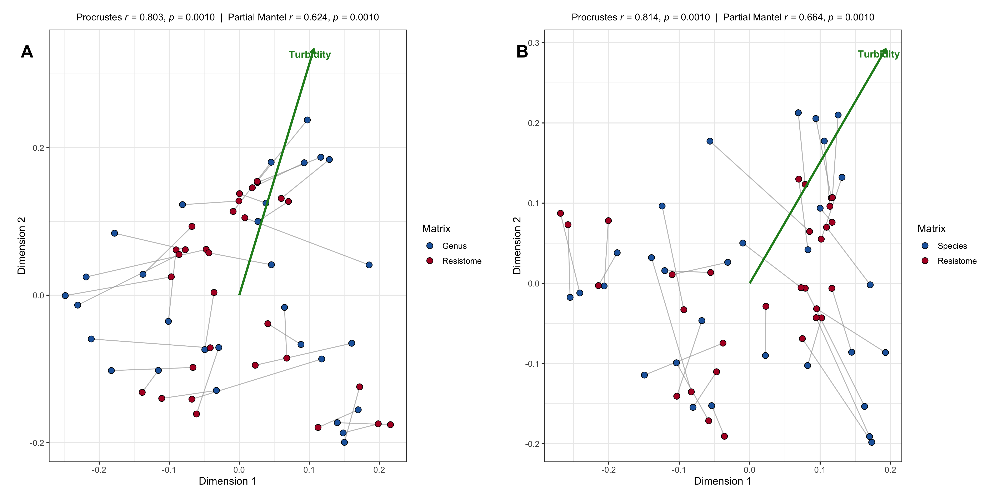<!-- -->

``` r
# Export Figure 8
svglite::svglite("Figure_8_Procrustes_Combined_AB.svg", width = 16, height = 8)
print(fig8)
dev.off()
```

    ## quartz_off_screen 
    ##                 2

``` r
ggsave("Figure_8_Procrustes_Combined_AB.tiff", plot = fig8, width = 16, height = 8, dpi = 300, compression = "lzw")
```

------------------------------------------------------------------------

### Module 11. Bipartite Species–ARG Co-occurrence Network (Figure 9)

This section constructs **Figure 9**, displaying a bipartite
co-occurrence network between key bacterial species (ESKAPE pathogens,
opportunistic taxa, native aquatic taxa, and core genera) and
antimicrobial resistance genes (ARGs). Correlations are calculated using
Spearman rank correlation ($|r_s| \ge 0.6$, FDR-adjusted $p < 0.05$).
Nodes are color-coded by taxonomic classification and gene category,
while edge thickness reflects correlation magnitude.

``` r
# ------------------------------------------------------------------------------
# 1. DEFINE TARGET CLINICAL & FOCAL SPECIES
# ------------------------------------------------------------------------------
focal_eskape_species <- c(
  "Acinetobacter baumannii", "Enterobacter cloacae", "Enterobacter hormaechei",
  "Klebsiella pneumoniae", "Pseudomonas aeruginosa"
)

focal_opportunistic_species <- c(
  "Acinetobacter johnsonii", "Acinetobacter lwoffii", "Klebsiella oxytoca", "Pseudomonas putida",
  "Aeromonas media", "Aeromonas caviae", "Aeromonas veronii", 
  "Aliarcobacter cryaerophilus", "Aliarcobacter butzleri",
  "Escherichia coli", "Escherichia albertii", "Escherichia fergusonii",
  "Mycobacterium tuberculosis", "Mycobacterium intracellulare", "Mycobacterium avium"
)

focal_20_clinical <- c(focal_eskape_species, focal_opportunistic_species)

native_target_genera <- c(
  "Microcystis", "Fluviibacter", "Acidovorax", "Cyanobium", "Rheinheimera", 
  "Thauera", "Polynucleobacter", "Synechococcus", "Streptomyces", "Flavobacterium", "Massilia"
)

core_target_genera <- c("Faucicola", "Tolumonas", "Bifidobacterium")

# ------------------------------------------------------------------------------
# 2. FILTER NATIVE/CORE SPECIES FROM MEMORY (>= 0.1%)
# ------------------------------------------------------------------------------
tax_species_all <- data_rel_taxa %>%
  filter(Taxonomic_level == "Species" | Taxonomic_level == "species" | is.na(Taxonomic_level)) %>%
  mutate(
    Taxa               = str_trim(Taxa),
    Sample_name        = str_trim(Sample_name),
    Relative_abundance = as.numeric(Relative_abundance),
    Genus              = str_extract(Taxa, "^[A-Za-z]+")
  )

abundance_cutoff <- 0.1

filtered_native_species <- tax_species_all %>%
  filter(Genus %in% native_target_genera) %>%
  group_by(Genus, Taxa) %>%
  summarise(Mean_Abundance = mean(Relative_abundance, na.rm = TRUE), .groups = "drop") %>%
  group_by(Genus) %>%
  slice_max(order_by = Mean_Abundance, n = 1, with_ties = FALSE) %>%
  filter(Mean_Abundance >= abundance_cutoff) %>%
  pull(Taxa)

filtered_core_species <- tax_species_all %>%
  filter(Genus %in% core_target_genera) %>%
  group_by(Genus, Taxa) %>%
  summarise(Mean_Abundance = mean(Relative_abundance, na.rm = TRUE), .groups = "drop") %>%
  group_by(Genus) %>%
  slice_max(order_by = Mean_Abundance, n = 1, with_ties = FALSE) %>%
  filter(Mean_Abundance >= abundance_cutoff) %>%
  pull(Taxa)

target_species_list <- unique(c(focal_20_clinical, filtered_native_species, filtered_core_species))

# ------------------------------------------------------------------------------
# 3. PREPARE TAXONOMY MATRIX
# ------------------------------------------------------------------------------
tax_filtered <- tax_species_all %>%
  filter(Taxa %in% target_species_list) %>%
  mutate(
    sample_prefix = str_extract(Sample_name, "^[A-Za-z]+"),
    sample_num    = as.numeric(str_extract(Sample_name, "[0-9]+")),
    sample        = paste0(sample_prefix, sample_num)
  ) %>%
  group_by(sample, Taxa) %>%
  summarise(Abundance = sum(Relative_abundance, na.rm = TRUE), .groups = "drop") %>%
  pivot_wider(names_from = Taxa, values_from = Abundance, values_fill = 0)

# ------------------------------------------------------------------------------
# 4. LOAD ARG DATA FROM Resistome.xlsx
# ------------------------------------------------------------------------------
arg_data_raw <- read.xlsx("Resistome.xlsx")

arg_data <- arg_data_raw %>%
  mutate(
    Sample_name = str_trim(Sample_name),
    ARG_Gene    = str_trim(gene_unif_final_manual),
    RPKG        = as.numeric(RPKG)
  ) %>%
  mutate(
    sample_prefix = str_extract(Sample_name, "^[A-Za-z]+"),
    sample_num    = as.numeric(str_extract(Sample_name, "[0-9]+")),
    sample        = paste0(sample_prefix, sample_num)
  ) %>%
  group_by(sample, ARG_Gene) %>%
  summarise(RPKG = sum(RPKG, na.rm = TRUE), .groups = "drop") %>%
  pivot_wider(names_from = ARG_Gene, values_from = RPKG, values_fill = 0)

# ------------------------------------------------------------------------------
# 5. MERGE DATASETS BY SAMPLE & BUILD MATRICES
# ------------------------------------------------------------------------------
combined_data <- inner_join(tax_filtered, arg_data, by = "sample") %>%
  column_to_rownames("sample")

taxa_cols <- intersect(names(combined_data), target_species_list)
arg_cols  <- setdiff(names(combined_data), taxa_cols)

taxa_matrix <- as.matrix(combined_data[, taxa_cols])
arg_matrix  <- as.matrix(combined_data[, arg_cols])

# ------------------------------------------------------------------------------
# 6. CALCULATE SPEARMAN CORRELATIONS & FDR ADJUSTMENT
# ------------------------------------------------------------------------------
cor_matrix <- matrix(0, nrow = length(taxa_cols), ncol = length(arg_cols),
                     dimnames = list(taxa_cols, arg_cols))
p_matrix   <- cor_matrix

for (t in taxa_cols) {
  for (a in arg_cols) {
    test <- suppressWarnings(cor.test(taxa_matrix[, t], arg_matrix[, a], method = "spearman"))
    cor_matrix[t, a] <- test$estimate
    p_matrix[t, a]   <- test$p.value
  }
}

p_fdr_vector <- p.adjust(as.vector(p_matrix), method = "BH")
p_fdr_matrix <- matrix(p_fdr_vector, nrow = length(taxa_cols), ncol = length(arg_cols),
                       dimnames = list(taxa_cols, arg_cols))

# ------------------------------------------------------------------------------
# 7. FILTER CORRELATIONS (|r_s| >= 0.6 & FDR p < 0.05)
# ------------------------------------------------------------------------------
edge_list <- expand.grid(Taxa = taxa_cols, ARG = arg_cols, stringsAsFactors = FALSE) %>%
  mutate(
    r_s   = apply(., 1, function(x) cor_matrix[x[1], x[2]]),
    p_adj = apply(., 1, function(x) p_fdr_matrix[x[1], x[2]])
  ) %>%
  filter(abs(r_s) >= 0.6 & p_adj < 0.05) %>%
  mutate(Direction = ifelse(r_s > 0, "Positive", "Negative"))

# ------------------------------------------------------------------------------
# 8. BUILD BIPARTITE IGRAPH OBJECT & ABBREVIATE SPECIES NAMES
# ------------------------------------------------------------------------------
net_graph <- graph_from_data_frame(edge_list[, c("Taxa", "ARG", "r_s", "Direction")], directed = FALSE)

V(net_graph)$NodeClassification <- case_when(
  V(net_graph)$name %in% focal_eskape_species ~ "ESKAPE pathogens",
  V(net_graph)$name %in% focal_opportunistic_species ~ "Opportunistic pathogens",
  str_detect(V(net_graph)$name, paste0("(?i)", paste(native_target_genera, collapse="|"))) ~ "Native aquatic taxa",
  V(net_graph)$name %in% taxa_cols ~ "Other core taxa",
  TRUE ~ "Resistance genes"
)

V(net_graph)$NodeType <- ifelse(V(net_graph)$name %in% taxa_cols, "Species", "ARG")
V(net_graph)$NodeSize <- ifelse(V(net_graph)$NodeType == "ARG", 3.2, 6.0)

clean_node_label_abbrev <- function(name) {
  if (name %in% target_species_list) {
    if (str_detect(name, "(?i)sp\\.")) {
      return(paste0("bolditalic('", name, "')"))
    } else {
      abbrev_name <- str_replace(name, "^([A-Z])[a-z]+", "\\1.")
      return(paste0("bolditalic('", abbrev_name, "')"))
    }
  }
  
  x <- name
  x <- str_replace(x, "^Qnr", "qnr")
  x <- str_replace(x, "^AAC", "aac")
  x <- str_replace(x, "^APH", "aph")
  x <- str_replace(x, "^ANT", "ant")
  x <- str_replace(x, "^Inu", "inu")
  x <- str_replace(x, "^Ere", "ere")
  x <- str_replace(x, "^Rbp", "rbp")
  x <- str_replace(x, "^Mex", "mex")
  
  if (str_detect(x, "^bla") && x != "blaA") {
    enzima <- str_remove(x, "^bla")
    return(paste0("italic(bla)[plain(\"", enzima, "\")]"))
  } else {
    x_safe <- str_replace_all(x, "'", "\\\\'")
    return(paste0("italic('", x_safe, "')"))
  }
}

V(net_graph)$parsed_label <- sapply(V(net_graph)$name, clean_node_label_abbrev)

set.seed(123)
layout_kk_clean <- create_layout(net_graph, layout = "kk")

# ------------------------------------------------------------------------------
# 8b. COORDINATE ADJUSTMENTS FOR ESCHERICHIA MICRO-ALIGNMENT
# ------------------------------------------------------------------------------
layout_species <- layout_kk_clean %>% filter(NodeType == "Species")
layout_species <- layout_species %>%
  mutate(
    x = ifelse(name == "Escherichia albertii", x + 0.07, x),
    y = ifelse(name == "Escherichia albertii", y - 0.02, y),
    x = ifelse(name == "Escherichia fergusonii", x - 0.10, x),
    y = ifelse(name == "Escherichia fergusonii", y + 0.03, y)
  )

layout_args <- layout_kk_clean %>% filter(NodeType == "ARG")

# ------------------------------------------------------------------------------
# 8c. DYNAMICALLY GENERATE KEY FOR SPECIES PRESENT IN GRAPH
# ------------------------------------------------------------------------------
present_species <- intersect(V(net_graph)$name, target_species_list)
legend_species_sorted <- sort(present_species)

split_idx <- ceiling(length(legend_species_sorted) / 2)

col1_species <- legend_species_sorted[1:split_idx]
col2_species <- legend_species_sorted[(split_idx + 1):length(legend_species_sorted)]

format_key_entry <- function(x) {
  if (str_detect(x, "(?i)sp\\.")) {
    return(paste0(x, ": ", x))
  } else {
    return(paste0(str_replace(x, "^([A-Z])[a-z]+", "\\1."), ": ", x))
  }
}

col1_text <- paste(sapply(col1_species, format_key_entry), collapse = "\n")
col2_text <- paste(sapply(col2_species, format_key_entry), collapse = "\n")

max_x_val <- max(layout_kk_clean$x)
max_y_val <- max(layout_kk_clean$y)

x_table_col1  <- max_x_val * 0.30
x_table_col2  <- max_x_val * 0.70
y_table_title <- max_y_val * 1.05
y_table_text  <- max_y_val * 1.00

# ------------------------------------------------------------------------------
# 9. BUILD FIGURE 9 PLOT
# ------------------------------------------------------------------------------
fig9 <- ggraph(layout_kk_clean) +
  geom_edge_link(aes(width = abs(r_s), color = Direction), alpha = 0.50) +
  geom_node_point(aes(color = NodeClassification, shape = NodeClassification, size = NodeSize)) +
  
  geom_node_text(
    data = layout_species,
    aes(x = x, y = y, label = parsed_label), 
    parse = TRUE, family = "sans", repel = TRUE, size = 2.5,
    max.overlaps = Inf, 
    point.padding = unit(0.15, "lines"),
    box.padding   = unit(0.08, "lines"),
    force         = 0.5,
    force_pull    = 5.0,
    max.iter      = 10000,
    segment.color = "grey40", 
    segment.size  = 0.25, 
    segment.alpha = 0.6,
    bg.color      = "white", 
    bg.r          = 0.12
  ) +
  
  geom_node_text(
    data = layout_args,
    aes(x = x, y = y, label = parsed_label), 
    parse = TRUE, family = "sans", repel = TRUE, size = 2.0,
    max.overlaps = Inf, 
    point.padding = unit(0.10, "lines"),
    box.padding   = unit(0.05, "lines"),
    force         = 0.3,
    force_pull    = 5.0,
    max.iter      = 10000,
    segment.color = "grey70", 
    segment.size  = 0.20, 
    segment.alpha = 0.5,
    bg.color      = "white", 
    bg.r          = 0.10
  ) +
  
  annotate("text", x = x_table_col1, y = y_table_title, label = "Species Key:", fontface = "bold", family = "sans", size = 3.2, hjust = 0) +
  annotate("text", x = x_table_col1, y = y_table_text, label = col1_text, fontface = "italic", family = "sans", size = 2.5, hjust = 0, vjust = 1.0) +
  annotate("text", x = x_table_col2, y = y_table_text, label = col2_text, fontface = "italic", family = "sans", size = 2.5, hjust = 0, vjust = 1.0) +
  
  scale_size_identity() +
  scale_color_manual(
    name = "Node Classification:",
    values = c(
      "ESKAPE pathogens"        = "#ab47bc",
      "Opportunistic pathogens" = "#ab47bc",
      "Native aquatic taxa"     = "#1874cd",
      "Other core taxa"         = "#ff9800",
      "Resistance genes"        = "#666666"
    ),
    guide = guide_legend(order = 1, nrow = 1)
  ) +
  scale_shape_manual(
    name = "Node Classification:",
    values = c(
      "ESKAPE pathogens"        = 17,
      "Opportunistic pathogens" = 19,
      "Native aquatic taxa"     = 19,
      "Other core taxa"         = 19,
      "Resistance genes"        = 15
    ),
    guide = guide_legend(order = 1, nrow = 1)
  ) +
  scale_edge_color_manual(
    name = "Correlation type:",
    values = c("Positive" = "#2ca02c", "Negative" = "#d7191c"),
    guide = guide_legend(order = 2, nrow = 1)
  ) +
  scale_edge_width_continuous(
    name = expression(Spearman ~ '|'*r[s]*'|'),
    range = c(0.4, 2.0),
    breaks = c(0.7, 0.8, 0.9),
    labels = c("0.7", "0.8", "0.9"),
    guide = guide_legend(order = 2, nrow = 1)
  ) +
  
  theme_void(base_size = 12, base_family = "sans") +
  labs(
    subtitle = bquote(plain("Spearman correlation |") * r[s] * plain("| ") >= 0.6 * plain(", FDR ") * italic("p") ~ plain("< 0.05"))
  ) +
  
  theme(
    plot.subtitle       = element_text(family = "sans", size = 11, hjust = 0.5, color = "black", margin = margin(b = 15)),
    legend.position     = "bottom",
    legend.box          = "vertical",
    legend.box.just     = "center",
    legend.spacing.x    = unit(0.8, "cm"),
    legend.spacing.y    = unit(0.15, "cm"),
    legend.margin       = margin(t = 10),
    legend.title        = element_text(family = "sans", face = "bold", size = 10.0),
    legend.text         = element_text(family = "sans", size = 9.5),
    plot.margin         = margin(35, 35, 35, 35)
  )

# Display plot in document output
print(fig9)
```

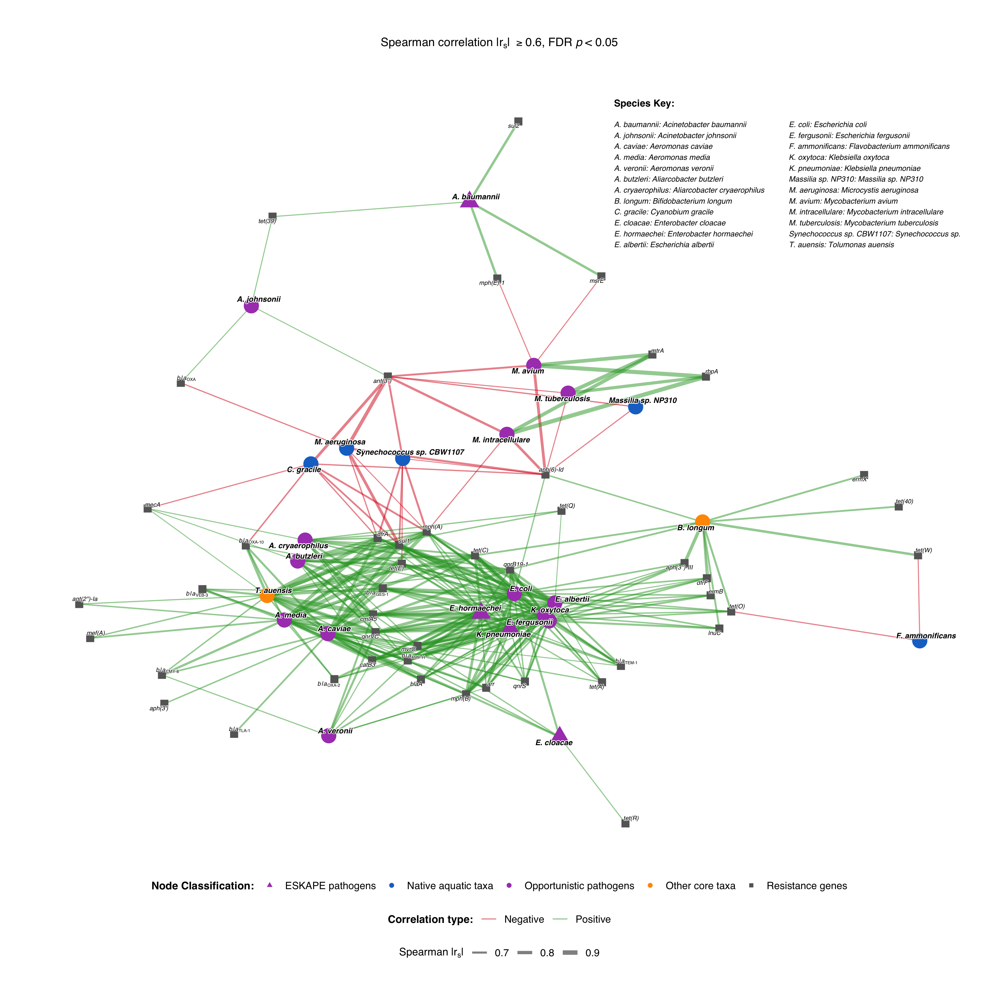<!-- -->

``` r
# ------------------------------------------------------------------------------
# 10. EXPORT HIGH-RESOLUTION OUTPUT FILES
# ------------------------------------------------------------------------------
svglite::svglite("Figure_9_Bipartite_ARG_Network.svg", width = 13, height = 13)
print(fig9)
dev.off()
```

    ## quartz_off_screen 
    ##                 2

``` r
ggsave("Figure_9_Bipartite_ARG_Network.tiff", plot = fig9, width = 13, height = 13, dpi = 300, compression = "lzw")
```

------------------------------------------------------------------------

## Supplementary Figures

------------------------------------------------------------------------

### Module 12. Rarefaction Curves across States and Water Body Types (Figure S1)

This section constructs **Figure S1**, displaying a two-panel grid of
sequencing depth rarefaction curves facetted by geographical region
(State) and water body type (Lentic vs. Lotic). Panel A depicts observed
taxonomic richness at the Genus level, while Panel B evaluates richness
at the Species level. Rarefaction summaries and coverage estimates are
compiled into **Table S2**.

``` r
# ------------------------------------------------------------------------------
# 1. SETUP PARAMETERS & LOAD METADATA
# ------------------------------------------------------------------------------
metadata_rare <- read_tsv("metadatos_saida_ultimos.txt", show_col_types = FALSE) %>%
  mutate(
    Sample_name   = str_trim(as.character(Sample_name)),
    State         = str_trim(as.character(State)),
    Effluent_type = str_trim(as.character(Effluent_type))
  )

config_analisis <- list(
  list(nivel = "Genus",   archivo = "Abundancia_Absoluta_31_Genus.csv"),
  list(nivel = "Species", archivo = "Abundancia_Absoluta_31_Species.csv")
)

COMMON_DEPTH    <- 50000 
FUENTE_GRAFICOS <- "sans"

plots_rarefaccion <- list()
tablas_resumen    <- list()

# ------------------------------------------------------------------------------
# 2. PROCESS RAREFACTION FOR GENUS AND SPECIES LEVELS
# ------------------------------------------------------------------------------
for (item in config_analisis) {
  nivel   <- item$nivel
  archivo <- item$archivo
  sep_char <- if (grepl("\\.csv$", archivo)) "," else "\t"
  
  if (!file.exists(archivo)) {
    warning(paste("File", archivo, "not found. Skipping..."))
    next
  }
  
  tabla_conteos    <- read.table(archivo, header = TRUE, row.names = 1, sep = sep_char, check.names = FALSE)
  matriz_comunidad <- round(t(tabla_conteos))
  
  if (nrow(matriz_comunidad) == 0) next
  
  rarefaccion_list <- rarecurve(matriz_comunidad, step = 100, label = FALSE)
  
  rare_df <- purrr::imap_dfr(rarefaccion_list, function(curve, idx) {
    data.frame(
      Original_Sample = rownames(matriz_comunidad)[idx], 
      Reads           = attr(curve, "Subsample"), 
      Taxa            = as.numeric(curve)
    )
  }) %>%
    mutate(
      Sample = trimws(gsub("\\..*", "", Original_Sample)),
      Sample_Short = ifelse(
        grepl("^[A-Za-z]+_[0-9]+", Sample),
        paste0(
          sub("^([A-Za-z]+)_.*", "\\1", Sample), 
          as.numeric(sub("^[A-Za-z]+_([0-9]+)_.*", "\\1", Sample)) 
        ),
        Sample 
      )
    ) %>%
    left_join(metadata_rare, by = c("Sample_Short" = "Sample_name"))
  
  # Construct Individual Rank Plot
  plot_rare <- ggplot(rare_df, aes(x = Reads, y = Taxa, group = Sample_Short, color = Sample_Short)) +
    geom_line(linewidth = 0.6, alpha = 0.85) +
    facet_wrap(~ State + Effluent_type, scales = "free_x", ncol = 4) + 
    labs(
      title = paste("Rarefaction Curves -", nivel, "Level"), 
      x     = "Sequencing Depth (Reads)", 
      y     = paste0("Observed Taxa (", nivel, ")"),
      color = "Sample name"
    ) +
    theme_bw(base_size = 9, base_family = FUENTE_GRAFICOS) + 
    theme(
      legend.position  = "bottom",
      legend.key.size  = unit(0.3, "cm"),          
      legend.text      = element_text(size = 7, family = FUENTE_GRAFICOS),      
      legend.title     = element_text(size = 8, face = "bold", family = FUENTE_GRAFICOS),
      plot.title       = element_text(size = 11, face = "bold", hjust = 0.5, family = FUENTE_GRAFICOS),
      axis.title       = element_text(size = 9, face = "bold", family = FUENTE_GRAFICOS),
      axis.text.y      = element_text(size = 6.5, color = "black", family = FUENTE_GRAFICOS),
      axis.text.x      = element_text(size = 6.5, color = "black", family = FUENTE_GRAFICOS, angle = 30, hjust = 1),
      strip.background = element_rect(fill = "#f4ebd8", color = "#333333"),
      strip.text       = element_text(face = "bold", size = 8.5, family = FUENTE_GRAFICOS),
      panel.grid.minor = element_blank()
    ) +
    guides(color = guide_legend(ncol = 10))
  
  plots_rarefaccion[[nivel]] <- plot_rare
  
  # Summary Table Data Generation
  tabla_resumen <- rare_df %>%
    group_by(Sample_Short, State, Effluent_type) %>%
    filter(Reads <= max(Reads)) %>% 
    summarise(
      Max_Reads         = max(Reads),
      Observed_Taxa_Max = max(Taxa),
      Taxa_at_50k       = if (max(Reads) >= COMMON_DEPTH) approx(Reads, Taxa, xout = COMMON_DEPTH)$y else NA,
      .groups = "drop"
    ) %>%
    mutate(
      Taxonomic_Level = nivel,
      Taxa_at_50k     = round(Taxa_at_50k, 0)
    )
  
  tablas_resumen[[nivel]] <- tabla_resumen
}
```

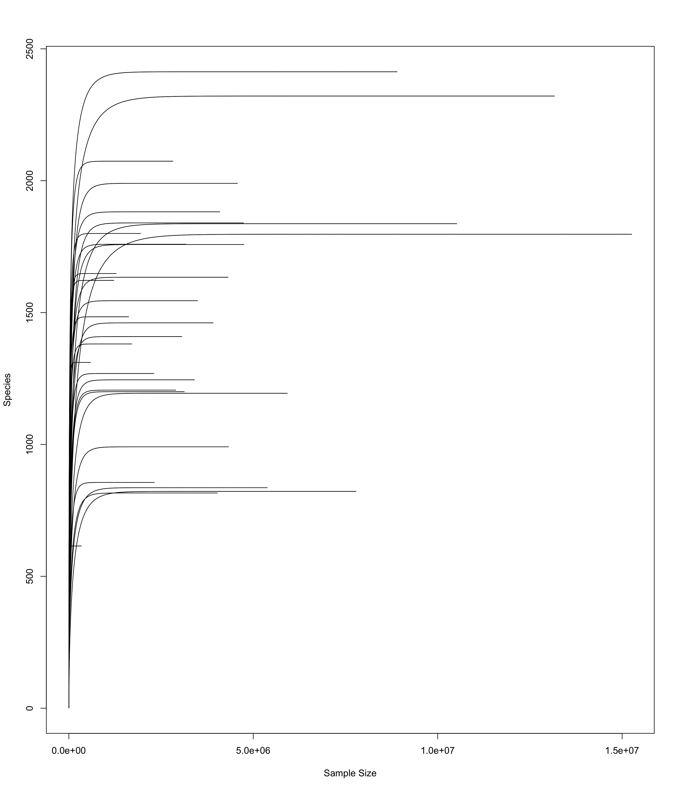<!-- -->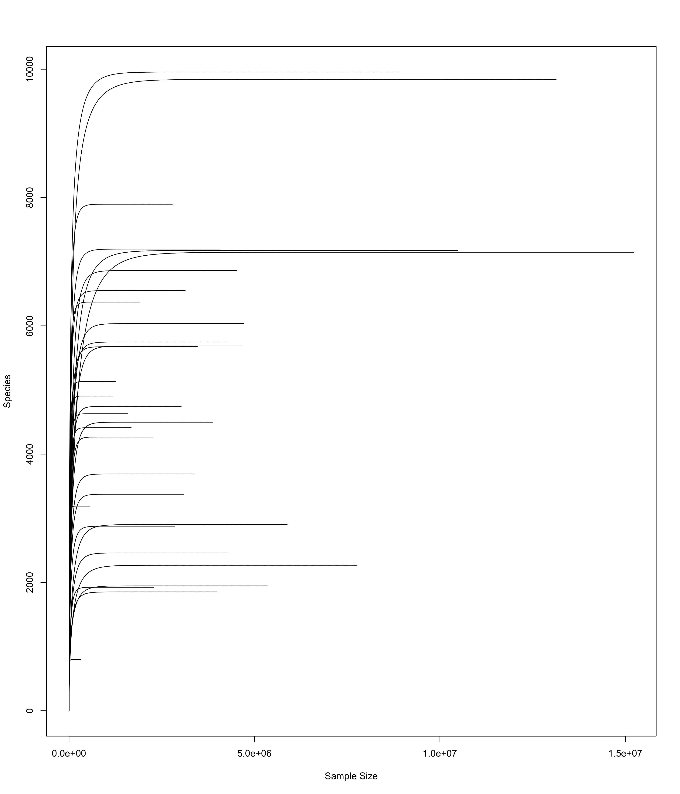<!-- -->

``` r
# ------------------------------------------------------------------------------
# 3. COMBINE PANELS INTO FIGURE S1 AND EXPORT TABLE S2 (SIDE-BY-SIDE FORMAT)
# ------------------------------------------------------------------------------
fig_s1 <- (plots_rarefaccion[["Genus"]] / plots_rarefaccion[["Species"]]) + 
  plot_annotation(tag_levels = 'A') & 
  theme(plot.tag = element_text(face = "bold", size = 14))

# Display plot in document output
print(fig_s1)
```

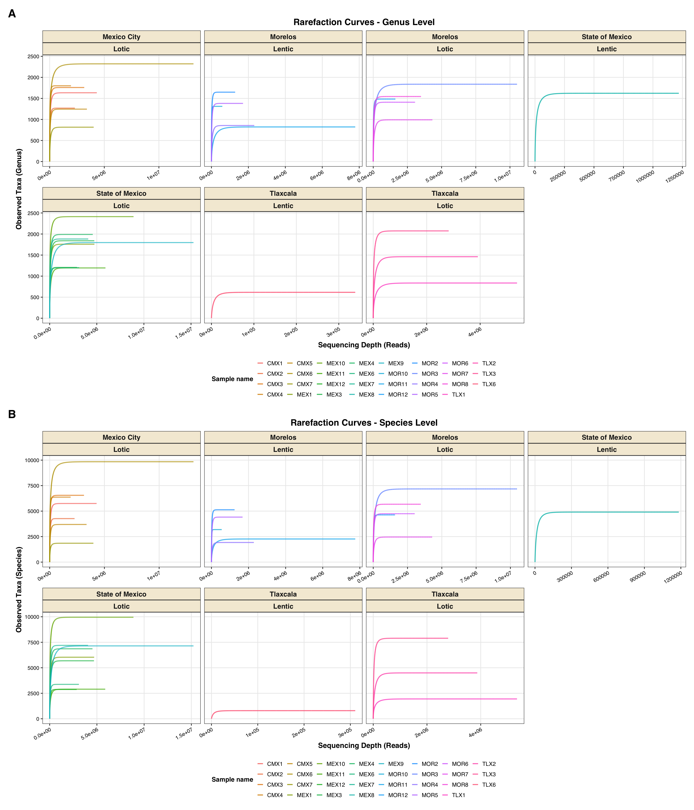<!-- -->

``` r
# Export Figure S1
svglite::svglite("Figure_S1_Rarefaction_Curves.svg", width = 12.0, height = 14.0)
print(fig_s1)
dev.off()
```

    ## quartz_off_screen 
    ##                 2

``` r
ggsave("Figure_S1_Rarefaction_Curves.tiff", plot = fig_s1, width = 12.0, height = 14.0, dpi = 300, compression = "lzw")

# ------------------------------------------------------------------------------
# 4. RESHAPE AND EXPORT TABLE S2 (HORIZONTAL LAYOUT)
# ------------------------------------------------------------------------------
table_s2_long <- bind_rows(tablas_resumen)

table_s2_wide <- table_s2_long %>%
  pivot_wider(
    names_from = Taxonomic_Level,
    values_from = c(Max_Reads, Observed_Taxa_Max, Taxa_at_50k),
    names_glue = "{.value}_{Taxonomic_Level}"
  ) %>%
  select(
    Sample = Sample_Short,
    State,
    Effluent_type,
    Max_Reads_Genus,
    Observed_Taxa_Max_Genus,
    Taxa_at_50k_Genus,
    Max_Reads_Species,
    Observed_Taxa_Max_Species,
    Taxa_at_50k_Species
  ) %>%
  arrange(Sample)

# Create structured Excel file
wb_s2 <- createWorkbook()
addWorksheet(wb_s2, "Table_S2_Rarefaction")

# Row 1: Table title
title_s2 <- "Table S2. Rarefaction summary results used to assess sequencing depth adequacy"
writeData(wb_s2, "Table_S2_Rarefaction", data.frame(Title = title_s2), startCol = 1, startRow = 1, colNames = FALSE)

# Row 3 onward: data in wide format
writeData(wb_s2, "Table_S2_Rarefaction", table_s2_wide, startCol = 1, startRow = 3, colNames = TRUE)

# Save final files
saveWorkbook(wb_s2, "Table_S2_Rarefaction_Summary.xlsx", overwrite = TRUE)
write.csv(table_s2_wide, "Table_S2_Rarefaction_Summary.csv", row.names = FALSE)

# ------------------------------------------------------------------------------
# 5. Render/Print the table visually in the HTML report
# ------------------------------------------------------------------------------
kable(table_s2_wide, 
      format = "html", 
      caption = "Table S2. Rarefaction summary results at the genus- and species-level used to assess sequencing depth adequacy.") %>%
  kable_styling(bootstrap_options = c("striped", "hover", "condensed", "responsive"), 
                full_width = FALSE,
                position = "center")
```

<table class="table table-striped table-hover table-condensed table-responsive" style="width: auto !important; margin-left: auto; margin-right: auto;">
<caption>
Table S2. Rarefaction summary results at the genus- and species-level
used to assess sequencing depth adequacy.
</caption>
<thead>
<tr>
<th style="text-align:left;">
Sample
</th>
<th style="text-align:left;">
State
</th>
<th style="text-align:left;">
Effluent_type
</th>
<th style="text-align:right;">
Max_Reads_Genus
</th>
<th style="text-align:right;">
Observed_Taxa_Max_Genus
</th>
<th style="text-align:right;">
Taxa_at_50k_Genus
</th>
<th style="text-align:right;">
Max_Reads_Species
</th>
<th style="text-align:right;">
Observed_Taxa_Max_Species
</th>
<th style="text-align:right;">
Taxa_at_50k_Species
</th>
</tr>
</thead>
<tbody>
<tr>
<td style="text-align:left;">
CMX1
</td>
<td style="text-align:left;">
Mexico City
</td>
<td style="text-align:left;">
Lotic
</td>
<td style="text-align:right;">
4316281
</td>
<td style="text-align:right;">
1634
</td>
<td style="text-align:right;">
1114
</td>
<td style="text-align:right;">
4285586
</td>
<td style="text-align:right;">
5748
</td>
<td style="text-align:right;">
3633
</td>
</tr>
<tr>
<td style="text-align:left;">
CMX2
</td>
<td style="text-align:left;">
Mexico City
</td>
<td style="text-align:left;">
Lotic
</td>
<td style="text-align:right;">
2305281
</td>
<td style="text-align:right;">
1269
</td>
<td style="text-align:right;">
929
</td>
<td style="text-align:right;">
2272413
</td>
<td style="text-align:right;">
4266
</td>
<td style="text-align:right;">
3072
</td>
</tr>
<tr>
<td style="text-align:left;">
CMX3
</td>
<td style="text-align:left;">
Mexico City
</td>
<td style="text-align:left;">
Lotic
</td>
<td style="text-align:right;">
3164978
</td>
<td style="text-align:right;">
1759
</td>
<td style="text-align:right;">
1304
</td>
<td style="text-align:right;">
3133306
</td>
<td style="text-align:right;">
6549
</td>
<td style="text-align:right;">
4841
</td>
</tr>
<tr>
<td style="text-align:left;">
CMX4
</td>
<td style="text-align:left;">
Mexico City
</td>
<td style="text-align:left;">
Lotic
</td>
<td style="text-align:right;">
1949464
</td>
<td style="text-align:right;">
1800
</td>
<td style="text-align:right;">
1489
</td>
<td style="text-align:right;">
1913277
</td>
<td style="text-align:right;">
6370
</td>
<td style="text-align:right;">
5344
</td>
</tr>
<tr>
<td style="text-align:left;">
CMX5
</td>
<td style="text-align:left;">
Mexico City
</td>
<td style="text-align:left;">
Lotic
</td>
<td style="text-align:right;">
3407201
</td>
<td style="text-align:right;">
1245
</td>
<td style="text-align:right;">
830
</td>
<td style="text-align:right;">
3370469
</td>
<td style="text-align:right;">
3690
</td>
<td style="text-align:right;">
2368
</td>
</tr>
<tr>
<td style="text-align:left;">
CMX6
</td>
<td style="text-align:left;">
Mexico City
</td>
<td style="text-align:left;">
Lotic
</td>
<td style="text-align:right;">
13164559
</td>
<td style="text-align:right;">
2321
</td>
<td style="text-align:right;">
1307
</td>
<td style="text-align:right;">
13136074
</td>
<td style="text-align:right;">
9841
</td>
<td style="text-align:right;">
5076
</td>
</tr>
<tr>
<td style="text-align:left;">
CMX7
</td>
<td style="text-align:left;">
Mexico City
</td>
<td style="text-align:left;">
Lotic
</td>
<td style="text-align:right;">
4025960
</td>
<td style="text-align:right;">
816
</td>
<td style="text-align:right;">
467
</td>
<td style="text-align:right;">
3993294
</td>
<td style="text-align:right;">
1851
</td>
<td style="text-align:right;">
1165
</td>
</tr>
<tr>
<td style="text-align:left;">
MEX1
</td>
<td style="text-align:left;">
State of Mexico
</td>
<td style="text-align:left;">
Lotic
</td>
<td style="text-align:right;">
4747097
</td>
<td style="text-align:right;">
1758
</td>
<td style="text-align:right;">
1064
</td>
<td style="text-align:right;">
4707830
</td>
<td style="text-align:right;">
6035
</td>
<td style="text-align:right;">
3206
</td>
</tr>
<tr>
<td style="text-align:left;">
MEX10
</td>
<td style="text-align:left;">
State of Mexico
</td>
<td style="text-align:left;">
Lotic
</td>
<td style="text-align:right;">
8897973
</td>
<td style="text-align:right;">
2413
</td>
<td style="text-align:right;">
1603
</td>
<td style="text-align:right;">
8867714
</td>
<td style="text-align:right;">
9956
</td>
<td style="text-align:right;">
6127
</td>
</tr>
<tr>
<td style="text-align:left;">
MEX11
</td>
<td style="text-align:left;">
State of Mexico
</td>
<td style="text-align:left;">
Lotic
</td>
<td style="text-align:right;">
5920664
</td>
<td style="text-align:right;">
1194
</td>
<td style="text-align:right;">
610
</td>
<td style="text-align:right;">
5881900
</td>
<td style="text-align:right;">
2901
</td>
<td style="text-align:right;">
1466
</td>
</tr>
<tr>
<td style="text-align:left;">
MEX12
</td>
<td style="text-align:left;">
State of Mexico
</td>
<td style="text-align:left;">
Lotic
</td>
<td style="text-align:right;">
2897259
</td>
<td style="text-align:right;">
1206
</td>
<td style="text-align:right;">
809
</td>
<td style="text-align:right;">
2855918
</td>
<td style="text-align:right;">
2876
</td>
<td style="text-align:right;">
1932
</td>
</tr>
<tr>
<td style="text-align:left;">
MEX3
</td>
<td style="text-align:left;">
State of Mexico
</td>
<td style="text-align:left;">
Lotic
</td>
<td style="text-align:right;">
4735581
</td>
<td style="text-align:right;">
1840
</td>
<td style="text-align:right;">
1039
</td>
<td style="text-align:right;">
4689045
</td>
<td style="text-align:right;">
5685
</td>
<td style="text-align:right;">
2762
</td>
</tr>
<tr>
<td style="text-align:left;">
MEX4
</td>
<td style="text-align:left;">
State of Mexico
</td>
<td style="text-align:left;">
Lotic
</td>
<td style="text-align:right;">
4572347
</td>
<td style="text-align:right;">
1990
</td>
<td style="text-align:right;">
1220
</td>
<td style="text-align:right;">
4529467
</td>
<td style="text-align:right;">
6862
</td>
<td style="text-align:right;">
3698
</td>
</tr>
<tr>
<td style="text-align:left;">
MEX6
</td>
<td style="text-align:left;">
State of Mexico
</td>
<td style="text-align:left;">
Lotic
</td>
<td style="text-align:right;">
3130793
</td>
<td style="text-align:right;">
1200
</td>
<td style="text-align:right;">
789
</td>
<td style="text-align:right;">
3094200
</td>
<td style="text-align:right;">
3374
</td>
<td style="text-align:right;">
2201
</td>
</tr>
<tr>
<td style="text-align:left;">
MEX7
</td>
<td style="text-align:left;">
State of Mexico
</td>
<td style="text-align:left;">
Lotic
</td>
<td style="text-align:right;">
4091412
</td>
<td style="text-align:right;">
1882
</td>
<td style="text-align:right;">
1338
</td>
<td style="text-align:right;">
4058564
</td>
<td style="text-align:right;">
7196
</td>
<td style="text-align:right;">
4851
</td>
</tr>
<tr>
<td style="text-align:left;">
MEX8
</td>
<td style="text-align:left;">
State of Mexico
</td>
<td style="text-align:left;">
Lentic
</td>
<td style="text-align:right;">
1219447
</td>
<td style="text-align:right;">
1622
</td>
<td style="text-align:right;">
1445
</td>
<td style="text-align:right;">
1183150
</td>
<td style="text-align:right;">
4905
</td>
<td style="text-align:right;">
4373
</td>
</tr>
<tr>
<td style="text-align:left;">
MEX9
</td>
<td style="text-align:left;">
State of Mexico
</td>
<td style="text-align:left;">
Lotic
</td>
<td style="text-align:right;">
15260454
</td>
<td style="text-align:right;">
1797
</td>
<td style="text-align:right;">
703
</td>
<td style="text-align:right;">
15224014
</td>
<td style="text-align:right;">
7146
</td>
<td style="text-align:right;">
2521
</td>
</tr>
<tr>
<td style="text-align:left;">
MOR10
</td>
<td style="text-align:left;">
Morelos
</td>
<td style="text-align:left;">
Lentic
</td>
<td style="text-align:right;">
588481
</td>
<td style="text-align:right;">
1311
</td>
<td style="text-align:right;">
1274
</td>
<td style="text-align:right;">
553118
</td>
<td style="text-align:right;">
3188
</td>
<td style="text-align:right;">
3115
</td>
</tr>
<tr>
<td style="text-align:left;">
MOR11
</td>
<td style="text-align:left;">
Morelos
</td>
<td style="text-align:left;">
Lentic
</td>
<td style="text-align:right;">
7785745
</td>
<td style="text-align:right;">
822
</td>
<td style="text-align:right;">
346
</td>
<td style="text-align:right;">
7752996
</td>
<td style="text-align:right;">
2267
</td>
<td style="text-align:right;">
1076
</td>
</tr>
<tr>
<td style="text-align:left;">
MOR12
</td>
<td style="text-align:left;">
Morelos
</td>
<td style="text-align:left;">
Lotic
</td>
<td style="text-align:right;">
1622702
</td>
<td style="text-align:right;">
1484
</td>
<td style="text-align:right;">
1254
</td>
<td style="text-align:right;">
1587498
</td>
<td style="text-align:right;">
4629
</td>
<td style="text-align:right;">
3851
</td>
</tr>
<tr>
<td style="text-align:left;">
MOR2
</td>
<td style="text-align:left;">
Morelos
</td>
<td style="text-align:left;">
Lentic
</td>
<td style="text-align:right;">
1284380
</td>
<td style="text-align:right;">
1648
</td>
<td style="text-align:right;">
1452
</td>
<td style="text-align:right;">
1247585
</td>
<td style="text-align:right;">
5131
</td>
<td style="text-align:right;">
4509
</td>
</tr>
<tr>
<td style="text-align:left;">
MOR3
</td>
<td style="text-align:left;">
Morelos
</td>
<td style="text-align:left;">
Lotic
</td>
<td style="text-align:right;">
10516675
</td>
<td style="text-align:right;">
1837
</td>
<td style="text-align:right;">
904
</td>
<td style="text-align:right;">
10482552
</td>
<td style="text-align:right;">
7175
</td>
<td style="text-align:right;">
3102
</td>
</tr>
<tr>
<td style="text-align:left;">
MOR4
</td>
<td style="text-align:left;">
Morelos
</td>
<td style="text-align:left;">
Lentic
</td>
<td style="text-align:right;">
2318967
</td>
<td style="text-align:right;">
856
</td>
<td style="text-align:right;">
583
</td>
<td style="text-align:right;">
2287801
</td>
<td style="text-align:right;">
1924
</td>
<td style="text-align:right;">
1377
</td>
</tr>
<tr>
<td style="text-align:left;">
MOR5
</td>
<td style="text-align:left;">
Morelos
</td>
<td style="text-align:left;">
Lentic
</td>
<td style="text-align:right;">
1708678
</td>
<td style="text-align:right;">
1381
</td>
<td style="text-align:right;">
1133
</td>
<td style="text-align:right;">
1676408
</td>
<td style="text-align:right;">
4412
</td>
<td style="text-align:right;">
3632
</td>
</tr>
<tr>
<td style="text-align:left;">
MOR6
</td>
<td style="text-align:left;">
Morelos
</td>
<td style="text-align:left;">
Lotic
</td>
<td style="text-align:right;">
3062215
</td>
<td style="text-align:right;">
1409
</td>
<td style="text-align:right;">
976
</td>
<td style="text-align:right;">
3026246
</td>
<td style="text-align:right;">
4745
</td>
<td style="text-align:right;">
3210
</td>
</tr>
<tr>
<td style="text-align:left;">
MOR7
</td>
<td style="text-align:left;">
Morelos
</td>
<td style="text-align:left;">
Lotic
</td>
<td style="text-align:right;">
4329747
</td>
<td style="text-align:right;">
991
</td>
<td style="text-align:right;">
536
</td>
<td style="text-align:right;">
4294891
</td>
<td style="text-align:right;">
2459
</td>
<td style="text-align:right;">
1381
</td>
</tr>
<tr>
<td style="text-align:left;">
MOR8
</td>
<td style="text-align:left;">
Morelos
</td>
<td style="text-align:left;">
Lotic
</td>
<td style="text-align:right;">
3491778
</td>
<td style="text-align:right;">
1545
</td>
<td style="text-align:right;">
1144
</td>
<td style="text-align:right;">
3461333
</td>
<td style="text-align:right;">
5675
</td>
<td style="text-align:right;">
4039
</td>
</tr>
<tr>
<td style="text-align:left;">
TLX1
</td>
<td style="text-align:left;">
Tlaxcala
</td>
<td style="text-align:left;">
Lotic
</td>
<td style="text-align:right;">
5379749
</td>
<td style="text-align:right;">
836
</td>
<td style="text-align:right;">
437
</td>
<td style="text-align:right;">
5351124
</td>
<td style="text-align:right;">
1945
</td>
<td style="text-align:right;">
1118
</td>
</tr>
<tr>
<td style="text-align:left;">
TLX2
</td>
<td style="text-align:left;">
Tlaxcala
</td>
<td style="text-align:left;">
Lotic
</td>
<td style="text-align:right;">
3914509
</td>
<td style="text-align:right;">
1461
</td>
<td style="text-align:right;">
872
</td>
<td style="text-align:right;">
3871973
</td>
<td style="text-align:right;">
4497
</td>
<td style="text-align:right;">
2592
</td>
</tr>
<tr>
<td style="text-align:left;">
TLX3
</td>
<td style="text-align:left;">
Tlaxcala
</td>
<td style="text-align:left;">
Lotic
</td>
<td style="text-align:right;">
2822266
</td>
<td style="text-align:right;">
2074
</td>
<td style="text-align:right;">
1593
</td>
<td style="text-align:right;">
2787753
</td>
<td style="text-align:right;">
7896
</td>
<td style="text-align:right;">
5999
</td>
</tr>
<tr>
<td style="text-align:left;">
TLX6
</td>
<td style="text-align:left;">
Tlaxcala
</td>
<td style="text-align:left;">
Lentic
</td>
<td style="text-align:right;">
338770
</td>
<td style="text-align:right;">
615
</td>
<td style="text-align:right;">
611
</td>
<td style="text-align:right;">
310531
</td>
<td style="text-align:right;">
795
</td>
<td style="text-align:right;">
794
</td>
</tr>
</tbody>
</table>

------------------------------------------------------------------------

### Module 13. Global Relative Abundance Profiles Across Taxonomic Ranks (Figure S2)

This section constructs **Figure S2**, displaying a $2 \times 3$ grid
panel of bar plots summarizing the mean relative abundance (%) of the
Top 20 most abundant bacterial taxa across six major taxonomic levels
(Phylum, Class, Order, Family, Genus, and Species). Taxonomic names at
the Genus and Species levels are formatted in italics.

``` r
# ------------------------------------------------------------------------------
# 1. CLEAN DATASET & RE-NORMALIZE RELATIVE ABUNDANCE
# ------------------------------------------------------------------------------
data_rel_clean_s2 <- data_rel_taxa %>%
  filter(!Taxa %in% non_bacterial_taxa) %>%
  group_by(Sample_name, Taxonomic_level) %>%
  mutate(Relative_abundance = (Relative_abundance / sum(Relative_abundance, na.rm = TRUE)) * 100) %>%
  ungroup()

# ------------------------------------------------------------------------------
# 2. FUNCTION TO CREATE INDIVIDUAL RANK PANELS
# ------------------------------------------------------------------------------
create_rank_plot <- function(data, rank_name, bar_color, top_n = 20, is_italic = FALSE) {
  
  rank_summary <- data %>%
    filter(Taxonomic_level == rank_name) %>%
    group_by(Taxa) %>%
    summarise(Mean_Abundance = mean(Relative_abundance, na.rm = TRUE), .groups = "drop") %>%
    arrange(desc(Mean_Abundance)) %>%
    slice_head(n = top_n)
  
  y_text_face <- if (is_italic) "italic" else "plain"
  
  p <- ggplot(rank_summary, aes(x = reorder(Taxa, Mean_Abundance), y = Mean_Abundance)) +
    geom_bar(stat = "identity", fill = bar_color, width = 0.7) +
    coord_flip() +
    theme_minimal(base_size = 11) +
    labs(
      title = rank_name,
      x     = NULL,
      y     = NULL
    ) +
    theme(
      panel.grid.minor = element_blank(),
      axis.text.y      = element_text(color = "black", size = 9, face = y_text_face),
      axis.text.x      = element_text(color = "black", size = 8),
      plot.title       = element_text(face = "bold", hjust = 0.5, size = 12)
    )
  
  return(p)
}

# ------------------------------------------------------------------------------
# 3. GENERATE THE 6 INDIVIDUAL PANELS
# ------------------------------------------------------------------------------
p_phylum  <- create_rank_plot(data_rel_clean_s2, "Phylum",  "#ff6b6b", is_italic = FALSE)
p_class   <- create_rank_plot(data_rel_clean_s2, "Class",   "#baba00", is_italic = FALSE)
p_order   <- create_rank_plot(data_rel_clean_s2, "Order",   "#00c032", is_italic = FALSE)
p_family  <- create_rank_plot(data_rel_clean_s2, "Family",  "#00c4c4", is_italic = FALSE)
p_genus   <- create_rank_plot(data_rel_clean_s2, "Genus",   "#4589ff", is_italic = TRUE)
p_species <- create_rank_plot(data_rel_clean_s2, "Species", "#f043e0", is_italic = TRUE)

# ------------------------------------------------------------------------------
# 4. COMBINE INTO A 2x3 GRID USING PATCHWORK
# ------------------------------------------------------------------------------
combined_plot_s2 <- (p_phylum | p_class | p_order) / 
  (p_family | p_genus | p_species) +
  plot_annotation(
    caption = "Mean relative abundance (%)",
    theme   = theme(plot.caption = element_text(hjust = 0.5, size = 12, face = "bold"))
  )

# Display plot in document output
print(combined_plot_s2)
```

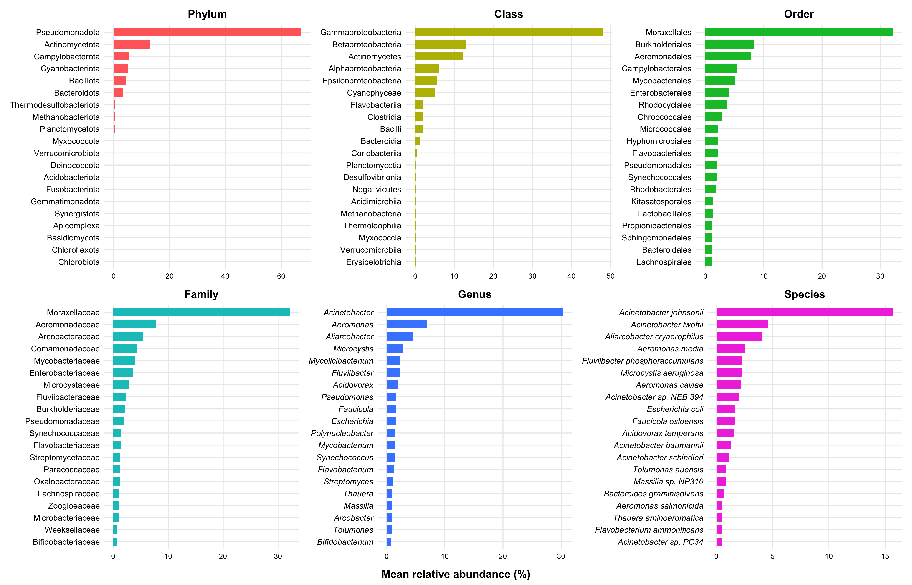<!-- -->

``` r
# ------------------------------------------------------------------------------
# 5. EXPORT HIGH-RESOLUTION OUTPUT FILES (FIGURE S2)
# ------------------------------------------------------------------------------
svglite::svglite("Figure_S2_Taxonomic_Relative_Abundance_Grid.svg", width = 14, height = 9)
print(combined_plot_s2)
dev.off()
```

    ## quartz_off_screen 
    ##                 2

``` r
ggsave("Figure_S2_Taxonomic_Relative_Abundance_Grid.pdf", plot = combined_plot_s2, width = 14, height = 9, dpi = 300)
ggsave("Figure_S2_Taxonomic_Relative_Abundance_Grid.tiff", plot = combined_plot_s2, width = 14, height = 9, dpi = 300, compression = "lzw")
```

------------------------------------------------------------------------

### Module 14. Alpha Diversity Comparison by Region and Water Body Type (Figure S3)

This section constructs **Figure S3**, displaying a 4-panel grid of
alpha diversity distributions (Shannon index and Observed Taxa richness)
across geographical regions (State) and water body types (Lentic
vs. Lotic) at both Genus and Species levels. Statistical differences are
evaluated using Kruskal-Wallis tests with Benjamini-Hochberg (BH)
adjusted pairwise Wilcoxon post-hoc comparisons. Full statistical
metrics are compiled into **Table S4**.

``` r
# ------------------------------------------------------------------------------
# 1. SETUP PARAMETERS & METADATA STANDARDIZATION
# ------------------------------------------------------------------------------
metadata_alpha <- read_tsv("metadatos_saida_ultimos.txt", show_col_types = FALSE) %>%
  mutate(
    Sample_name   = str_trim(as.character(if ("Sample_name" %in% names(.)) Sample_name else Sample)),
    State         = str_trim(as.character(State)),
    Effluent_type = str_trim(as.character(if ("Effluent_type" %in% names(.)) Effluent_type else `Water body type`))
  )

metadata_alpha$State         <- factor(metadata_alpha$State, levels = c("Mexico City", "Morelos", "State of Mexico", "Tlaxcala"))
metadata_alpha$Effluent_type <- factor(metadata_alpha$Effluent_type, levels = c("Lentic", "Lotic"))

palette_state <- c("Mexico City" = "#8BCEBA", "Morelos" = "#A5B6D9", "State of Mexico" = "#EFC24A", "Tlaxcala" = "#9D559E")
palette_water <- c("Lentic" = "#E8685D", "Lotic" = "#86C186")

config_alpha <- list(
  list(nivel = "Genus",   archivo = "Abundancia_Absoluta_31_Genus.csv"),
  list(nivel = "Species", archivo = "Abundancia_Absoluta_31_Species.csv")
)

list_plots_alpha   <- list()
alpha_stats_master <- data.frame()
alpha_values_master <- data.frame()

# ------------------------------------------------------------------------------
# 2. CALCULATE ALPHA DIVERSITY AND RUN STATISTICAL TESTS
# ------------------------------------------------------------------------------
for (item in config_alpha) {
  nivel   <- item$nivel
  archivo <- item$archivo
  sep_char <- if (grepl("\\.csv$", archivo)) "," else "\t"
  
  if (!file.exists(archivo)) {
    warning(paste("File", archivo, "not found. Skipping..."))
    next
  }
  
  tabla_conteos    <- read.table(archivo, header = TRUE, row.names = 1, sep = sep_char, check.names = FALSE)
  matriz_comunidad <- t(tabla_conteos)
  
  df_alpha <- data.frame(
    Sample_name = rownames(matriz_comunidad),
    Shannon     = vegan::diversity(matriz_comunidad, index = "shannon"),
    Observed    = vegan::specnumber(matriz_comunidad)
  ) %>%
    left_join(metadata_alpha, by = c("Sample_name" = "Sample_name")) %>%
    filter(!is.na(State) & !is.na(Effluent_type))
  
  # Accumulate values for output tables
  df_values <- df_alpha %>%
    select(Sample_name, State, Effluent_type, Shannon, Observed) %>%
    mutate(Taxonomic_Level = nivel)
  
  alpha_values_master <- bind_rows(alpha_values_master, df_values)
  
  # Run tests and generate panels
  for (var_name in c("State", "Effluent_type")) {
    current_palette <- if (var_name == "State") palette_state else palette_water
    var_label       <- if (var_name == "State") "State" else "Water Body Type"
    
    # We use Shannon index for primary panel plotting
    kw_res <- kruskal.test(as.formula(paste("Shannon ~", var_name)), data = df_alpha)
    
    # Store stats
    stats_row <- data.frame(
      Taxonomic_Level = nivel,
      Variable        = var_label,
      Metric          = "Shannon",
      KW_p_value      = kw_res$p.value
    )
    alpha_stats_master <- bind_rows(alpha_stats_master, stats_row)
    
    p_val_label <- if (kw_res$p.value < 0.001) "p < 0.001" else paste0("p = ", round(kw_res$p.value, 4))
    
    p_box <- ggplot(df_alpha, aes(x = .data[[var_name]], y = Shannon, fill = .data[[var_name]])) +
      geom_boxplot(alpha = 0.7, outlier.shape = NA, color = "#333333", linewidth = 0.5) +
      geom_jitter(width = 0.18, size = 2.3, alpha = 0.85, shape = 21, color = "black") +
      scale_fill_manual(values = current_palette) +
      labs(
        title    = paste0(var_label, " (", nivel, " Level)"),
        subtitle = paste0("Kruskal-Wallis: ", p_val_label),
        x        = NULL,
        y        = "Shannon Diversity Index"
      ) +
      theme_bw(base_size = 10, base_family = "sans") +
      theme(
        legend.position  = "none",
        plot.title       = element_text(face = "bold", size = 11, hjust = 0.5),
        plot.subtitle    = element_text(face = "italic", size = 9, hjust = 0.5, color = "grey30"),
        axis.title       = element_text(face = "bold", size = 9.5),
        axis.text.x      = element_text(face = "bold", color = "black", size = 8.5),
        axis.text.y      = element_text(color = "black", size = 8.5),
        panel.grid.minor = element_blank()
      )
    
    list_plots_alpha[[paste(nivel, var_name, sep = "_")]] <- p_box
  }
}

# ------------------------------------------------------------------------------
# 3. COMBINE PANELS INTO FIGURE S3 AND EXPORT TABLE S4
# ------------------------------------------------------------------------------
fig_s3 <- (list_plots_alpha[["Genus_State"]] | list_plots_alpha[["Genus_Effluent_type"]]) /
          (list_plots_alpha[["Species_State"]] | list_plots_alpha[["Species_Effluent_type"]]) +
  plot_annotation(tag_levels = 'A') & 
  theme(plot.tag = element_text(face = "bold", size = 13))

# Display plot in document output
print(fig_s3)
```

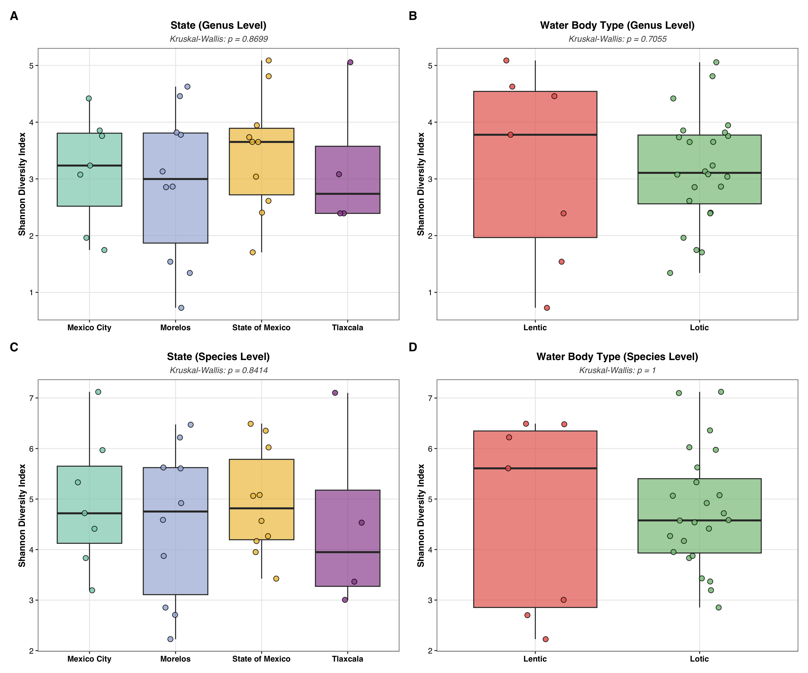<!-- -->

``` r
# Export Figure S3
svglite::svglite("Figure_S3_Alpha_Diversity.svg", width = 12.0, height = 10.0)
print(fig_s3)
dev.off()
```

    ## quartz_off_screen 
    ##                 2

``` r
ggsave("Figure_S3_Alpha_Diversity.tiff", plot = fig_s3, width = 12.0, height = 10.0, dpi = 300, compression = "lzw")

# Export Summary Tables (Table S4)
writexl::write_xlsx(alpha_stats_master, "Table_S4_Alpha_Diversity_Statistics.xlsx")


# ------------------------------------------------------------------------------
# 4. Render/Print the table visually in the HTML report
# ------------------------------------------------------------------------------
kable(alpha_stats_master, 
      format = "html", 
      caption = "Table S4.  Results of Krukal-Wallis tests comparing bacterial alpha diversity by region and water body type at the genus- and species-level .") %>%
  kable_styling(bootstrap_options = c("striped", "hover", "condensed", "responsive"), 
                full_width = FALSE,
                position = "center")
```

<table class="table table-striped table-hover table-condensed table-responsive" style="width: auto !important; margin-left: auto; margin-right: auto;">
<caption>
Table S4. Results of Krukal-Wallis tests comparing bacterial alpha
diversity by region and water body type at the genus- and species-level
.
</caption>
<thead>
<tr>
<th style="text-align:left;">
Taxonomic_Level
</th>
<th style="text-align:left;">
Variable
</th>
<th style="text-align:left;">
Metric
</th>
<th style="text-align:right;">
KW_p_value
</th>
</tr>
</thead>
<tbody>
<tr>
<td style="text-align:left;">
Genus
</td>
<td style="text-align:left;">
State
</td>
<td style="text-align:left;">
Shannon
</td>
<td style="text-align:right;">
0.8698524
</td>
</tr>
<tr>
<td style="text-align:left;">
Genus
</td>
<td style="text-align:left;">
Water Body Type
</td>
<td style="text-align:left;">
Shannon
</td>
<td style="text-align:right;">
0.7054570
</td>
</tr>
<tr>
<td style="text-align:left;">
Species
</td>
<td style="text-align:left;">
State
</td>
<td style="text-align:left;">
Shannon
</td>
<td style="text-align:right;">
0.8414464
</td>
</tr>
<tr>
<td style="text-align:left;">
Species
</td>
<td style="text-align:left;">
Water Body Type
</td>
<td style="text-align:left;">
Shannon
</td>
<td style="text-align:right;">
1.0000000
</td>
</tr>
</tbody>
</table>

------------------------------------------------------------------------

## List of Supplementary Tables

The following supplementary tables were generated as part of this
reproducible analysis workflow. Tables S1, S3, and S5 are available as
independent Excel workbooks in the repository output, while Tables S2,
S4, and S6-S8 are rendered visually within the corresponding sections of
this report.

| Table Identifier | Description / Content Summary                                                                                                                                                                                                                          | Status in Report     | Associated Output File |
|:-----------------|:-------------------------------------------------------------------------------------------------------------------------------------------------------------------------------------------------------------------------------------------------------|:---------------------|:-----------------------|
| **Table S1**     | NCBI accessions, metadata, sequence quality attributes and assembly quality metrics of the study surface waters metagenomes                                                                                                                            | Exported (Data file) | `Table_S1.xlsx`        |
| **Table S2**     | Rarefaction summary results at the genus- and species-level used to assess sequencing depth adequacy                                                                                                                                                   | Exported (Data file) | `Table_S2.xlsx`        |
| **Table S3**     | Merged, deduplicated, and manually curated antimicrobial resistance gene profile. Raw counts were normalized as reads per kilobase per gigabase (RPKG, colum X)                                                                                        | Exported (Data file) | `Table_S3.xlsx`        |
| **Table S4**     | Results of Krukal-Wallis tests comparing bacterial alpha diversity by region and water body type at the genus- and species-level                                                                                                                       | Exported (Data file) | `Table_S4.xlsx`        |
| **Table S5**     | Relative abundance of the microbial community in surface water metagenomes per taxonomic level. Note that some residual non-bacterial taxa remained after host DNA filtration and were excluded in R (please, refer to the R code available in GitHub) | Exported (Data file) | `Table_S5.xlsx`        |
| **Table S6**     | Non-parametric Kruskal-Wallis tests of the top 20 most abundant genera across states and water body types. Wilcoxon rank-sum tests are also reported for pairwise comparisons among states and water body types                                        | Rendered & Exported  | `Table_S6.xlsx`        |
| **Table S7**     | Species-level profiling (mean relative abundance and detection frequency) targeting ESKAPE-associated genera and other priority clinical pathogens                                                                                                     | Rendered & Exported  | `Table_S7.xlsx`        |
| **Table S8**     | Relative contribution of the 203 unique antimicrobial resistance genes to the total resistome abundance (RPKG-normalized)                                                                                                                              | Rendered & Exported  | `Table_S8.xlsx`        |

> **Note for Reviewers:** The raw datasets (`Taxonomy.xlsx`,
> `Resistome.xlsx`, `Table_S5.xlsx`), metadata and sequence and assembly
> quality attributes (`Table_S1.xlsx`), and output Excel files are
> permanently stored in the project’s GitHub repository for complete
> methodological transparency and independent auditing.
